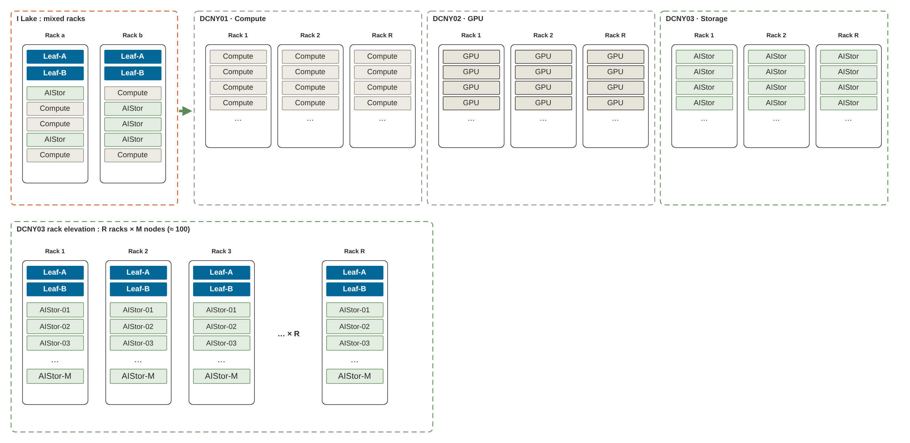
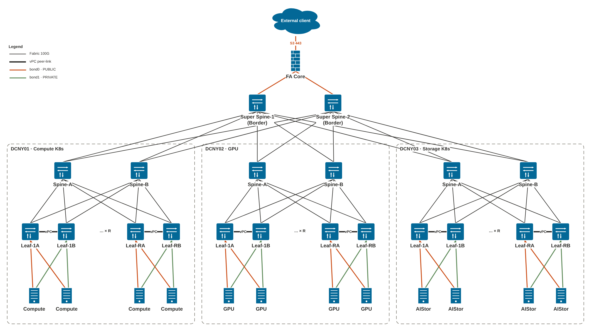
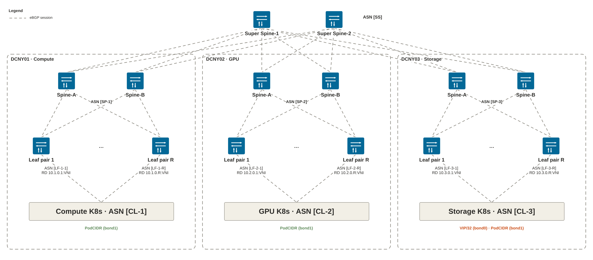
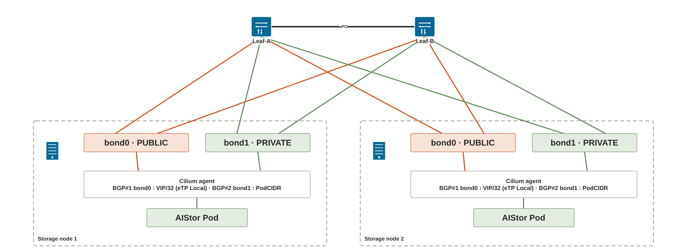
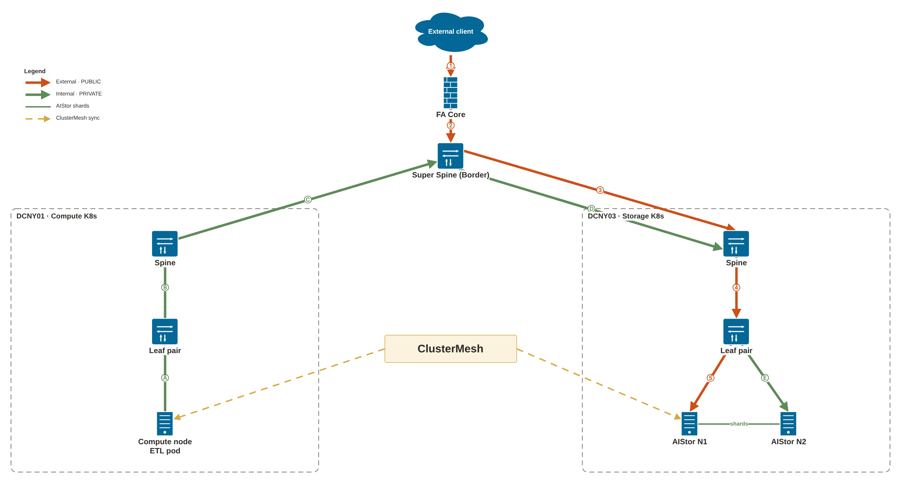
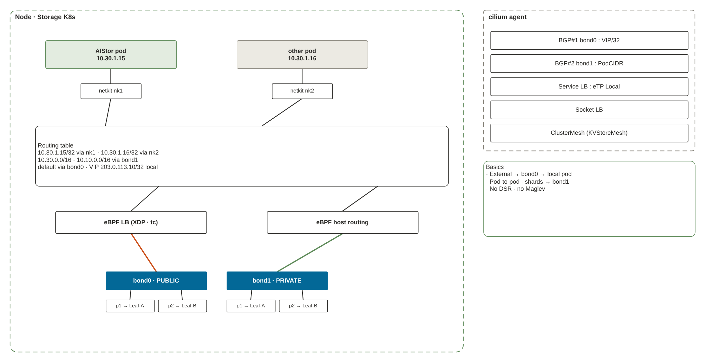
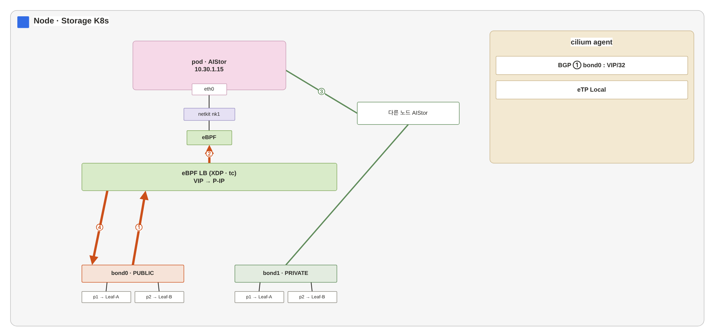
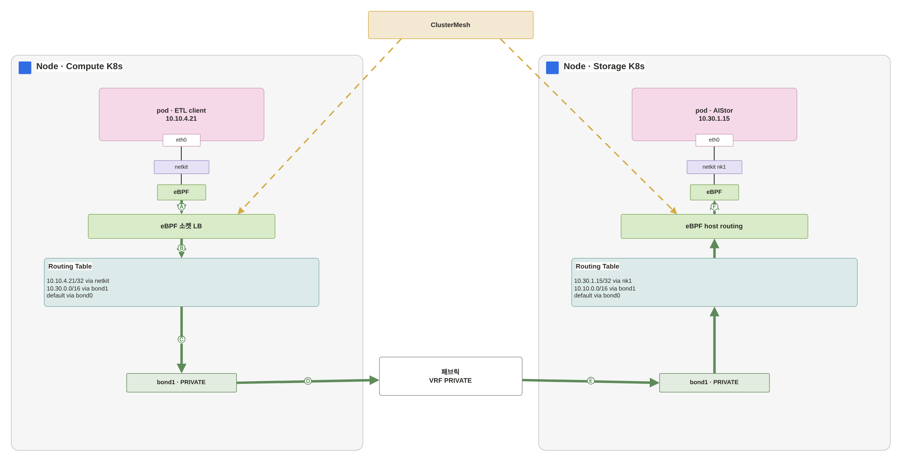

# Y1 AI DATAPLATFORM 네트워크 고도화 검토 요청 (서버 배치 · Switch N/W · K8s Cilium N/W)

| 항목 | 내용 |
|---|---|
| 문서 | 검토 요청서 v1.0 |
| 요청 | DevOps 파트 (인프라 · 스위치 설정 최적화) |
| 검토 대상 | **서버 인프라 담당 (DC 구간 · 랙 배치)** · 고객 담당 (의사결정) · N/W 인프라 담당 (스위치 설계 · 설정) |
| 범위 | Y1 Lake 고도화 중 **서버 배치(DC 구간 · 랙)**, **Switch(N9K) 네트워크**, **K8s Cilium 네트워크** |
| 기준 | I Lake (현행 운영 Lake) 대비 개선 · 유지 |
| 회신 | 8장 검토 요청 표에 의견 · 값 기입 (8-1 서버 인프라 우선) |
| 그림 | 그림에는 구조만, 설명은 각 그림 아래 · N-0 DC 구간 · 랙 배치 · N-1 전체 토폴로지 · N-2 랙 · 노드 연결 · N-3 eBGP · EVPN 제어 · N-4 트래픽 경로 · C-1 ~ C-3 노드 내부 (draw.io 원본 별첨) |

---

## 0. 요약

> **AIStor 요청이 노드 100대에 고르게 나뉘려면 먼저 서버를 DC 구간 · 랙별로 역할 분리하고 Storage 랙마다 같은 수로 실장해야 한다. 그 위에서 패브릭은 eBGP only + 고유 RD + 충분한 ECMP 로, 클러스터는 eTP Local 유지 + 랙 균등 + 무중단 작업 절차로 맞춘다. DSR · Maglev 는 쓰지 않는다.**

| 영역 | 핵심 제안 | I Lake 대비 |
|---|---|---|
| **서버 : DC 구간 분리** | DCNY01 Compute · DCNY02 GPU · DCNY03 Storage, 구간 · 랙에 한 역할만 실장 (I Lake 랙 혼재 해소) | 개선 (최우선) |
| **서버 : 랙 균등 배치** | Storage 랙마다 같은 수 M 대 (R × M ≈ 100), 증설도 랙 단위 같은 수 | 개선 (최우선) |
| Switch : BGP 구조 | iBGP · eBGP 혼합 → **eBGP only** (혼합 multipath 루프 위험 제거) | 개선 |
| Switch : 경로 수 | 고유 RD · maximum-paths ≥ V · multipath-relax · ECMP 하드웨어 폭 확인 | 개선 · 확인 |
| Switch : 경로 변화 | **resilient hashing 필수** · 계층별 해시 seed · 스위치 간 BFD | 개선 |
| Switch : 링크 | port-channel LACP fast · MTU 9216 · 구간 간 링크 대역 · 이중 경로 | 개선 |
| Cilium : 외부 VIP | eTP **Local 유지** (랙 균등 · 외부는 Spine 방향만 진입 전제), DSR · Maglev 제외 | 유지 |
| Cilium : BGP 운영 | bond 별 광고 정리, 작업 절차(drain → BGP 해제 → 철회 확인), PDB, operator 이중화 | 개선 |
| Cilium : 내부 경로 | global-svc (Global Service) · 소켓 LB · bond1 · KVStoreMesh | 개선 |

---

## 1. 서버 인프라 : DC 구간 분리 · 랙 균등 배치 (최우선)



- 왼쪽 I Lake : 랙마다 AIStor 수가 달라 랙 단위로 같은 몫을 받아도 노드당 몫이 최대 수 배 차이
- Y1 : 구간마다 한 역할만 실장. Storage 는 랙당 같은 수 M 대 (필수), Compute · GPU 는 랙당 같은 수 (권장)
- 아래 실장도 : 랙 상단 ToR Leaf 쌍(vPC), 그 아래 AIStor-01 ~ M. R 랙 × M 대 ≈ 100 대
- 케이블링 : 서버마다 bond0 2포트 · bond1 2포트를 Leaf-A 1 · Leaf-B 1 로 분산 (같은 NIC 두 포트를 한 Leaf 에 몰지 않음)
- 증설 : 기존 랙마다 같은 수 추가, 또는 새 랙 여러 개를 같은 수로. 새 랙 1개에 일부만 실장 금지
- 노드 라벨 `rack=<물리 랙>` = 실장 위치, Leaf 포트는 랙당 M × 4 × 100G + 업링크

> **패브릭은 랙(Leaf 쌍) 단위로 같은 몫을 나눈다. 랙마다 역할이 섞이거나 서버 수가 다르면 스위치 · Cilium 설정으로는 노드 균등을 만들 수 없다.**

- I Lake : 랙마다 Compute · AIStor 가 무작위로 섞여 랙별 AIStor 수가 다름 → 같은 몫을 받은 랙 안에서 노드당 몫이 최대 수 배 차이
- Y1 : 공간 · 전력 제약으로 나눈 DC 구간을 역할 기준으로 쓰고, 구간 안 랙도 한 역할만 실장
- Storage 랙당 서버 수가 같으면 랙 균등 = 노드 균등 → eTP Local 유지 · export-gateway-ip 보류가 가능해짐 (4 · 5장의 전제)

| ID | 항목 | I Lake | Y1 제안 | 사유 |
|---|---|---|---|---|
| I01 | DC 구간 역할 분리 | 랙마다 역할 혼재 | DCNY01 Compute · DCNY02 GPU · DCNY03 Storage 전용 | 역할별 트래픽 · 장애 범위 분리, 랙 균등의 전제 |
| I02 | Storage 랙당 서버 수 | 랙마다 다름 | **랙마다 M 대 동일** (R × M ≈ 100) | Border ECMP 가 랙 단위 → 랙 서버 수가 같아야 노드 100 대가 같은 몫 (필수) |
| I03 | Compute · GPU 랙당 서버 수 | 랙마다 다름 | 랙마다 같은 수 (권장) | 내부 적재 출발점 분산 · 장애 범위 균일 |
| I04 | 증설 원칙 | 수시 · 개별 | 기존 랙마다 같은 수 추가, 또는 새 랙 여러 개를 같은 수로 | 새 랙 1개에 일부만 실장하면 그 랙 노드에 부하 집중 |
| I05 | 케이블링 | 확인 필요 | 서버마다 bond0 2포트 · bond1 2포트를 Leaf-A 1 · Leaf-B 1 로 분산 | Leaf 1대 장애 시 bond 유지, 같은 NIC 두 포트를 한 Leaf 에 몰지 않음 |
| I06 | NIC 슬롯 · NUMA | bond 멤버가 NUMA 0 · 1 에 나뉨 | bond 별 NIC 배치 협의 (로컬 NUMA 성능 vs NIC 장애 대비) | 처리 성능 · 장애 범위 균형 |
| I07 | rack 라벨 | `rack=<랙>` 사용 | 노드 라벨 = 물리 실장 위치, 인벤토리와 일치 관리 | 핵심 Pod · erasure set 랙 분산의 기준 |
| I08 | Leaf 포트 용량 | - | 랙당 M × 4 × 100G + 업링크 포트 | 랙 단위 증설 시 포트 부족 방지 |
| I09 | 전력 · 공간 | 제약으로 구간 분리 | 랙당 M 을 전력 · 공간 한도 안에서 확정, 랙 단위로 미리 확보 | M 이 랙마다 달라지는 원인 차단 |
| I10 | erasure set | 랙 고려 구성 | 유지 | 랙 균등이면 erasure set 의 랙 분산도 균일 |

---

## 2. 범위 · 전제

### 2-1. 범위

| 포함 | 제외 |
|---|---|
| 서버 실장 : DC 구간 역할 분리, 랙당 서버 수, 증설 원칙, 케이블링 · NIC 배치 | 서버 HW 사양 · 구매 |
| N9K VXLAN EVPN 패브릭 (Super Spine · Spine · Leaf), BGP · ECMP · port-channel · MTU · BFD · VRF | 스토리지(AIStor) 설정, 애플리케이션 |
| Cilium BGP Control Plane, LB(VIP) 방식, ClusterMesh, 노드 bond · 네트워크 설정 | 노드 OS 일반 튜닝 (참고만) |

### 2-2. 전제 (확인된 사실)

| 항목 | 내용 |
|---|---|
| DC 구간 | DCNY01 = Compute K8s, DCNY02 = GPU, DCNY03 = Storage(AIStor) K8s. 공간 · 전력 때문에 분리, 구간마다 역할별 랙 분리 |
| 노드 망 | bond0 = PUBLIC (외부 요청), bond1 = PRIVATE (Pod 간 기본 통신 · AIStor 내부) |
| 외부 client | **Spine(Border) 방향으로만 진입** (Storage leaf 에 직접 붙은 client 없음) |
| AIStor | Pool Pod 가 **노드당 1개**, Storage 노드 약 100대. 어느 Pod 든 모든 S3 요청 처리 가능 |
| VIP | CiliumLoadBalancerIPPool 로 할당, Cilium BGP 로 광고 (L2 announcement 없음) |
| I Lake 패브릭 | iBGP · eBGP 혼합, igp-metric ignore 적용 완료 |
| I Lake 노드 | bond 802.3ad · layer3+4 · LACP slow, MTU 1500, BGP hold 12 · keepalive 4 · GR 15 |
| I Lake LB | SNAT · random, LoadBalancer Service eTP Cluster 4 · Local 4 |

### 2-3. 목표

| 목표 | 지표 | 목표값 |
|---|---|---|
| 균등 분산 | AIStor Pod 별 요청 수 · 노드 bond0 수신 편차 | ±10% |
| 경로 완전성 | Border 의 PUBLIC VIP/32 설치 경로 수 | V (Storage leaf VTEP 수) |
| 무중단 작업 | 계획된 노드 작업 시 오류 | 0 |
| 빠른 전환 | 스위치 간 링크 · bond 멤버 장애 | 1초 · 3초 이내 |

---

## 3. 전체 토폴로지



**그림 읽는 법 (N-0 ~ N-4 공통)**

| 표시 | 뜻 |
|---|---|
| 파란 아이콘 | L3 스위치 (Super Spine · Spine · Leaf) · 방화벽 (FA Core) · 서버 |
| 검은 실선 | 패브릭 링크 (100G) |
| 검은 굵은 선 | vPC peer-link (Leaf 쌍) |
| 오렌지 선 | 노드 bond0 · VRF PUBLIC (외부 요청) |
| 그린 선 | 노드 bond1 · VRF PRIVATE (Pod 간 기본 통신 · AIStor 내부) |
| 회색 점선 | eBGP 세션 (underlay · EVPN) |
| 굵은 화살표 | 요청 흐름 (오렌지 외부 · 그린 내부) |
| 머스터드 점선 | ClusterMesh 동기화 (제어) |

- Super Spine (Border) : FA Core 와 VRF-lite eBGP (PUBLIC · PRIVATE), EVPN Type-5 중계 (next-hop unchanged)
- 외부 client 진입은 Spine 방향만. PUBLIC VIP/32 경로 V 개 ECMP, resilient hashing · 계층별 해시 seed · BFD · MTU 9216
- Spine : 구간 ASN, `retain route-target all`
- Leaf 쌍 : 랙별 고유 ASN · `rd auto` · VTEP 공유(vPC), maximum-paths ≥ V · multipath-relax · LACP fast
- 노드 : 랙당 같은 수, bond0 · bond1 각 2 × 100G (802.3ad · layer3+4 · LACP fast), Cilium BGP 로 bond 별 eBGP
- 구간 간 링크 (DCNY01 · 02 → 03) : 대역 ≥ Compute + GPU 합, 2 경로 이상, RTT ≤ 0.2 ms

- 3 계층 : Super Spine(Border) 2대 → 구간별 Spine 2대 → 랙별 Leaf 쌍(vPC) → 노드
- 노드는 bond0 · bond1 각각 Leaf 쌍 두 대에 2 × 100G 로 연결 (802.3ad)
- 외부 client 는 FA Core → Super Spine(Border) 로만 진입. 구간 간 링크로 DCNY01 · 02 → 03 트래픽이 모임

---

## 4. Switch N/W 고도화



- 계층별 ASN : Super Spine `[SS]` (2대 같은 ASN) · 구간 Spine `[SP-n]` · 랙 Leaf 쌍 `[LF-n-r]` · 클러스터 `[CL-n]`
- Leaf 마다 RD 가 달라 (`rd auto`) Border 에 VIP/32 경로가 V 개 모두 전달 → ECMP V 설치
- 광고 : Compute · GPU 는 PodCIDR (bond1), Storage 는 PUBLIC VIP/32 (bond0, eTP Local) · PodCIDR · PRIVATE VIP (bond1)
- Leaf : maximum-paths ≥ V · as-path multipath-relax · `rewrite-evpn-rt-asn` · VRF 별 수신 prefix-list, `allowas-in` · `as-override` 사용 안 함

| ID | 항목 | I Lake | Y1 제안 | 사유 |
|---|---|---|---|---|
| S01 | BGP 구조 | iBGP · eBGP 혼합 | **eBGP only** (Super Spine · 구간 Spine · 랙 Leaf 쌍 · 노드 각각 ASN) | 혼합 구조에서 경로를 모두 쓰려면 eiBGP multipath 가 필요해 루프 위험. eBGP 는 AS-path 로 루프 방지, IGP 비교 없음 |
| S02 | RD | 확인 필요 | leaf 마다 고유 (`rd auto`) | 같은 RD 면 RR · spine 이 VIP 경로를 1개만 전달 → 한 랙 쏠림 |
| S03 | maximum-paths | 확인 필요 | ≥ V (Border · Spine · Leaf) | V 개 경로 모두 설치 |
| S04 | ECMP 하드웨어 폭 | 확인 필요 | ≥ V 확인 | 장비 한도를 넘는 경로는 설치 안 됨 |
| S05 | multipath-relax | 확인 필요 | `bestpath as-path multipath-relax` | 랙별 ASN 이 달라 AS-path 내용이 다른 경로도 묶음 |
| S06 | RT | - | `rewrite-evpn-rt-asn` 또는 수동 RT 통일 | 자동 RT 에 ASN 이 들어가 leaf 마다 어긋남 |
| S07 | Spine EVPN 중계 | RR | next-hop unchanged · `retain route-target all` | eBGP spine 이 VTEP next-hop 을 바꾸지 않고 전달 |
| S08 | resilient hashing | 확인 필요 | **적용 (필수)** | 경로 100개 중 하나가 빠질 때 무관한 흐름 이동 방지. eTP Local 에서는 유일한 연결 보호 수단 |
| S09 | 계층별 해시 seed | 확인 필요 | 계층마다 다른 `universal-id` | 상 · 하위 계층 해시 쏠림(polarization) 방지 |
| S10 | BFD | 확인 필요 | 스위치 간 300ms × 3 | 링크 장애 1초 내 감지 (노드 구간은 Cilium 미지원) |
| S11 | port-channel LACP | normal 추정 | fast | 링크 유지 장애 감지 90초 → 3초, 노드 쪽과 일치 |
| S12 | MTU | 확인 필요 | 패브릭 9216 | 노드 9000 선택 시 선행 조건 |
| S13 | VRF 수신 필터 | 확인 필요 | VRF 별 prefix-list (노드 bond0 세션은 VIP 만, bond1 세션은 PodCIDR · PRIVATE VIP) | PodCIDR 의 PUBLIC 노출 방지, 잘못된 광고 차단 |
| S14 | uRPF | 확인 필요 | 노드 포트 방식 확인 (loose 또는 미적용 권장) | VIP 가 다수 노드에서 광고되는 구조 |
| S15 | GR helper · RFC 8538 | 확인 필요 | 지원 여부 확인 | 노드 작업 시 경로 철회 시점이 달라짐 (5장 C05) |
| S16 | 구간 간 링크 | 확인 필요 | 대역 ≥ Compute + GPU 의 Storage 접근 합, 경로 2개 이상, RTT ≤ 0.2 ms | S3 · ETL · 학습 I/O 가 모두 DCNY03 으로 모임 |
| S17 | export-gateway-ip | 적용 예정 (NW 전언) | **보류** : 랙 균등으로 해결 | 노드 단위 ECMP 는 경로 약 100개 → 하드웨어 폭 초과 가능. 랙당 노드 수가 같으면 leaf 단위 ECMP 로 노드 균등 |

**eBGP only 로도 남는 조건 · 부담**

| 구분 | 내용 | 대응 |
|---|---|---|
| 그대로 필요 | 고유 RD · maximum-paths · ECMP 폭 · resilient hashing · seed | S02 ~ S09 |
| ASN 관리 | 랙 · 구간마다 ASN 필요 | 4바이트 사설 ASN 대역 규칙 부여 · 설정 자동 생성 |
| 수렴 시 우회 탐색 | 경로 철회 때 우회 경로를 차례로 시도해 수렴 지연 가능 | 같은 계층 같은 ASN, BFD, 광고 간격 확인 |
| 금지 설정 | `allowas-in` · `as-override` | 사용 안 함 (루프 방지 약화) |
| 운영 표준 | I Lake 와 이원화 | Y1 운영 문서 별도, I Lake 전환은 별도 과제 |

---

## 5. K8s Cilium N/W 고도화



- Leaf-A · Leaf-B : 랙별 고유 ASN (쌍은 같은 ASN), VRF PUBLIC 은 노드 bond0 대역과, VRF PRIVATE 는 bond1 대역과 eBGP
- port-channel : LACP fast · MTU 9216 · VRF 별 수신 prefix-list · uRPF 방식 확인
- bond0 · bond1 : 802.3ad · layer3+4 · LACP fast, MTU 9000 은 선택 (패브릭 9216 선행)
- Cilium agent : native routing · netkit · eBPF host routing. BGP ① (bond0) = PUBLIC VIP/32, eTP Local 이라 AIStor Pod 있는 노드만 광고. BGP ② (bond1) = PodCIDR · PRIVATE VIP
- hold 12 · keepalive 4 · GR 15 (I Lake 유지), BFD 미지원 → 노드 구간 감지는 hold · LACP
- 외부 요청은 bond0 → 로컬 AIStor Pod (노드 간 추가 경유 없음), erasure 조각 · 내부 client 는 bond1
- 작업 : drain → BGP 라벨 해제 → 철회 확인. PDB 로 AIStor 동시 중단 제한 · preStop 대기

| ID | 항목 | I Lake | Y1 제안 | 사유 |
|---|---|---|---|---|
| C01 | 외부 VIP 정책 | Local 4 · Cluster 4 (AIStor VIP 확인 중) | AIStor VIP **eTP Local** | 노드당 1 Pod · 어느 Pod 든 처리 · 외부는 Spine 방향만 진입 → 랙 균등이면 인입 = 처리 균등. Cluster 는 요청 약 99% 가 bond1 로 노드 간 추가 경유 (AIStor 내부 트래픽과 경합, PUBLIC → PRIVATE 경계 넘음) |
| C02 | DSR · Maglev | SNAT · random | **사용 안 함** | Local 에서는 노드 간 경유가 없어 DSR 불필요. Maglev 는 eTP Cluster 에만 적용 (Cilium 문서) |
| C03 | BGP 광고 | 인스턴스 2개 (매핑 확인 중) | bond0 세션 : PUBLIC VIP/32 · bond1 세션 : PodCIDR · PRIVATE VIP | 광고 · 응답 경로를 같은 bond 로 |
| C04 | BGP 타이머 | hold 12 · keepalive 4 · GR 15 | 유지 | 노드 실제 장애 시 최악 약 27초 (hold + GR) 인지. BFD 는 Cilium 미지원 |
| C05 | 노드 작업 절차 | 확인 필요 | **drain → BGP 라벨 해제 → 경로 철회 확인 → 작업** | Cilium 문서 권장 순서. Local 은 drain 으로 VIP 광고도 함께 빠짐 |
| C06 | AIStor PDB · 종료 순서 | 확인 필요 | PodDisruptionBudget, preStop 대기 | Local 은 백엔드가 모두 사라지면 VIP 광고 자체가 중단. 동시 중단 제한 |
| C07 | Cilium operator | 확인 필요 | replica 2 이상 · 랙 분산 | operator 정지 시 PodCIDR · LB IP 할당과 광고 갱신 중단 |
| C08 | 업그레이드 | - | preflight 로 이미지 사전 다운로드 | 이미지 다운로드가 GR 15초를 넘으면 경로 철회 |
| C09 | 소켓 LB | off | on (off 이유 확인 후) | 내부 global-svc 접근 시 패킷 NAT · 연결 추적 제거 |
| C10 | LB 맵 | 기본 (65536) | 상향 | 노드 100대 · 다수 연결 여유 |
| C11 | ClusterMesh | apiserver 1 · 직접 연결 | KVStoreMesh · apiserver 2 이상 | 원격 연결 수 감소 · 단일 장애점 제거 |
| C12 | 노드 bond | LACP slow · MTU 1500 | LACP fast · MTU 9000 (선택, S12 선행) | 장애 감지 3초 · 처리량 |
| C13 | Egress Gateway | 미사용 | 미사용 유지 (외부가 고정 IP 만 허용할 때만 검토) | 추가 경유 · 병목 · 단일 장애점 |
| C14 | BGP 상태 모니터링 | 확인 필요 | `ciliumbgpnodeconfigs` · 상태 조건 · 광고 수 상시 확인 | 설정 오류 조기 발견 |

---

## 6. 트래픽 경로



- 외부 ① ~ ⑤ : client → FA Core → Super Spine(Border) → VIP/32 ECMP → Storage Spine → Leaf 쌍 → 노드 bond0 → 로컬 AIStor Pod. 응답은 같은 경로 역방향
- 내부 Ⓐ ~ Ⓔ : ETL Pod → 소켓 LB 가 연결 시 AIStor Pod 주소로 변경 → bond1 → VXLAN(PRIVATE) → 구간 간 링크 → Storage Leaf → 노드 bond1. NAT 없음
- N1 ↔ N2 그린 선 : AIStor erasure 조각 송수신 (bond1)
- ClusterMesh : global-svc 백엔드 · identity 동기화 (제어만)

| 경로 | 흐름 | 망 |
|---|---|---|
| 외부 client → S3 (①~⑤) | FA Core → Super Spine(Border) → VIP/32 ECMP (V 경로) → Storage Spine → Leaf 쌍 → 노드 bond0 → **로컬 AIStor Pod** | PUBLIC · bond0. 응답 같은 경로 역방향 |
| AIStor 내부 | 앞단 Pod ↔ 다른 노드 Pod (erasure 조각) | PRIVATE · bond1 |
| 내부 client → global-svc (Ⓐ~Ⓔ) | ETL Pod → 소켓 LB 가 AIStor Pod 주소로 연결 → bond1 → Leaf → Spine → 구간 간 링크 → Storage Leaf → 노드 bond1 → Pod | PRIVATE · bond1, NAT 없음 |
| ClusterMesh | global-svc 백엔드 · identity 를 Compute · GPU 클러스터에 동기화 | 제어만 (데이터는 패브릭) |


### 6-1. 노드 내부 (Cilium)



- Pod 마다 netkit 장치(nk1 · nk2)와 eBPF 프로그램이 붙음 (I Lake 유지)
- Routing Table : 로컬 Pod /32 → netkit, 다른 노드 PodCIDR → bond1, default → bond0, VIP 는 로컬 처리 (IP 는 예시)
- eBPF LB (XDP · tc) : bond0 로 들어온 VIP 요청을 로컬 AIStor Pod 로. eBPF host routing : Pod ↔ bond1 직접 전달
- cilium agent : BGP ① bond0 (VIP/32) · BGP ② bond1 (PodCIDR · PRIVATE VIP) · Service LB (eTP Local, Maglev · DSR 없음, LB 맵 상향) · 소켓 LB · ClusterMesh (KVStoreMesh) · eBPF 프로그램 적재



- ① bond0 수신 (C-IP → VIP) → eBPF LB 가 VIP → P-IP (로컬 백엔드만) → ② AIStor Pod
- ③ AIStor 가 다른 노드와 erasure 조각 송수신 (bond1)
- ④ 응답 : eBPF 가 src 를 VIP 로 복원해 bond0 로 송신. client IP (C-IP) 보존, 노드 간 추가 경유 없음
- Pod 종료 · drain 시 이 노드의 VIP 광고 철회 → 신규 연결은 다른 노드
- eTP Cluster 였다면 요청 약 99% 가 bond1 로 다른 노드를 거침 (AIStor 조각 트래픽과 경합 · PUBLIC → PRIVATE 경계 넘음), Maglev 는 eTP Cluster 에만 적용



- Ⓐ ETL Pod 가 global-svc:443 으로 connect() → eBPF 소켓 LB 가 AIStor Pod 주소(P-IP)로 바꿈 (연결마다 Pod 100 개 중 선택)
- Ⓑ Ⓒ Pod-IP → P-IP 그대로 (NAT 없음), Storage PodCIDR 경로로 bond1
- Ⓓ Ⓔ 패브릭 VRF PRIVATE (VXLAN · 구간 간 링크) → Storage 노드 bond1
- Ⓕ eBPF host routing · 정책 확인 (원격 identity) → AIStor Pod. 응답은 같은 경로 역방향
- ClusterMesh : 백엔드 목록은 Compute 노드 소켓 LB 로, identity 는 Storage 노드 정책으로 동기화

---

## 7. 장애 · 작업 시나리오

| 상황 | 감지 · 철회 | 영향 | 대응 |
|---|---|---|---|
| 스위치 간 링크 장애 | BFD 0.9초 | 해당 링크 흐름만 이동 | S08 resilient · S10 BFD |
| bond 멤버 1개 장애 | miimon 0.1초 · LACP fast 3초 | 처리량 절반, 세션 유지 | C12 · S11 |
| Storage 노드 계획 작업 | drain 시 VIP 광고 철회 | 신규 연결은 다른 노드, 기존 연결은 종료 대기 | C05 · C06 |
| Storage 노드 실제 장애 | hold 12초 + GR 15초 (최악 약 27초) | 그 노드 연결 종료, ECMP 재분배 | S08 로 나머지 흐름 보호 |
| Cilium agent 재시작 | GR 15초 내 유지 | 데이터 경로 유지 | C08 이미지 사전 다운로드 |
| Leaf 1대 장애 | vPC 쌍 중 다른 Leaf | bond 멤버 1개 감소 | 쌍 이중화 |
| 구간 간 링크 1개 장애 | BFD | 대역 감소 | S16 경로 2개 이상 |

---

## 8. 검토 요청

### 8-1. 서버 인프라 담당 (DC 구간 · 랙 배치) — 최우선

| # | 요청 · 확인 | 제안 | 회신 |
|---|---|---|---|
| R1 | Y1 Storage 랙 구성 확정 (R 랙 × M 대 ≈ 100) | 모든 Storage 랙 같은 M | |
| R2 | Compute · GPU 랙 구성 | 랙마다 같은 수 (권장) | |
| R3 | 랙당 전력 · 공간 한도 (M 상한) | M 결정 근거 | |
| R4 | 구간 · 랙 역할 분리 실장 가능 여부 | 구간 · 랙에 한 역할만 | |
| R5 | 증설 계획 · 랙 단위 확보 (공간 · 전력 · Leaf 포트) | 랙 단위 · 같은 수 | |
| R6 | 케이블링 표준 (bond 멤버 ↔ Leaf-A · Leaf-B 포트 매핑) | 멤버를 두 Leaf 에 분산 | |
| R7 | NIC 슬롯 · NUMA 배치 (bond0 · bond1 NIC 위치) | 협의 | |
| R8 | rack 라벨 ↔ 실장 위치 · 인벤토리 일치 관리 | 실장 변경 시 라벨 동시 변경 | |
| R9 | 구간 간 (DCNY01 · 02 ↔ 03) 물리 경로 · 관로 이중화 | 2 경로 이상 · 관로 분리 | |

### 8-2. 고객 담당 (의사결정)

| # | 요청 | 제안 | 회신 |
|---|---|---|---|
| D1 | Y1 BGP 구조 | eBGP only 채택 (I Lake 와 운영 표준 이원화 감수) | |
| D2 | 외부 VIP 정책 | AIStor VIP eTP Local 유지 + 랙 균등 조건 | |
| D3 | DSR · Maglev | 사용 안 함 | |
| D4 | export-gateway-ip | 보류 (랙 균등 우선) | |
| D5 | 서버 배치 원칙 | DC 구간 역할 분리 · Storage 랙당 같은 수 · 랙 단위 증설 (8-1 R1 ~ R5) | |
| D6 | Egress Gateway | 미사용 (원천 소스가 고정 IP 허용 목록을 쓰는지 확인) | |
| D7 | 검증 · 일정 | 9장 시험 통과 후 서비스 오픈 | |

### 8-3. N/W 인프라 담당 (값 · 지원 확인)

| # | 확인 항목 | 확인 방법 | 회신 |
|---|---|---|---|
| N1 | N9K 모델 · NX-OS 버전 (계층별) | `show version` | |
| N2 | ECMP 하드웨어 최대 폭 (≥ V 가능 여부) | 모델 사양 · `show hardware` | |
| N3 | 현행 RD 방식 (leaf 마다 고유 여부) | `show bgp l2vpn evpn <VIP>` | |
| N4 | 현행 maximum-paths · multipath-relax | `show run bgp \| include maximum-paths\|bestpath` | |
| N5 | Border 의 VIP/32 설치 경로 수 | `show ip route <VIP>/32 vrf PUBLIC` | |
| N6 | resilient hashing 지원 · eBGP 조합 동작 | 모델 · 버전 | |
| N7 | 계층별 해시 seed | `show ip load-sharing` | |
| N8 | BFD 적용 범위 | `show bfd neighbors` | |
| N9 | port-channel LACP rate fast 가능 여부 | `show lacp interface <멤버>` | |
| N10 | 패브릭 MTU 9216 전 구간 | `show interface \| include MTU` | |
| N11 | 노드 포트 uRPF 현행 | `show run interface <포트>` | |
| N12 | GR helper · RFC 8538 지원 | 버전 · 설정 | |
| N13 | 구간 간 링크 대역 · 경로 수 · RTT | 구성도 · 측정 | |
| N14 | ASN 계획 (사설 4바이트 대역 · 부여 규칙) | 협의 | |
| N15 | eBGP only 전환 시 우려 사항 · 대안 | 협의 | |

---

## 9. 검증 계획

| 시험 | 조건 | 통과 기준 |
|---|---|---|
| T0 | 실장 · 라벨 확인 | 랙별 Storage 노드 수 = M (`kubectl get nodes -L rack`), 실장 위치 = 라벨 |
| T1 | Border 경로 확인 | VIP/32 설치 경로 = V, RD 별 경로 V 개 |
| T2 | 외부 GET · PUT 부하 | AIStor Pod 별 요청 · 노드 bond0 수신 편차 ±10% |
| T3 | 내부 global-svc 부하 (Compute · GPU) | Pod 별 요청 편차 ±10%, bond1 경로 확인 |
| T4 | 부하 중 Storage 노드 계획 작업 (C05) | 오류 0 |
| T5 | 부하 중 Storage 노드 강제 종료 | 영향 27초 이내, 다른 노드 흐름 유지 (resilient) |
| T6 | 부하 중 스위치 간 링크 차단 | 1초 내 전환 |
| T7 | 부하 중 bond 멤버 차단 (링크 유지 장애 포함) | 3초 내 전환 |
| T8 | 부하 중 Leaf 1대 차단 | 서비스 유지 |
| T9 | DCNY01 · 02 동시 부하 | 구간 간 링크 사용률 70% 이하, RTT ≤ 0.2 ms |
| T10 | Cilium agent 롤링 재시작 | 경로 철회 없음 (GR 유지) |

---

## 부록 A. 설정 예시

> NX-OS 일반 문법 기준 골격. 장비 · 버전별 확인 필요.

```
! Leaf (랙별 고유 ASN)
router bgp <LEAF-ASN>
  bestpath as-path multipath-relax
  address-family ipv4 unicast
    maximum-paths 64
  neighbor <spine> remote-as <SPINE-ASN>
    address-family ipv4 unicast
    address-family l2vpn evpn
      send-community extended
      rewrite-evpn-rt-asn
  vrf PUBLIC
    address-family ipv4 unicast
      advertise l2vpn evpn
      maximum-paths 64
    neighbor <노드 bond0 대역> remote-as <CLUSTER-ASN>
      address-family ipv4 unicast
        prefix-list PUBLIC-VIP-IN in
  vrf PRIVATE
    address-family ipv4 unicast
      advertise l2vpn evpn
      maximum-paths 64
    neighbor <노드 bond1 대역> remote-as <CLUSTER-ASN>
      address-family ipv4 unicast
        prefix-list PRIVATE-IN in
vrf context PUBLIC
  rd auto
  address-family ipv4 unicast
    route-target both auto evpn

! Spine (구간 ASN)
route-map NH-UNCHANGED permit 10
  set ip next-hop unchanged
router bgp <SPINE-ASN>
  address-family l2vpn evpn
    retain route-target all
  neighbor <leaf> remote-as <LEAF-ASN>
    address-family l2vpn evpn
      send-community extended
      route-map NH-UNCHANGED out

! 공통
hardware profile ecmp resilient
ip load-sharing address source-destination port source-destination universal-id <계층별 값>
interface <패브릭 링크>
  mtu 9216
  bfd interval 300 min_rx 300 multiplier 3
interface port-channel <노드>
  lacp rate fast
```

```yaml
# Cilium (AIStor VIP)
apiVersion: v1
kind: Service
spec:
  type: LoadBalancer
  externalTrafficPolicy: Local
---
apiVersion: policy/v1
kind: PodDisruptionBudget
spec:
  maxUnavailable: 1          # erasure set 허용 장애 수 이하로
---
# Helm
operator:
  replicas: 2
clustermesh:
  apiserver:
    replicas: 2
    kvstoremesh:
      enabled: true
```

```bash
# 노드 작업 (C05)
kubectl drain <node> --ignore-daemonsets --delete-emptydir-data
kubectl label node <node> --overwrite <bgp-라벨>=false     # CiliumBGPClusterConfig nodeSelector
# leaf 에서 경로 철회 확인 후 작업 → 복구는 역순
```

## 부록 B. 확인 명령

| 대상 | 명령 | 확인 |
|---|---|---|
| Cilium BGP | `cilium bgp peers` | bond 별 세션 established · 광고 수 |
| Cilium 광고 | `cilium bgp routes advertised ipv4 unicast` | PUBLIC VIP → bond0, PodCIDR → bond1 |
| 노드별 BGP | `kubectl describe ciliumbgpnodeconfigs <node>` | 타이머 · 경로 수 |
| 광고 정책 | `cilium-dbg bgp route-policies` | 인스턴스별 export 규칙 |
| eTP | `kubectl get svc -A --field-selector spec.type=LoadBalancer -o custom-columns=NS:.metadata.namespace,N:.metadata.name,ETP:.spec.externalTrafficPolicy` | AIStor VIP Local |
| N9K 경로 | `show bgp l2vpn evpn <VIP>` · `show ip route <VIP>/32 vrf PUBLIC` | RD V 개 · 설치 경로 V |
| N9K 해시 | `show ip load-sharing` · `show run \| include resilient` | seed · resilient |

참고 : Cilium 공식 문서 *BGP Control Plane Operation Guide* (노드 작업 절차, Graceful Restart, 장애 시나리오, Maglev 적용 범위)
