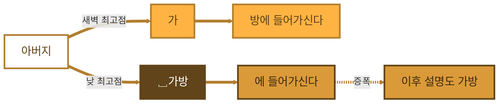
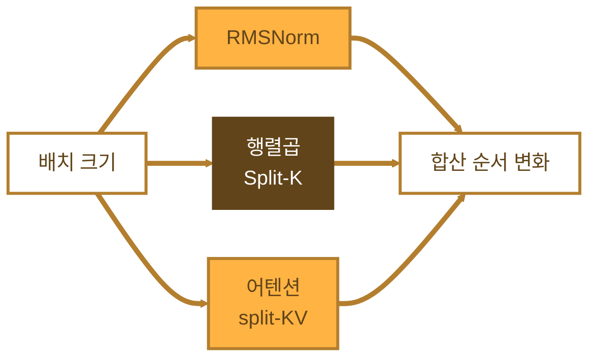
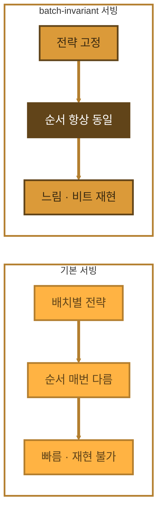
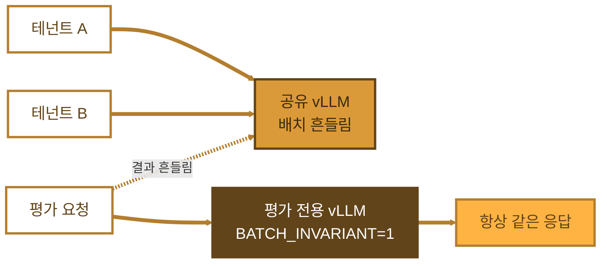

## LLM 은 "아버지가방에들어가신다" 를 어떻게 읽을까 - 같은 질문에 답이 바뀌는 이유

> **목표** : temperature 0 인데도 LLM 답이 바뀌는 진짜 원인을 이해하고, 자체 서빙 환경에서 재현성 확보 방법까지 정리

- 출처 : Thinking Machines Lab, "Defeating Nondeterminism in LLM Inference" (Horace He, 2025.09)
- 참고 : vLLM 공식 문서 Batch Invariance
- 기준 시점 : 2026-11 (vLLM batch invariance 는 개발 진행 중 기능)

---

## 1. 먼저 예제부터 - LLM 에게 띄어쓰기를 시켜봄

### 1-1. 같은 질문, 다른 답

- 사내 LLM 서버에 같은 요청을 두 번 보냄 → `다음 문장 띄어쓰기 해줘 : 아버지가방에들어가신다`
- 모델 같음, 프롬프트 같음, `temperature=0`, `seed=0` 고정
- 다른 건 보낸 시각뿐

| 보낸 시각 | 서버 상태 | 응답 |
|---|---|---|
| 새벽 3시 | 한산 | 아버지가 방에 들어가신다 |
| 낮 2시 | 붐빔 | 아버지 가방에 들어가신다 |

- temperature 0 = 랜덤성 없음 = 항상 같은 답이어야 정상
- 그런데 아버지가 낮에만 가방에 들어가심
- **원인은 모델이 아니라, 그 순간 서버에 같이 들어와 있던 다른 사람들의 요청임**

### 1-2. LLM 은 이 문장을 어떻게 읽나

- LLM 은 문장을 한 번에 해석하지 않음. 토큰 하나씩 이어 붙이며 답을 만듦
- 띄어쓰기 없는 문장은 원래 두 해석이 다 말이 됨 → 모델 입장에서도 박빙
- `아버지` 까지는 두 응답 완전히 동일
- 다음 토큰 후보 두 개 확률이 거의 같음
  - `가` → 아버지가 방에 들어가신다
  - `␣가방` → 아버지 가방에 들어가신다
- temperature 0 → logit 높은 쪽 무조건 선택
- 다이어그램의 "최고점" = 그 시점 다음 토큰 후보 중 logit 순위 1위. greedy 는 이 1위만 고름



**시각별 logit** (설명용 예시 값)

| 보낸 시각 | 배치 크기 | 행렬곱 전략 | `가` logit | `␣가방` logit | 선택 |
|---|---|---|---|---|---|
| 새벽 3시 | 1 | 일반 타일 | 12.3417 | 12.3415 | `가` |
| 낮 2시 | 8 | Split-K | 12.3414 | 12.3416 | `␣가방` |

- 가중치·프롬프트·설정 전부 동일
- 바뀐 건 같이 묶여 처리된 요청 수(배치 크기) → 그에 따른 덧셈 순서
- 덧셈 순서만 바뀌어도 소수점 넷째 자리가 흔들림
- 두 후보 격차가 0.0002 수준이라 그 흔들림에 순위 역전

> 참고 : 실제 토크나이저마다 `아버지가`, `가방` 의 분리 방식은 다름. 여기서는 갈림 구조를 보여주기 위한 단순화임

### 1-3. 한 번 갈리면 돌아오지 않음

- 갈림길 이후 모델은 이미 뽑힌 토큰을 "사실"로 받아들임
- `␣가방` 이 뽑히면 뒤에 붙는 설명까지 가방 해석에 맞춰 이어감 → 원래 경로로 복귀 없음
- 오차는 사라지지 않고 누적·증폭됨

### 1-4. 이 예제가 던지는 질문

- Q1. temperature 0 인데 왜 랜덤성이 남나 → 3-1
- Q2. 덧셈 순서가 바뀌면 왜 값이 바뀌나 → 3-2
- Q3. 흔히 말하는 "GPU 병렬 처리 탓" 아닌가 → 3-3
- Q4. 왜 하필 서버가 붐빌 때 바뀌나 → 3-4
- Q5. 왜 한 토큰 차이가 문장 전체로 번지나 → 3-6
- Q6. 아버지를 항상 같은 곳에 들어가시게 하려면 → 4장

---

## 2. 원인 지도

### 2-1. 원인별 정리

| 레이어 | 원인 | temperature 0 으로 제거? | 대응 |
|---|---|---|---|
| 샘플링 | temperature, top-p 확률 샘플링 | 제거됨 | greedy 또는 seed 고정 |
| 수치 연산 | 부동소수점 비결합성 | 안 됨 | 연산 순서 고정 |
| 서빙 | 배치 크기·구성 변화 (주범) | 안 됨 | batch-invariant 커널 |
| 분산 | 텐서 병렬 all-reduce 순서 | 안 됨 | 결정적 all-reduce |
| 모델 구조 | MoE 라우팅·용량 제한 | 안 됨 | 배치 독립 라우팅 |
| 환경 | GPU 종류, CUDA·커널·엔진 버전 | 안 됨 | 버전 고정 |
| 정밀도 | BF16·FP8 근소차에서 argmax 뒤집힘 | 안 됨 | 고정밀도 또는 위 대응 병행 |

### 2-2. 원인 연쇄 흐름

1장 예제를 원인 순서로 펼치면 이렇게 됨.


| 연쇄 단계 | 1장 예제에서 |
|---|---|
| 서버 부하 변화 | 새벽 한산 → 낮 붐빔 |
| 배치 크기 변화 | 1 → 8 |
| 커널 전략 변경 | 일반 타일 → Split-K |
| 합산 순서 변화 | 덧셈 묶는 방식 달라짐 |
| logit 미세 차이 | 12.3417 → 12.3414 |
| 토큰 1개 뒤집힘 | `가` → `␣가방` |
| 문장 전체 분기 | 방 해석 → 가방 해석 |

---

## 3. 분석

### 3-1. 샘플링 단계 비결정성 (Q1)

- LLM 출력 = 다음 토큰 확률분포. 여기서 토큰을 "뽑는" 방식이 샘플링
- **temperature** : 분포를 평평하게(높음) 또는 뾰족하게(낮음) 만드는 값
- **top-p / top-k** : 후보 토큰 범위 제한
- temperature 0 = greedy decoding → 항상 최고 확률 토큰 선택
- 이론상 여기서 랜덤성 끝. 실제로는 logit 자체가 흔들려서 비결정성 남음
- seed 고정도 같은 한계. 샘플링 난수만 고정, logit 계산은 못 고정함

**예제 대입**
- 예제에서 샘플링은 끝까지 결정적이었음. 항상 logit 최고점 후보를 뽑았음
- 바뀐 건 "어느 후보가 최고점인가" 자체 → 샘플링 앞단 문제

### 3-2. 부동소수점 비결합성 (Q2)

- 실수 연산은 결합법칙 성립 안 함 → `(a + b) + c ≠ a + (b + c)`
- 이유 : 유한 비트로 표현 → 매 연산마다 반올림 발생
- 예시 : `(0.1 + 1e20) - 1e20 = 0`, `0.1 + (1e20 - 1e20) = 0.1`
- 큰 수와 작은 수 섞어 더하면 작은 수가 묻힘
- 더하는 순서만 바뀌어도 결과 비트가 달라짐
- GPU 커널은 수천 개 값을 나눠 더함(reduction) → 나누는 방식이 곧 순서

**예제 대입**
- logit 하나 = 은닉 벡터 수천 차원의 곱을 전부 더한 값
- 새벽과 낮에 이 덧셈을 묶는 방식이 달랐음 → 12.3417 vs 12.3414

### 3-3. "동시성 + 부동소수점" 가설이 틀린 이유 (Q3)

**기존 가설**
- GPU 코어들이 병렬로 계산 → 먼저 끝난 코어 순으로 더함 → 순서 랜덤 → 결과 랜덤

**반박**
- 이렇게 되려면 atomic add(여러 스레드가 한 값에 경쟁적으로 더하기) 필요
- 일반적인 LLM forward pass 에는 atomic add 거의 없음
- 같은 입력, 같은 배치로 matmul 두 번 → 비트 단위로 동일한 결과
- 즉 개별 커널은 run-to-run 결정적임

**예제 대입**
- 새벽 3시 조건(배치 1)으로 백 번 보내면 백 번 다 "아버지가 방에"
- 낮 2시 조건(배치 8)을 정확히 재현해도 백 번 다 "아버지 가방에"
- 랜덤이 아님. 조건별로는 완전히 결정적
- 커널은 결정적인데, 커널에 들어가는 "배치"가 매번 다른 구조

### 3-4. 진짜 원인 - 배치 불변성 부재 (Q4)

#### 3-4-1. 배치 불변성이란

- **배치 불변성(batch invariance)** : 내 요청 결과가 같이 묶인 다른 요청 수·구성과 무관하게 동일한 성질
- 추론 서버는 처리량 위해 여러 사용자 요청을 한 배치로 묶음 (continuous batching)
- 배치 크기 = 그 순간 서버 부하에 따라 결정 → 사용자 입장에선 사실상 랜덤
- 커널이 배치 크기에 따라 다른 계산 전략 선택 → 같은 행이라도 다른 순서로 더해짐
- 비유 : 혼자 타면 직행, 합승하면 경유 노선. 목적지 같아도 도착 시간 다름

> 이 문제는 GPU 전용 아님. CPU·TPU 서빙도 배치 크기 변하면 똑같이 발생

#### 3-4-2. 배치 불변성이 깨지는 3대 연산

공통점 = 전부 reduction(합산) 포함 연산임



| 연산 | 깨지는 지점 | 배치 불변 방법 |
|---|---|---|
| RMSNorm | 배치 작을 때 한 행을 여러 코어가 나눠 합산 | 배치 크기 무관하게 행당 합산 전략 고정 |
| 행렬곱(Matmul) | 배치 크기 따라 Split-K 사용 여부·타일 크기 변경 | 커널 설정(타일·Split-K) 고정 |
| 어텐션(Attention) | KV 캐시 길이·디코딩 단계에 따라 KV 분할 수 변경 | KV 분할 "개수" 대신 "크기"를 고정 |

**RMSNorm**
- 배치 크면 행 하나당 코어 하나 → 순서 고정
- 배치 작으면 코어가 놀아서 한 행을 쪼개 병렬 합산 → 순서 바뀜

**Matmul - Split-K**
- 출력 타일 수가 GPU 코어를 채우기에 부족하면 코어가 놀게 됨
- 그래서 내적 방향(K)을 쪼개서 따로 계산 후 합침 → 합산 순서 변경
- 성능 최적화가 재현성을 깨는 전형적 사례
- 예제에서는 배치 8 상황에 Split-K 가 걸린 것으로 단순화함. 실제 전략 선택은 커널·GPU·행렬 크기마다 다름

**Attention**
- 디코딩 시 query 는 1개, KV 는 길게 쌓임
- 성능 위해 KV 를 여러 조각으로 나눠 병렬 계산 (split-KV, FlashDecoding 계열)
- 배치·길이 따라 조각 수가 바뀜 → 합산 순서 변경
- KV 캐시에 있는 부분과 새로 들어온 부분을 별도 처리하면 경계 위치 따라 결과 달라짐

**예제 대입**
- 낮 2시에 아버지가 가방에 들어가신 건, 그 순간 같이 들어와 있던 다른 7개 요청 때문
- 그 7개 요청 내용과는 무관. "몇 개였나"가 커널 전략을 바꿨음

### 3-5. 기타 비결정성 원인

- **MoE 라우팅** : 전문가별 용량(capacity) 제한 있으면 같은 배치의 다른 토큰 때문에 내 토큰이 밀리거나 드롭됨 → 이 경우엔 다른 요청의 "내용"까지 내 결과에 영향
- **텐서 병렬(TP)** : GPU 간 all-reduce 합산 순서·알고리즘(커스텀 all-reduce)에 따라 값 차이
- **청크 프리필(chunked prefill) / 프리픽스 캐싱** : 프롬프트를 몇 조각으로 나눠 처리했는지, 캐시 히트 여부에 따라 계산 경로 달라짐
- **추측 디코딩(speculative decoding)** : 검증 배치 형태가 매번 다름
- **환경 차이** : GPU 세대, CUDA·cuBLAS·FlashAttention·엔진 버전 바뀌면 커널 선택 자체가 다름
- **저정밀도** : BF16·FP8 은 오차 폭 큼 → 상위 두 토큰 확률이 근소하면 argmax 쉽게 뒤집힘

### 3-6. 한 토큰이 문장 전체로 번지는 이유 (Q5)

- LLM 은 자기회귀(autoregressive) 생성 → 앞 토큰이 다음 입력이 됨
- 수천 토큰 중 대부분은 후보 간 격차가 커서 미세 오차에도 안 뒤집힘
- 문제는 `가` vs `␣가방` 같은 "박빙 지점"이 긴 응답 어딘가엔 거의 반드시 있다는 것
- 띄어쓰기·중의적 표현·동점에 가까운 선택지가 대표적 박빙 지점
- 한 번 뒤집히면 모델은 그 토큰에 맞춰 문맥을 새로 만듦 → 두 응답 거리는 계속 벌어짐
- 그래서 응답이 길수록 비결정성 체감도 커짐
- 실험 결과 : Qwen3-235B 로 같은 프롬프트 1,000회 생성 → 고유 출력 80개. 앞부분 100여 토큰은 동일하다가 중간에서 갈라짐

---

## 4. 해결 - batch-invariant 커널 (Q6)

### 4-1. 기본 서빙과 비교



| 구분 | 기본 서빙 | batch-invariant 서빙 |
|---|---|---|
| 커널 전략 | 배치 크기별 최적 전략 선택 | 배치 무관하게 하나로 고정 |
| 합산 순서 | 부하 따라 매번 다름 | 항상 동일 |
| 처리량 | 빠름 | 느림 (대략 수십 % 손해, 최적화로 격차 축소 중) |
| 재현성 | 없음 | 같은 환경에서 비트 단위 재현 |
| 언제 쓰나 | 일반 챗봇·대량 서빙 | 평가·RL·회귀 테스트·장애 재현 |

- 원리 : 배치 크기와 상관없이 reduction 전략을 하나로 고정
- 예제 대입 : 새벽이든 낮이든 같은 합산 순서 → 같은 logit → 아버지는 항상 같은 곳에 들어가심
- 단, "방"이 보장되는 건 아님. 어느 쪽이든 항상 같은 쪽이 보장되는 것
- 1,000회 실험에 적용 → 고유 출력 80개 → 1개

### 4-2. 결정성 확보 체크리스트

- 샘플링 : temperature 0 또는 seed 고정
- 커널 : batch-invariant 모드
- 분산 : TP 크기·all-reduce 방식 고정
- 환경 : GPU 종류, 드라이버, CUDA, 엔진 버전 고정
- 입력 : 프롬프트·시스템 프롬프트·토크나이저 버전 고정

---

## 5. 사용법 예시

### 5-1. vLLM 실행

- vLLM 은 `VLLM_BATCH_INVARIANT=1` 환경변수로 지원
- 이 모드에서는 결정적 커널 사용 + TP 커스텀 all-reduce 같은 비결정 최적화 비활성화

```bash
VLLM_BATCH_INVARIANT=1 vllm serve <model> --seed 0
```

### 5-2. K8s 평가 전용 Deployment

개념 코드. 이미지·모델 경로는 환경에 맞게 바꿀 것.

```yaml
apiVersion: apps/v1
kind: Deployment
metadata:
  name: vllm-eval            # 평가 전용 (일반 서빙과 분리)
  namespace: llm-eval
spec:
  replicas: 1                # 리플리카 고정, HPA 미적용
  selector:
    matchLabels: {app: vllm-eval}
  template:
    metadata:
      labels: {app: vllm-eval}
    spec:
      nodeSelector:
        nvidia.com/gpu.product: <GPU-모델>   # GPU 세대 고정
      containers:
        - name: vllm
          image: <registry>/vllm/vllm-openai@sha256:<digest>   # 태그 대신 digest 고정
          args: ["--model", "/models/<model>", "--seed", "0",
                 "--tensor-parallel-size", "1"]               # TP 크기 고정
          env:
            - name: VLLM_BATCH_INVARIANT
              value: "1"
          resources:
            limits: {nvidia.com/gpu: 1}
```

### 5-3. 직접 확인해보기

- 1장 예제의 새벽·낮 상황을 직접 만들어보는 실험
- 같은 프롬프트를 (1) 순차 1개씩 = 새벽 (2) 동시 수십 개 = 낮 으로 보내고 고유 출력 수 비교
- 기본 모드 → 동시 요청 쪽에서 고유 출력 여러 개 나옴
- batch-invariant 모드 → 둘 다 고유 출력 1개

```python
import asyncio, collections
from openai import AsyncOpenAI

client = AsyncOpenAI(base_url="http://<vllm-svc>:8000/v1", api_key="EMPTY")
PROMPT = "다음 문장 띄어쓰기 해주고 뜻을 설명해줘 : 아버지가방에들어가신다"

async def one():
    r = await client.completions.create(
        model="<model>", prompt=PROMPT,
        max_tokens=300, temperature=0, seed=0,
    )
    return r.choices[0].text

async def main(n=50):
    outs = await asyncio.gather(*[one() for _ in range(n)])  # 동시 요청 = 배치 크기 흔들기
    c = collections.Counter(outs)
    print(f"요청 {n}개 -> 고유 출력 {len(c)}개")

asyncio.run(main())
```

---

## 6. 실무에서 확인

### 6-1. 어디에 결정성이 필요한가

| 용도 | 결정성 필요도 | 이유 |
|---|---|---|
| 모델 평가(eval) | 높음 | 점수 흔들리면 모델 비교 불가 |
| 강화학습(RL) 롤아웃 | 높음 | 학습 시점과 추론 시점 수치가 다르면 사실상 off-policy 됨 |
| 엔진·커널 업그레이드 회귀 테스트 | 높음 | 버그인지 노이즈인지 구분 필요 |
| 서빙 장애 디버깅 | 중간 | 문제 요청 재현 필요 |
| 일반 챗봇 서빙 | 낮음 | 처리량이 더 중요 |

- 전체 서빙에 켤 필요 없음. 평가·테스트용 엔드포인트만 분리해서 켜는 게 현실적

### 6-2. 멀티테넌트 K8s 서빙 관점



- 같은 vLLM 인스턴스를 여러 네임스페이스(사용자)가 공유하면 → 다른 테넌트 트래픽이 내 배치 크기를 바꿈
- 1장 예제의 "낮 2시"가 바로 이 상황
- 즉 **다른 사용자의 부하가 내 응답 내용에 영향을 주는 구조**임
- 기능적으로는 문제 아니지만 "어제랑 결과 다르다" 문의의 근본 원인이 됨
- 재현성 필요한 팀 → 전용 Deployment + batch-invariant 모드 + 고정 리플리카 구성 분리 권장
- HPA 로 리플리카가 늘어나면 요청이 어느 파드로 가는지도 변수. 단, batch-invariant 모드면 파드 간 GPU·버전 동일할 때 결과 동일

### 6-3. 폐쇄망·GPU 노드 관점

- 폐쇄망은 이미지·버전 고정이 원래 강제됨 → 환경 변수 통제는 오히려 유리
- 이미지 태그는 `latest` 금지, digest 로 고정. 엔진 버전 올리면 결과 달라질 수 있다고 공지
- GPU 세대 혼재 노드풀(예: H 계열 + B300)이면 nodeSelector 로 평가용 워크로드를 한 세대에 고정
- vLLM batch-invariant 모드는 GPU compute capability 요구사항 있음 → 문서 버전마다 요구치 다르므로 사용 버전 문서로 확인
- TP 크기 바꾸면 결과도 바뀜 → 평가 기준선 만들 때 TP 크기까지 기록

> 주의 : batch-invariant 모드 켜도 GPU 종류나 엔진 버전이 다르면 비트 단위 동일성은 보장 안 됨. "같은 환경에서 배치 무관"이 보장 범위임

> 주의 : 외부 상용 API 는 내부 배치·하드웨어 통제 불가 → temperature 0 이어도 재현성 기대하지 말 것

---

## 7. 용어 정리

- **비결정성(nondeterminism)** : 같은 입력에 다른 출력이 나오는 성질
- **greedy decoding** : 매 단계 최고 확률 토큰만 선택하는 방식. temperature 0 과 같음
- **logit** : softmax 직전, 토큰별 점수. 이 값이 가장 큰 토큰이 greedy 에서 선택됨
- **부동소수점 비결합성(floating-point non-associativity)** : 더하는 순서에 따라 결과가 달라지는 실수 연산 성질
- **reduction** : 여러 값을 하나로 합치는 연산 (합, 최댓값 등)
- **atomic add** : 여러 스레드가 한 메모리 값에 경쟁적으로 더하는 연산. 순서 보장 없음
- **run-to-run 결정성** : 같은 입력·같은 배치로 다시 돌리면 같은 결과가 나오는 성질
- **배치 불변성(batch invariance)** : 배치 크기·구성과 무관하게 개별 요청 결과가 동일한 성질
- **continuous batching** : 요청이 도착하는 대로 실행 중인 배치에 끼워 넣는 서빙 방식
- **Split-K** : 행렬곱 내적 차원을 쪼개 병렬 계산 후 합치는 최적화
- **split-KV** : 어텐션에서 KV 캐시를 여러 조각으로 나눠 병렬 계산하는 최적화
- **자기회귀(autoregressive)** : 이전 출력 토큰을 다음 입력으로 쓰는 생성 방식

---

## 8. 한 장 요약

| 항목 | 핵심 |
|---|---|
| 현상 | temperature 0 이어도 "아버지가방에들어가신다" 띄어쓰기가 새벽엔 방, 낮엔 가방 |
| LLM 의 해석 방식 | 문장을 토큰 하나씩 이어 붙임. 중의적 지점은 두 후보 logit 이 박빙 |
| 흔한 오해 | GPU 병렬과 부동소수점 경쟁 때문 → 주범 아님 |
| 진짜 원인 | 서버 부하 따라 배치 크기 변화, 커널이 배치 불변이 아님 |
| 깨지는 연산 | RMSNorm, Matmul(Split-K), Attention(split-KV) |
| 증폭 구조 | 미세 오차 → 박빙 지점에서 토큰 1개 뒤집힘 → 자기회귀로 전체 분기 |
| 해결 | batch-invariant 커널 (`VLLM_BATCH_INVARIANT=1`) |
| 대가 | 처리량 감소. 평가·RL·회귀 테스트용으로 분리 운영 |
| 운영 포인트 | GPU 세대·엔진 버전·TP 크기까지 고정해야 완전 재현 |

**LLM 이 아버지를 가방에 넣은 건 문장을 잘못 이해해서가 아니라 그 순간 서버가 붐볐기 때문이고, 배치와 무관하게 연산 순서를 고정하면 아버지는 항상 같은 곳에 들어가심**

---

## 9. 그럼 CPU 로만 돌리면 해결될까

### 9-1. 결론

- **자동으로 해결 안 됨. 조건을 고정했을 때만 결정적임**
- 요청 1개씩, 스레드 수 고정, 같은 CPU·같은 바이너리 → 비트 단위로 같은 답 나옴
- 서버처럼 동시 요청을 묶어 처리하면 → GPU 와 똑같이 아버지가 가방에 들어가심
- 이유 : 주범은 GPU 하드웨어가 아니라 "배치·분할 방식에 따라 합산 순서가 바뀌는 커널"임

### 9-2. 근거

| 근거 | 확인된 내용 | 의미 |
|---|---|---|
| Thinking Machines 원문 | 부하에 따라 배치 크기가 바뀌는 비결정성은 GPU 고유 문제 아님. CPU·TPU 엔드포인트도 같음 | 하드웨어 바꿔도 원인 그대로 |
| llama.cpp 이슈 7052 | 서버 슬롯 여러 개면 temperature 0 에도 고유 출력 5~8개. 슬롯 1개면 출력 일치 | 동시 요청 묶는 순간 비결정 |
| 같은 이슈 메인테이너 답변 | 부동소수점은 같은 연산을 같은 방식으로 실행해야 비트 동일. 멀티 슬롯이 빠른 이유가 바로 그렇게 안 하기 때문 | 속도와 재현성은 트레이드오프 |
| llama.cpp 이슈 22956 | CPU, `--threads 1` 인데도 비결정. OpenBLAS 가 OpenMP 기본 스레드로 몰래 멀티스레드 동작. `OMP_NUM_THREADS=1` 로 해결 | 스레드 수가 합산 순서를 바꿈 |
| llama.cpp 이슈 28963 | CPU 백엔드 토큰 경로는 스레드 1, 배치 고정, flash attention 끔 조건에서 비트 단위 결정적 | 조건 고정하면 CPU 는 결정적 |
| Intel oneMKL CNR 문서 | CPU 명령어 세트에 따라 코드 경로 달라짐. 재현하려면 스레드 수 고정 + `MKL_CBWR` 로 코드 브랜치 고정 필요 | CPU 세대·라이브러리도 변수 |

> 참고 : 이슈 7052 보고 환경은 Metal·GPU 임. 다만 메인테이너 설명은 백엔드와 무관한 부동소수점 원리이고, CPU 쪽은 이슈 22956·28963 이 직접 근거임

### 9-3. 왜 CPU 도 같은 문제가 생기나

- CPU 행렬곱도 성능 위해 블로킹(타일)과 스레드 분할을 함 → 분할 방식이 곧 합산 순서
- 배치 크기가 바뀌면 → BLAS·ggml 이 다른 블록 크기·스레드 분배 선택 → 합산 순서 변경
- 즉 GPU 의 Split-K 와 같은 구조가 CPU 에도 있음. 이름만 다름
- CPU 에는 오히려 변수가 더 붙음
  - **스레드 수** : 노드 코어 수 따라 자동 결정되면 노드마다 다른 순서
  - **명령어 세트 디스패치** : AVX2, AVX-512, AMX 중 무엇을 쓰느냐에 따라 다른 커널
  - **BLAS 종류·버전** : OpenBLAS, MKL, ggml 자체 커널마다 합산 방식 다름

**예제 대입**
- CPU 서버라도 낮에 동시 요청 8개가 들어와 한 배치로 묶이면 → 합산 순서 변경 → `␣가방` 역전 가능
- 새벽에 요청 1개만 처리하던 상황과 계산 경로가 달라지는 건 GPU 와 동일

### 9-4. CPU 로 바꾸면 달라지는 것과 그대로인 것

| 구분 | 내용 |
|---|---|
| 줄어드는 것 | CPU 는 느려서 동시 처리량이 작음 → 배치 크기 변동 폭이 작아 체감 비결정성은 낮을 수 있음 |
| 그대로인 것 | 배치 크기 변화, 부동소수점 비결합성, 자기회귀 증폭, 엔진·모델 버전 차이 |
| 새로 생기는 것 | 스레드 수, 명령어 세트 디스패치, BLAS 내부 멀티스레드, 노드별 CPU 세대 차이 |
| 비용 | GPU 대비 처리량·지연 크게 손해 → 재현성 하나 때문에 CPU 로 가는 건 비효율 |

### 9-5. CPU 에서 결정성 확보 조건

- 동시 처리 1개 : llama.cpp 서버면 슬롯 1개(`-np 1`), 요청 직렬 처리
- 스레드 고정 : `--threads`, `--threads-batch` 명시. `OMP_NUM_THREADS`, `MKL_NUM_THREADS` 도 같이 고정
- 배치 고정 : `n_batch`, `n_ubatch` 명시
- BLAS 재현 모드 : MKL 이면 `MKL_CBWR` 로 코드 브랜치 고정
- 환경 고정 : 같은 CPU 세대, 같은 바이너리·이미지 digest
- K8s : 스레드 수를 자동 감지에 맡기지 말 것. 노드마다 코어 수 다르면 결과도 달라짐 → 컨테이너 env 로 명시, nodeSelector 로 CPU 세대 고정

> 주의 : CPU limit(cgroup)은 속도만 늦추고 결과는 안 바꿈. 결과를 바꾸는 건 "몇 개 스레드로 나눠 더했나" 임

### 9-6. 정리

| 질문 | 답 |
|---|---|
| CPU 면 해결? | 아님. 배치·스레드가 바뀌면 똑같이 흔들림 |
| 언제 결정적? | 단일 요청, 스레드·배치·BLAS 경로·CPU 세대 모두 고정일 때 |
| 실무 선택 | 재현성 필요하면 CPU 전환보다 GPU batch-invariant 모드 분리 운영이 현실적 |

**결정성을 정하는 건 CPU 냐 GPU 냐가 아니라 합산 순서가 고정되느냐이고, CPU 도 동시 요청을 묶는 순간 아버지는 다시 가방에 들어가심**
