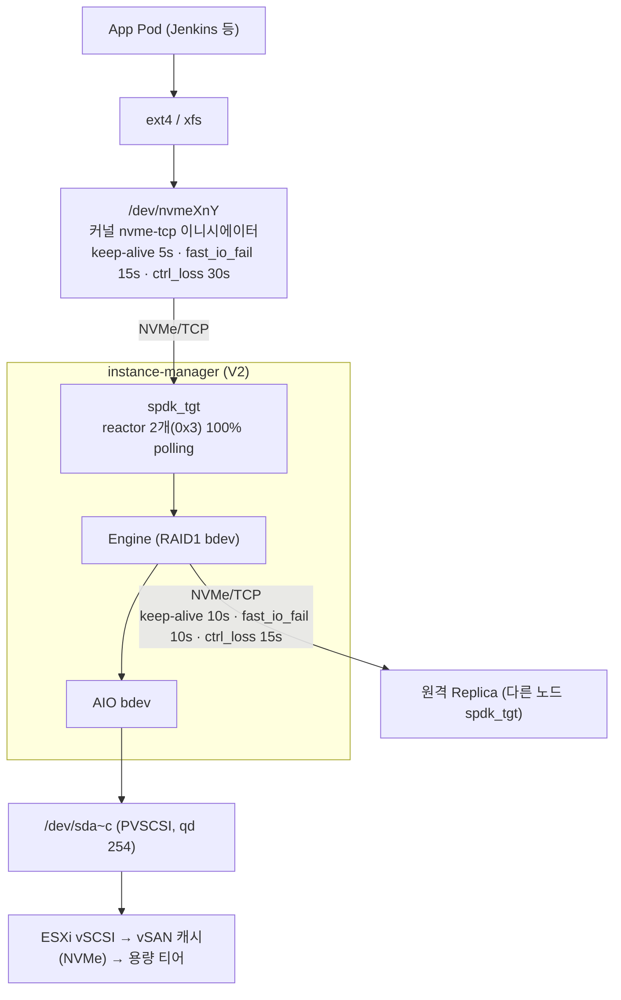
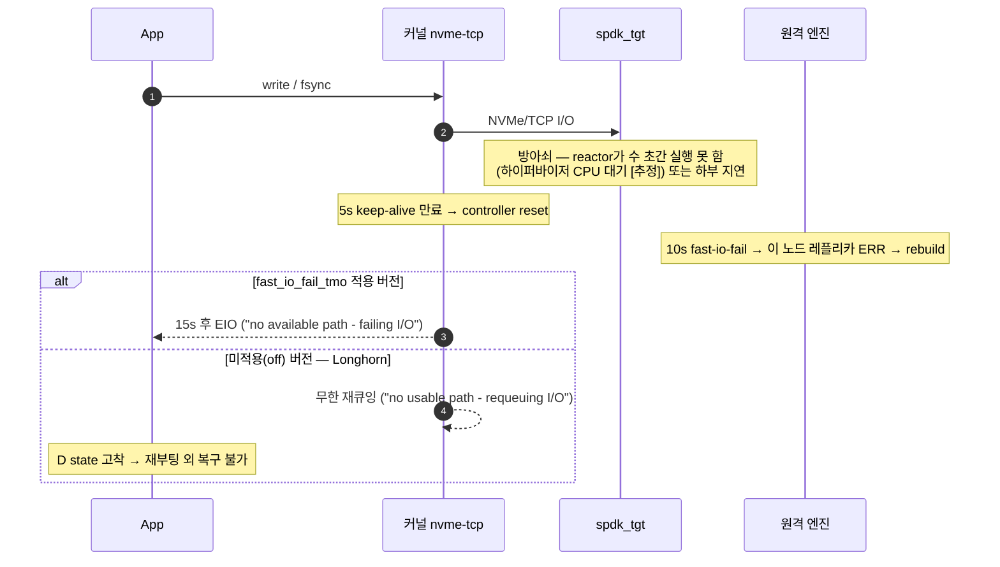
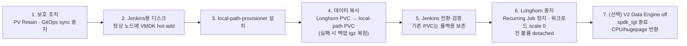

# Longhorn V2 노드 행(hang) 장애 대응 — 원인 분석·코드 근거·조치·Jenkins 이전 런북

- 작성일: 2026-11-25
- 대상 환경: vSphere vSAN 위 K8S 노드 VM 5대, 노드당 vSAN 가상 디스크 3개(`/dev/sda~c`)를 Longhorn **V2(SPDK)** 블록 디스크로 사용
- 관련 문서: [longhorn-architecture-guide.md](./longhorn-architecture-guide.md) · [longhorn-vm-spdk-evidence.md](./longhorn-vm-spdk-evidence.md) (E5: burstable VM I/O stuck)
- 표기: **[확인]** = 실측·코드로 확인 / **[추정]** = 근거는 있으나 장애 시각 데이터로 아직 확정 못 함

---

## 1. 장애 요약

| 일시 | 내용 |
|---|---|
| 2026-11-24 | 특정 노드 행. "nvme Cache I/O 에러" 보고. 노드 재부팅 |
| 2026-11-24 | 재부팅 후 **같은 노드에서 행 재발** |
| 2026-11-25 | 원인 분석, 온라인 완화 조치, **Jenkins를 Longhorn 밖으로 이전하고 Longhorn은 제거하지 않고 중지**하기로 결정 |

인프라 측 확인: 같은 vSAN의 다른 VM에서는 에러 없음, 해당 노드만 발생.

## 2. 현재까지 확인된 사실

| 항목 | 결과 | 의미 |
|---|---|---|
| 게스트의 `nvme` 장치 | **[확인]** `nvme0`, `nvme1` — NQN `...spdk:volume-pvc-...`, `addr 10.x` | 물리 NVMe가 아니라 **Longhorn V2 볼륨(NVMe-oF TCP)**. vSAN 캐시 NVMe는 게스트에서 보이지 않는다 |
| `creating 36 I/O queues` | **[확인]** `nproc` = 36 | 정상 연결 로그. VM vCPU 36개 |
| V2 CPU Mask | **[확인]** `0x3` (2코어) | 코어 수는 권장값. 변경 불필요 |
| 디스크 컨트롤러 | **[확인]** `queue_depth` 254, `nr_requests` 256 → PVSCSI(큐 상향) | 게스트 큐 포화 가설은 **거의 배제** |
| 어제자 journal의 nvme 에러 | **[확인]** 없음 | journal이 디스크에 저장되지 않아 **재부팅 때 사라졌을 가능성**. 행 원인이 없다는 뜻이 아님 |
| `FuEngine failed to add device /dev/sr0` | **[확인]** fwupd가 가상 CD-ROM을 탐색한 무해 로그 | 장애와 무관 |
| 볼륨 robustness `unknown` 다수 | **[확인]** detach 상태 볼륨의 정상 표시 | STATE와 짝지어 판단해야 함 |

## 3. 동작 구조와 장애 전파

### 3.1 I/O 경로



### 3.2 코드로 확인한 timeout 값 **[확인]**

| 구간 | 값 | 코드 위치 |
|---|---|---|
| 커널 → 로컬 SPDK (볼륨 프런트엔드) | `ctrl-loss-tmo 30`, `keep-alive-tmo 5`, `reconnect-delay 2`, `fast_io_fail_tmo 15` | `longhorn/go-spdk-helper` `pkg/initiator/nvmecli.go` |
| 엔진 SPDK → 레플리카 SPDK | `ctrlr_loss 15s`, `reconnect_delay 2s`, `fast_io_fail 10s`, `transport_ack_timeout 10`(≈1s), `keep_alive 10000ms` | `longhorn/longhorn-spdk-engine` `pkg/spdk/types.go`, `server.go` |
| vSAN 디스크 등록 | `BdevAioCreate` (AIO 경로) | `longhorn-spdk-engine` `pkg/spdk/disk/aio/aio.go` |

### 3.3 장애 전파 시나리오



- 일반 VM은 디스크가 몇 초 느려져도 SCSI timeout(180s) 안에서 버틴다. **V2는 SPDK가 5초만 멈춰도 볼륨이 끊긴다.** "다른 VM은 정상, 이 노드만 에러"가 설명된다.
- 행(D state, 재부팅 필요)으로 번지는 부분은 Longhorn 이슈 [#13913](https://github.com/longhorn/longhorn/issues/13913)이다. v1.13.0-rc1에서 보고되었고, 수정은 go-spdk-helper 커밋 `737672f`(2026-09-09, `--fast_io_fail_tmo 15` 추가)와 longhorn-spdk-engine #689·#712에 들어 있다.

## 4. 원인 판별 방법

### 4.1 가설 상태

| 가설 | 상태 | 근거 |
|---|---|---|
| vSAN 전체 장애 | 낮음 | 다른 VM 정상 |
| 게스트 디스크 큐 포화로 SPDK `io_submit` 블록 | **거의 배제** | PVSCSI qd 254 / nr_requests 256 |
| 하이퍼바이저 CPU 대기(Ready·Co-stop)로 SPDK 정지 | **유력 [추정]** | V2 polling + 5s keep-alive, 36 vCPU 대형 VM. 장애 시각 %RDY/%CSTP 미확인 |
| 이 VM 디스크 경로만의 하부 지연(IOPS limit, 디스크 그룹) | 가능 | 장애 시각 Virtual Disk latency 미확인 |
| 행 확대 = Longhorn #13913 | 확인 필요 | `fast_io_fail_tmo` 값과 `requeuing I/O` 로그로 확정 |

### 4.2 결정적 판별 지표

| 확인 | 결과 → 판정 |
|---|---|
| nvme **첫 에러** 종류 | `keep alive` 계열이 먼저 → SPDK 자체 정지(CPU 쪽) / `I/O ... timeout`만 먼저 → I/O 완료 지연(vSAN 쪽) |
| 장애 중 SPDK reactor 스레드 상태 | `R`인데 진행 없음 + esxtop %RDY 높음 → CPU 경합 / `D` + `io_schedule`·`blk_mq_get_tag` → 디스크 대기 |
| vCenter 장애 시각 차트 | vCPU당 Ready 10% 이상 또는 %CSTP 3% 이상 → CPU 경합 |
| 게스트 커널 로그 | `soft lockup`, `rcu stall`, `hrtimer: interrupt took`, 시간 점프 → vCPU 미실행 |
| `/sys/class/nvme/nvme*/fast_io_fail_tmo` | `off` → #13913 행 경로에 노출된 버전 |

```bash
# nvme 첫 에러 (정상 연결 로그 제외)
dmesg -T | grep -i nvme | grep -viE "creating .* I/O queues|new ctrl|mapped .* queues" | head -20

# reactor 상태 (장애 중 실행)
P=$(pgrep -f spdk_tgt); for t in /proc/$P/task/*; do echo "$(cat $t/comm) $(awk '{print $3}' $t/stat) $(cat $t/wchan)"; done | grep -i reactor

# 행 확대 버그 노출 여부
for c in /sys/class/nvme/nvme*; do echo "$c fast_io_fail=$(cat $c/fast_io_fail_tmo 2>/dev/null) ctrl_loss=$(cat $c/ctrl_loss_tmo)"; done
```

### 4.3 다음 장애 때 증거가 남도록 (필수)

```bash
mkdir -p /var/log/journal
systemd-tmpfiles --create --prefix /var/log/journal
systemctl restart systemd-journald
journalctl --disk-usage          # 0이 아니면 영구 저장
# 재부팅 후 직전 부팅 로그: journalctl -b -1 -k
```

## 5. 온라인 완화 조치 (무중단)

| # | 조치 | 위치 | 비고 |
|---|---|---|---|
| 1 | CPU **Shares High**, **Limit Unlimited**, 가능한 만큼 **Reservation**(최소 SPDK 2코어 분량) | vCenter → VM → Edit Settings → CPU | 즉시 반영. 36 vCPU 전체 예약은 비현실적 |
| 2 | `systemctl disable --now fstrim.timer` | 노드 5대 | AIO bdev는 unmap 미지원 |
| 3 | **Backup Concurrent Limit Per Backup** 2 → 1 | Longhorn UI → Setting → General | Save 즉시 반영. 진행 중인 백업은 기존 값 유지 |
| 4 | **Concurrent Replica Rebuild Per Node Limit** → 1 | Setting → General | |
| 5 | **Replica Rebuilding Bandwidth Limit** 0 → 200 MB/s | Setting | rebuild 대상 lvol 쓰기 QoS. 평소 I/O 영향 없음 |
| 6 | Recurring Job의 Concurrency 1, 실행 시각 분산 | Recurring Job | |
| 7 | `fast_io_fail_tmo` 15 수동 설정 | 노드 sysfs | 행 대신 EIO. 재연결·재부팅 시 원복 |

```bash
for c in /sys/class/nvme/nvme*; do [ "$(cat $c/fast_io_fail_tmo)" = off ] && echo 15 > $c/fast_io_fail_tmo; done
```

**메트릭 수집은 끄지 않는다.** 코드상 `bdev_get_iostat`는 Longhorn 내부 감시 루프가 3초마다 무조건 호출한다(`longhorn-spdk-engine` `pkg/spdk/server.go` `MonitorInterval`, `UpdateEngineMetrics`). Prometheus는 캐시 값(`MetricsGet`)만 읽으므로, 수집을 꺼도 SPDK 부하는 줄지 않고 증거만 사라진다.

### 5.1 운영 중 변경 금지 — Setting → Danger Zone

`Data Engine CPU Mask`, `Guaranteed Instance Manager CPU`, `Data Engine Interrupt Mode Enabled`, `V2 Data Engine` 등은 instance-manager 재시작이나 볼륨 detach가 필요하다. 유지보수 시간에 **볼륨 detach 후 한 번에** 바꾼다. Longhorn 1.10 이상에서는 V2 값이 `{"v2":"0x3"}`처럼 JSON 형식이다.

## 6. 런북 — Jenkins 이전 + Longhorn 중지 (제거하지 않음)



### 6.1 보호 조치

```bash
# Longhorn PV를 Retain으로 (PVC를 실수로 지워도 데이터 보존)
for pv in $(kubectl get pv -o jsonpath='{range .items[?(@.spec.csi.driver=="driver.longhorn.io")]}{.metadata.name}{"\n"}{end}'); do
  kubectl patch pv $pv -p '{"spec":{"persistentVolumeReclaimPolicy":"Retain"}}'
done
```

- ArgoCD·Flux로 관리 중이면 auto-sync를 끈다. 켜 두면 scale 0이 원래대로 되돌아간다.
- Jenkins 백업 파일에 `secrets/master.key`, `secrets/`, `credentials.xml`이 들어 있는지 확인한다. 없으면 복원해도 credential을 풀 수 없다.

```bash
helm -n <jenkins-ns> get values <release> > jenkins-values.yaml
kubectl -n <jenkins-ns> get sts,deploy,svc,ingress,secret,cm -o yaml > jenkins-k8s-backup.yaml
```

### 6.2 Jenkins용 디스크 (정상 노드, 무중단)

vCenter에서 **행이 걸리던 노드가 아닌** VM에 새 Hard Disk를 hot-add한다.

```bash
echo "- - -" | tee /sys/class/scsi_host/host*/scan
ls -l /dev/disk/by-id/ | grep sdd
mkfs.xfs /dev/disk/by-id/<sdd-id>
mkdir -p /opt/local-path-provisioner
echo "/dev/disk/by-id/<sdd-id> /opt/local-path-provisioner xfs defaults 0 0" >> /etc/fstab   # discard 넣지 않음
mount -a && df -h /opt/local-path-provisioner
```

루트 디스크 여유가 Jenkins home의 2배 이상이면 디스크를 추가하지 않고 루트 경로를 써도 된다.

#### 대안: master #2 루트 볼륨(900GB)에 hostPath로 띄우기

디스크를 추가하지 않아도 되므로 가장 빠르다. 다만 **control-plane 노드**라서 아래 조건을 지킨다.

| 위험 | 이유 | 대응 |
|---|---|---|
| **etcd 지연 → 클러스터 전체 불안정** | 루트 디스크를 etcd(`/var/lib/etcd`)와 공유하면 Jenkins의 디스크 I/O가 etcd fsync를 늦춘다 | `df /var/lib/etcd`로 etcd가 같은 디스크인지 확인한다. 같다면 **controller만** 올리고 빌드는 다른 노드의 agent Pod로 돌린다(controller executor 0) |
| master taint | control-plane에는 기본으로 `NoSchedule` taint가 걸려 있다 | Jenkins에 toleration을 추가한다 |
| 자원 경합 | apiserver·etcd와 CPU·메모리를 나눠 쓴다 | Jenkins에 requests/limits 지정 |
| 노드 고정 | hostPath라 다른 노드로 옮길 수 없다 | 정기 백업 (CronJob tar → NFS·S3) |

Pod에 hostPath를 직접 넣는 대신 **노드에 고정된 static PV**로 만들면 Helm의 `existingClaim`을 그대로 쓸 수 있고, 나중에 스토리지를 바꾸기도 쉽다.

```bash
# master #2 에서
mkdir -p /data/jenkins-home && chown -R 1000:1000 /data/jenkins-home
df -h /data /var/lib/etcd       # 같은 파일시스템인지 확인
```

```yaml
apiVersion: v1
kind: PersistentVolume
metadata: { name: jenkins-home-master2 }
spec:
  capacity: { storage: 200Gi }
  accessModes: [ReadWriteOnce]
  persistentVolumeReclaimPolicy: Retain
  storageClassName: jenkins-local
  local: { path: /data/jenkins-home }
  nodeAffinity:
    required:
      nodeSelectorTerms:
      - matchExpressions:
        - { key: kubernetes.io/hostname, operator: In, values: ["<master2 노드명>"] }
---
apiVersion: v1
kind: PersistentVolumeClaim
metadata: { name: jenkins-home-local, namespace: <jenkins-ns> }
spec:
  accessModes: [ReadWriteOnce]
  storageClassName: jenkins-local
  volumeName: jenkins-home-master2
  resources: { requests: { storage: 200Gi } }
```

```yaml
# jenkins-values.yaml (6.5와 함께)
controller:
  nodeSelector: { kubernetes.io/hostname: <master2 노드명> }
  tolerations:
  - { key: node-role.kubernetes.io/control-plane, operator: Exists, effect: NoSchedule }
  numExecutors: 0          # 빌드는 agent Pod에서
  resources:
    requests: { cpu: "1", memory: 2Gi }
    limits:   { cpu: "4", memory: 8Gi }
```

이 방법을 쓰면 6.3(local-path 설치)은 건너뛴다. 6.4의 migrate Pod에는 master2 `nodeSelector`와 위 toleration을 넣고, 새 PVC 정의는 빼고 위 PVC를 쓴다.

### 6.3 local-path-provisioner

```bash
kubectl apply -f https://raw.githubusercontent.com/rancher/local-path-provisioner/<최신버전>/deploy/local-path-storage.yaml
kubectl get sc local-path
```

폐쇄망이면 이미지를 사내 레지스트리로 바꾼다. local-path는 노드에 고정되고 복제가 없다(하부 vSAN이 복제 담당). 그래서 정기 백업이 필수다.

### 6.4 데이터 복사 (Jenkins 중단 시작)

```bash
NS=<jenkins-ns>; NODE=<디스크 추가한 정상 노드>
OLD=<기존 Jenkins Longhorn PVC>

# Jenkins Quiet Down → 빌드 종료 확인
kubectl -n $NS scale sts <jenkins-sts> --replicas=0

cat <<EOF | kubectl apply -f -
apiVersion: v1
kind: PersistentVolumeClaim
metadata: { name: jenkins-home-local, namespace: $NS }
spec:
  accessModes: [ReadWriteOnce]
  storageClassName: local-path
  resources: { requests: { storage: 50Gi } }
---
apiVersion: v1
kind: Pod
metadata: { name: jenkins-migrate, namespace: $NS }
spec:
  nodeSelector: { kubernetes.io/hostname: $NODE }
  containers:
  - name: m
    image: alpine
    command: ["sh","-c","apk add --no-cache rsync && sleep infinity"]
    volumeMounts: [{ name: old, mountPath: /old, readOnly: true }, { name: new, mountPath: /new }]
  volumes:
  - { name: old, persistentVolumeClaim: { claimName: $OLD } }
  - { name: new, persistentVolumeClaim: { claimName: jenkins-home-local } }
EOF
kubectl -n $NS wait --for=condition=Ready pod/jenkins-migrate --timeout=300s
kubectl -n $NS exec jenkins-migrate -- rsync -aHAX --numeric-ids --info=progress2 /old/ /new/
kubectl -n $NS exec jenkins-migrate -- sh -c "chown -R 1000:1000 /new && ls /new/secrets/master.key /new/config.xml"
kubectl -n $NS delete pod jenkins-migrate
```

- **Longhorn 볼륨이 붙지 않거나 복사 중 멈추면:** old 마운트를 빼고 백업 tgz를 `kubectl cp`로 넣어 `tar xzf` → `chown -R 1000:1000` 한다.
- 폐쇄망이면 alpine 이미지와 apk 저장소를 사내 경로로 바꾼다.

### 6.5 Jenkins 전환

```yaml
# jenkins-values.yaml에 추가
persistence:
  existingClaim: jenkins-home-local
controller:
  nodeSelector:
    kubernetes.io/hostname: <정상 노드>
```

```bash
helm upgrade <release> jenkins/jenkins -n $NS -f jenkins-values.yaml --version <기존 차트 버전>
kubectl -n $NS get pod -o wide
```

- **검증:** 로그인, Job 목록·빌드 이력, **Credentials 값**, 테스트 빌드. agent workspace PVC가 있으면 StorageClass를 `local-path`로 바꾼다.
- **롤백:** `existingClaim`을 기존 Longhorn PVC로 되돌린다. 기존 PVC는 지우지 않는다.

### 6.6 Longhorn 중지 (데이터 보존)

1. Recurring Job을 Disable하고, **Allow Recurring Job While Volume Is Detached = false**로 둔다. true이면 detach된 볼륨을 백업 시간에 Longhorn이 다시 붙인다.
2. Longhorn PVC를 쓰는 나머지 워크로드를 scale 0으로 내린다.
3. 확인:

```bash
kubectl -n longhorn-system get volumes.longhorn.io -o custom-columns=NAME:.metadata.name,STATE:.status.state --no-headers | grep -v detached   # 아무것도 없어야 함
nvme list-subsys     # 노드 5대 모두 Longhorn NQN 없음
```

이 상태면 Longhorn 데이터 경로가 완전히 멈춘 것이다. NVMe-TCP 연결이 없으므로 같은 행은 재발하지 않는다.

### 6.7 (선택) V2 Data Engine 비활성화

전 볼륨이 detached인 것을 확인한 뒤, Setting → Danger Zone → **V2 Data Engine = false**로 바꾼다. 확인 방법은 `pgrep -a spdk_tgt`가 비어 있는 것이다.

- Longhorn 버전에 따라 V2 볼륨이 남아 있으면 이 변경이 거부될 수 있다. 그 경우 6.6 상태로 두는 것만으로 충분하다.
- V2 디스크의 데이터는 보존된다.

### 6.8 하지 말 것

- `longhorn-manager` DaemonSet scale 0
- `longhorn-system` 네임스페이스나 Longhorn CRD 삭제
- Longhorn PVC 삭제

## 7. Longhorn 재개 조건

| 조건 | 방법 |
|---|---|
| 행 확대 버그 해소 | #13913 수정이 포함된 Longhorn으로 업그레이드 (`fast_io_fail_tmo` ≠ off 확인) |
| 방아쇠 제거 | 장애 시각 %RDY/%CSTP 확인 → CPU Reservation·Shares, 호스트 오버커밋 축소, 필요 시 vCPU 적정화 |
| CPU 점유 완화 | 유지보수 때 Interrupt Mode 활성화, Guaranteed IM CPU(v2) ≥ 2000m 확인 |
| 구조 재검토 | VM/vSAN 환경은 V1 엔진 또는 vSphere CSI 검토 ([longhorn-architecture-guide.md](./longhorn-architecture-guide.md) 구성안 B·C) |

재개할 때는 V2 Data Engine을 true로 되돌리고(6.7을 했다면) 워크로드를 scale up한다.

## 8. 참고

- Longhorn V2 Data Engine Issues (burstable VM): https://documentation.suse.com/en-us/cloudnative/storage/1.13/en/troubleshooting-maintenance/v2-data-engine-issues.html
- Longhorn #13913 (V2 volume fails to reattach, D state): https://github.com/longhorn/longhorn/issues/13913
- Longhorn #13585 (burstable VM I/O stuck): https://github.com/longhorn/longhorn/issues/13585
- Configurable CPU Cores: https://longhorn.io/docs/1.13.0/advanced-resources/v2-data-engine/configurable-cpu-cores/
- Interrupt Mode: https://longhorn.io/docs/1.10.0/v2-data-engine/features/interrupt-mode
- 코드 (2026-11-24 main 기준): https://github.com/longhorn/go-spdk-helper · https://github.com/longhorn/longhorn-spdk-engine · https://github.com/longhorn/longhorn-instance-manager
