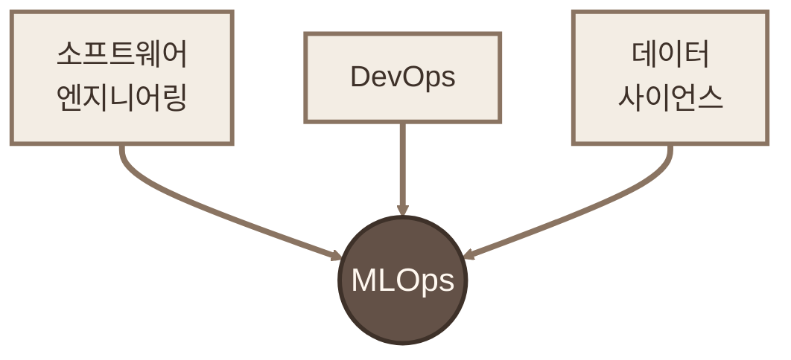
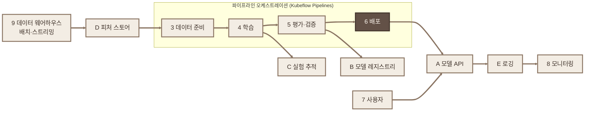
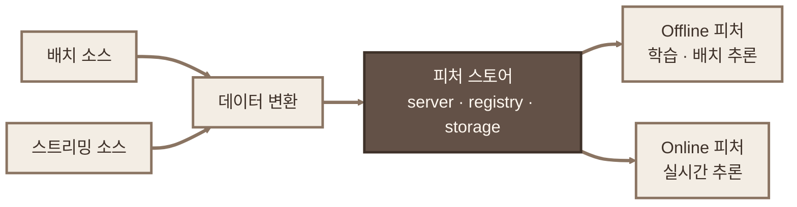
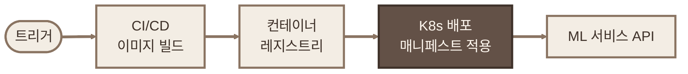

## Machine Learning Platform Engineering 스터디 - CH1

> **목표** : ML 라이프사이클 2단계, ML 엔지니어 역량, 플랫폼 구성요소 전체 그림 이해

- 원서 : Machine Learning Platform Engineering (Manning, 2026)
- 범위 : 1장 Getting started with MLOps and ML engineering

---

## 1. 개요

1장은 책 전체 지도 그리는 장. 다루는 것 4가지.

1. ML 라이프사이클
2. MLOps 필요 역량
3. ML 플랫폼 만들기
4. 3개 프로젝트 소개

---

## 2. 1장 개념 정리 - Getting started with MLOps and ML engineering

### 2-1. ML 라이프사이클

일반 SW 는 안정성 우선. ML 은 본질적으로 반복. **첫 배포로 끝나는 ML 프로젝트 없음.**

실험 단계 / 운영 단계 2개로 나뉨.

#### 2-1-1. 실험 단계

그림은 한 방향. 실제론 단계마다 루프. 학습하다 데이터 문제 보이면 준비 단계로 복귀.

**실험 단계부터 파이프라인으로 묶을 것.** 수작업 실수는 나중에 추적 불가.

**문제 정의**

- 첫 질문 : ML 꼭 필요한가? 휴리스틱으로 되면 그걸 씀
- 고차원·비선형 패턴일 때만 ML
- 비즈니스 + 기술 쪽이 같이 결정
- 예 : OCR 로 신분증 ID 번호 추출 → 부정거래 탐지

**데이터 수집·준비**

- 출처 확정. 부족하면 합성 데이터(synthetic data) 고려
- 라벨링이 제일 고됨. OCR 은 바운딩 박스 + ID 번호 수기 입력
- 마지막에 train / validation / test 분할

**데이터 버전관리**

- ML = **코드 + 데이터**. 데이터 바뀌어도 동작 바뀜
- 같은 코드 + 같은 데이터 = 같은 결과 → 재현성
- 단, 데이터는 Git 같은 표준 도구 아직 없음

**모델 학습**

- 예측값과 실제값 오차 줄이도록 가중치 튜닝
- 자동화 → 실험 병렬 실행, 파라미터·아티팩트 추적
- 학습에 시간 제일 많이 든다는 건 착각. 나머지가 더 듦

**평가 vs 검증**

- **평가(Evaluation)** : 학습 안 쓴 데이터로 지표 확인. precision, recall, AUC
- **검증(Validation)** : 비즈니스 이해관계자가 의도대로 동작하는지 승인. 보통 다른 팀

평가 = 숫자, 검증 = 업무 승인.

**보완 : 혼동 행렬(confusion matrix)과 평가 지표**

분류 모델 결과는 4칸으로 나뉨. 암 진단 모델 예시.

| 실제 \ 예측 | 암이라고 진단 (Positive) | 정상이라고 진단 (Negative) |
|---|---|---|
| 실제 암 환자 | **TP** : 암을 암이라 진단. 정답 | **FN** : 암인데 정상이라 진단. **놓침** |
| 실제 정상인 | **FP** : 정상인데 암이라 진단. **오경보** | **TN** : 정상을 정상이라 진단. 정답 |

- 읽는 법 : 앞 글자 True/False = 예측이 맞았나, 뒤 글자 Positive/Negative = 모델이 뭐라고 했나
- FN = 틀린 음성 판정 = 암 환자를 돌려보냄
- FP = 틀린 양성 판정 = 멀쩡한 사람을 암 환자로 만듦

숫자 예시 : 검진자 1,000명 중 실제 암 10명. 모델 결과 TP 8, FN 2, FP 40, TN 950.

| 지표 | 식 | 예시 값 | 뜻 |
|---|---|---|---|
| Accuracy (정확도) | (TP+TN) / 전체 | 958/1000 = 95.8% | 전체 중 맞힌 비율 |
| Precision (정밀도) | TP / (TP+FP) | 8/48 = 16.7% | 암이라고 한 사람 중 진짜 암 |
| Recall (재현율·민감도) | TP / (TP+FN) | 8/10 = 80% | 실제 암 환자 중 잡아낸 비율 |
| Specificity (특이도) | TN / (TN+FP) | 950/990 = 96% | 정상인 중 정상으로 본 비율 |
| F1 | 2·P·R / (P+R) | 약 0.28 | Precision·Recall 조화평균 |

**정확도 함정**

- 모델이 무조건 "정상"만 외쳐도 정확도 99% (990/1000)
- 그런데 암 환자 10명 전부 놓침 → Recall 0%
- 암처럼 드문 사건(불균형 데이터)에선 정확도 의미 없음 → 책이 precision, recall, AUC 를 드는 이유

**FN 사례 - 진단 과정 순서**

<!-- diagram: mlpe-ch01-07-fn-timeline.html -->

- 1~3 : 검진 → CT → AI 모델이 암 확률 0.38 출력
- **FN 발생 지점** : 임계값 0.5 기준이라 0.38 은 음성 처리. 실제로는 암
- 4~5 : 의사가 AI 음성 결과 참고 → 정밀검사 생략 → "정상" 통보
- 6~7 : 6개월 치료 공백 → 증상 발현 후 재검 → 암 3기 진행
- 8 : 사후 분석에서 FN 확인 → 선별 단계 임계값 하향 (Recall 우선)

한 번의 FN 이 실제 운영에서는 "치료 공백 6개월"로 나타남. 지표 하나가 사람 한 명의 예후임.

**왜 FN, FP 를 따로 봐야 하나**

- **FN (암인데 정상 진단)** : 치료 시기 놓침 → 병 진행, 생명 위험. 되돌릴 수 없는 비용
- **FP (정상인데 암 진단)** : 불필요한 조직검사·CT, 환자 불안, 비용. 단, 추가 검사로 바로잡을 수 있음
- 둘 다 줄이면 좋지만 보통 하나 줄이면 하나 늘어남
  - 판정 기준(임계값) 낮춤 → 조금만 의심돼도 암 판정 → Recall ↑, Precision ↓
  - 판정 기준 높임 → 확실할 때만 암 판정 → Precision ↑, Recall ↓
- 그래서 1차 선별검사 = Recall 우선 (놓치지 말 것), 확진 단계 = Precision 우선 (멀쩡한 사람 수술 막기)

어떤 실수가 더 비싼지가 지표 선택 기준. 같은 모델이라도 업무에 따라 임계값이 달라짐.

**다른 업무 예시**

- **부정거래 탐지 (책 OCR 예시)** : FN = 사기 통과 → 금전 손실, FP = 정상 고객 거래 차단 → 고객 불만
- **스팸 필터** : FP = 중요한 메일이 스팸함으로 → 더 치명적. Precision 우선
- **장애 알람** : FN = 장애 놓침, FP = 알람 피로. 운영에서 늘 겪는 trade-off 와 같음

**AUC (Area Under the ROC Curve)**

- 임계값을 0~1 로 바꿔가며 Recall(=TPR) 과 FPR(=FP/(FP+TN)) 을 찍은 곡선이 ROC
- 그 곡선 아래 면적이 AUC. 0.5 = 동전 던지기, 1.0 = 완벽 구분
- 의미 : 암 환자 1명, 정상인 1명 무작위로 뽑았을 때 모델이 암 환자에게 더 높은 점수를 줄 확률
- 임계값 정하기 전 모델 자체의 구분 능력 비교용. 실제 운영 임계값은 FN·FP 비용 보고 따로 정함

**평가 단계에서 AUC 로 모델 고르고, 검증 단계에서 업무 비용 기준으로 임계값 정함.**

#### 2-1-2. 개발/스테이징/운영 단계

관심사 전환. 탐색 → 유지·개선. 윤리, 보안, 확장성, 견고성, 실시간 성능이 중요해짐.

실험 단계와 차이 3가지

- **완전 자동화** : 반자동 → 완전 자동
- **트리거** : CI 나 프로그래밍 호출로 시작
- **배포 추가** : 결과물은 REST API. 지표 떨어지면 트리거 재발동 → 전체 반복

**모델 배포**

- 기본 : REST API → Docker → 클라우드
- 배포로 끝 아님
  - 부하 테스트
  - 오토스케일링
  - 배포 버전관리 + 롤백 전략
- 저자 의견 : 데이터 사이언티스트도 배포 참여하는 게 이득

**모델 모니터링**

실데이터 만나면 성능 떨어지는 게 보통. 운영 중 측정 필수.

| 구분 | 예시 |
|---|---|
| 시스템/운영 지표 | RPS, HTTP 상태코드 |
| ML 고유 지표 | 데이터 드리프트, 모델 드리프트 |
| 비즈니스 지표 | 이탈률, 리텐션 |

**모델 재학습**

- 언제? → 상황 따라 다름
- 핵심은 자동화. 학습만 자동이면 반쪽. 배포까지 자동이어야 함
- 트리거 2가지
  - **스케줄** : 매월 등
  - **임계치** : 대출 승인 건수 급감 등

### 2-2. MLOps 필요 역량

MLOps = **SW 엔지니어링 + DevOps + 데이터 사이언스** 교집합.

ML 엔지니어 조건 (순서 = 우선순위)

1. **괜찮은 SW 엔지니어** : 배포 경험, 디버깅, 병목 해결. 가장 밑바탕
2. **ML 이해** : 역전파 몰라도 됨. TensorFlow/PyTorch/scikit-learn 다룰 줄 알면 됨
3. **데이터 엔지니어링 감각** : 제일 어려운 건 결국 데이터 확보
4. **자동화·재현성** : 실수 감소, 반복 속도 향상. 규제·감사 대상이면 필수

**재현 가능한 결과 = 신뢰.**

한 번에 다 알 필요 없음. 코끼리는 한 입씩.

### 2-3. ML 플랫폼 만들기

ML 라이프사이클 전 단계 처리하는 도구·인프라 기반. **한 번에 다 안 만들고 필요할 때 하나씩 붙임.**

#### 2-3-1. 플랫폼 전체 구성도 (그림 1.4, 원서 mental map)

책 전체에 계속 나오는 그림. 장마다 다루는 블록 강조.

- **숫자(1~9)** : 작업 흐름 단계
- **알파벳(A~E)** : 인프라 구성요소
- 번호 순서 = 소개 순서 = 데이터 흐름

| 번호 | 단계 | 알파벳 | 인프라 |
|---|---|---|---|
| 1 | 문제 정의·설계 | A | 모델 API 서비스 |
| 2 | 모델 설계 | B | 모델 레지스트리 |
| 3 | 데이터 수집·준비 | C | 실험 추적 |
| 4 | 모델 학습 | D | 피처 스토어 |
| 5 | 평가·검증 | E | 로깅 |
| 6 | 모델 배포 | | |
| 7 | 사용자 요청 | | |
| 8 | 모니터링 | | |
| 9 | 데이터 웨어하우스 | | |

- 웨어하우스·레이크, Spark/Flink 는 **플랫폼 경계 밖**. 주변부만 다룸
- 시작 : Kubeflow 설치 → Jupyter Notebook → Kubeflow Pipelines
- 부족한 건 유스케이스 따라 추가 → 피처 스토어 없으니 Feast 붙이는 식

> 주의 : **정답 아키텍처 없음.** 처음부터 만들면 점진적으로 키울 것.

#### 2-3-2. Build vs Buy

- SageMaker, Vertex AI 쓰고 있어도 **한 번은 직접 만들어볼 것**
- 이유 : 오픈소스 조립·커스터마이징 능력은 다른 데서 안 가르침
- 직접 해봐야 도구 간 연결, 한계 돌파 지점 보임
- 완성차만 몰아본 사람 vs 엔진 분해해본 사람 차이

#### 2-3-3. MLOps → LLMOps

그림 1.5 = 전체 구성도 오른쪽에 LLMOps 블록 추가.

| 영역 | 추가 구성요소 | 장 |
|---|---|---|
| RAG | 문서 수집 → 청킹 → 임베딩 → 벡터DB(FAISS/Pinecone/Chroma) → 검색 → 증강 → 생성 | 12 |
| UI·관측 | Chainlit, Langfuse(트레이스, 프롬프트 관리, 토큰·비용 추적) | 12 |
| 안전 | 입력 가드레일(PII, 프롬프트 인젝션), 출력 가드레일(독성, 정책) | 13 |
| 테스트 | Promptfoo(탈옥, 레드티밍), DeepEval(G-Eval, 사실 일관성) | 13 |
| 비용 | 시맨틱 캐시(RedisVL), 모델 티어 라우팅, 프롬프트 최적화 | 13 |

**기본기(오케스트레이션, 배포, 모니터링)는 LLM 에도 그대로.** 새로 짜는 게 아니라 블록 추가.

도구 선택 원칙

- 추천 도구 = 출발점일 뿐
- 며칠 PoC 로 검증. 한계 미리 드러남
- 같은 목적도 유스케이스별 다른 도구 → 드리프트 감지 6장 Evidently, 11장 Deepchecks
- 기준 : 커뮤니티 탄탄 + 프로덕션 검증된 오픈소스

#### 2-3-4. 주요 도구

**Kubeflow Pipelines - 파이프라인 자동화**

- 라이프사이클 단계 1개 = 컴포넌트 1개
- 앞 컴포넌트 출력 → 다음 컴포넌트 입력

**Feast - 피처 스토어**

- 핵심은 **피처 공유**. 각자 재생성 낭비 제거
- 학습·서빙 양쪽에서 같은 피처 사용
- 입력은 이미 변환된 데이터
- 내부 구성
  - **Feature server** : REST/gRPC 제공
  - **Feature registry** : 피처 카탈로그
  - **Feature storage** : 저장 계층
- 제공 모드
  - **Offline** : 학습, 배치 추론
  - **Online** : 실시간 추론

**training-serving skew 방지가 제일 중요.**

- 학습 때와 추론 때 변환 로직 달라서 생기는 불일치
- 예 : 학습은 결측치 평균 대체, 서빙은 0 대체
- 피처 스토어가 한 곳에서 양쪽 공급 → 구조적으로 해결

**MLflow - 모델 레지스트리**

- 학습 결과물 = 모델 + 플롯 + 메타데이터 + 하이퍼파라미터. 전부 캡처해야 재현
- 실험 추적 + 레지스트리 겸용
- 대표 용도 : Staging → Production 승격
- 서비스가 레지스트리에서 직접 모델 받아 서빙도 가능

**배포 - 컨테이너 레지스트리 + CI/CD + K8s**

| 관점 | 해결 |
|---|---|
| 이식성 | 컨테이너화 |
| 확장성 | K8s 레플리카 |
| 성능 | GPU/CPU/RAM 사이징 |
| 신뢰성 | CI/CD 자동화 |

흐름 : 트리거 → 이미지 빌드 → 레지스트리 푸시 → K8s 매니페스트 적용 → 서비스 갱신

### 2-4. 3개 프로젝트

체험시키려는 것 3가지

1. **ML 은 선형 아님** : 학습 실패 → 데이터 준비 복귀. 일부러 넣어둠
2. **요구사항은 바뀜** : 도구 쓰다 한계 짚고 대안 소개하는 흐름
3. **핵심 개념은 도메인 무관** : 생략·병합은 가능해도 틀은 유지

| 프로젝트 | 데이터 | 내용 | 장 |
|---|---|---|---|
| OCR (신분증 탐지) | 이미지 | 데이터셋 구축 → 오픈소스 초기 구현 → YOLO 파인튜닝 → 배포 | 7~11 |
| 영화 추천 | 테이블 | 흐름 동일. 피처 스토어, 드리프트, 관측성 설명용 | 7~11 |
| DakkaBot (RAG) | 텍스트 | 문서 수집 → 임베딩 → RAG → 가드레일, 비용, 평가 | 12~13 |

실제 회사 시스템 축소판. 이미지 / 테이블 / LLM 으로 유형별 차이 체감.

---

## 3. 실무에서 확인

- **Build vs Buy** : 폐쇄망 온프레미스면 SageMaker, Vertex AI 선택지 없음. 직접 조립이 맞는 환경. 부록 A 는 오프라인 이미지·차트 미러링 기준으로 재작성 필요
- **멀티테넌트** : Kubeflow Profile = 네임스페이스. 사용자별 네임스페이스 운영 모델과 맞물림. 3장, 7장 이 관점으로 볼 것
- **MinIO** : 7장, 9장 저장소. 기존 오브젝트 스토리지 연결 지점 체크
- **LLMOps** : 12~13장은 Gemini API 전제. 폐쇄망은 사내 모델 서빙으로 치환. 가드레일·평가·비용 개념은 그대로 사용

> 주의 : 실습은 로컬 단일 노드(k3s/microK8s) 기준. 대규모 클러스터는 쿼터, 스토리지 클래스, 레지스트리 전제가 다름. 실습 스펙 그대로 믿지 말 것.

---

## 4. 용어 정리

- **MLOps** : ML 모델 배포·운영·개선 실무와 원칙
- **LLMOps** : MLOps 를 LLM 운영으로 확장
- **EDA(Exploratory Data Analysis)** : 분포, 이상치, 관계 먼저 훑는 탐색 분석
- **데이터 드리프트(data drift)** : 운영 입력 분포가 학습 때와 달라짐
- **모델 드리프트(model drift)** : 시간 지나며 예측 성능 저하
- **Training-serving skew** : 학습·추론 시점 피처 처리 차이로 생기는 불일치
- **피처 스토어(feature store)** : 변환된 피처 저장·카탈로그·offline/online 제공
- **모델 레지스트리(model registry)** : 모델, 메타데이터, 버전, 단계 관리 저장소
- **오케스트레이션 파이프라인** : ML 단계를 의존성 순서대로 자동 실행
- **RAG(Retrieval-Augmented Generation)** : 문서 검색 → 프롬프트 삽입 → LLM 답변

---

## 5. 한 장 요약

| 항목 | 핵심 |
|---|---|
| 라이프사이클 | 실험(문제 정의 → EDA → 준비 → 버전관리 → 학습 → 평가 → 검증) + 운영(자동 파이프라인 + 배포 + 모니터링 + 재학습) |
| 반복성 | 반복이 기본 → 처음부터 파이프라인 |
| 재현성 | ML = 코드 + 데이터. 데이터 버전관리 표준 도구 없음 |
| 모니터링 | 시스템 + ML(드리프트) + 비즈니스 지표 |
| 재학습 | 스케줄 / 임계치 트리거 자동화 |
| 역량 | SW 엔지니어 + ML 프레임워크 + 데이터 엔지니어링 + 자동화·재현성 |
| 플랫폼 | Kubeflow 시작, 하나씩 추가. 정답 없음 |
| 도구 | KFP(오케스트레이션), Feast(피처), MLflow(추적·레지스트리), CI/CD + K8s(배포) |
| LLMOps | 같은 기본기 + 벡터DB, 가드레일, 프롬프트 관리, 비용 최적화 |

**ML 은 모델이 아니라 반복되는 라이프사이클이고, 그걸 자동으로 돌리는 플랫폼을 조금씩 키우는 게 MLOps 임.**

다음 글 : 2장 What is MLOps? - MLOps 라이프사이클 세부, DevOps 와 차이, 성숙도 레벨 0~2
