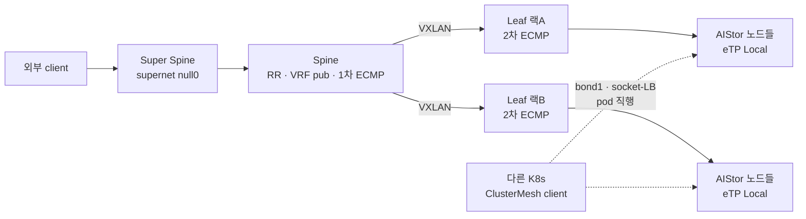
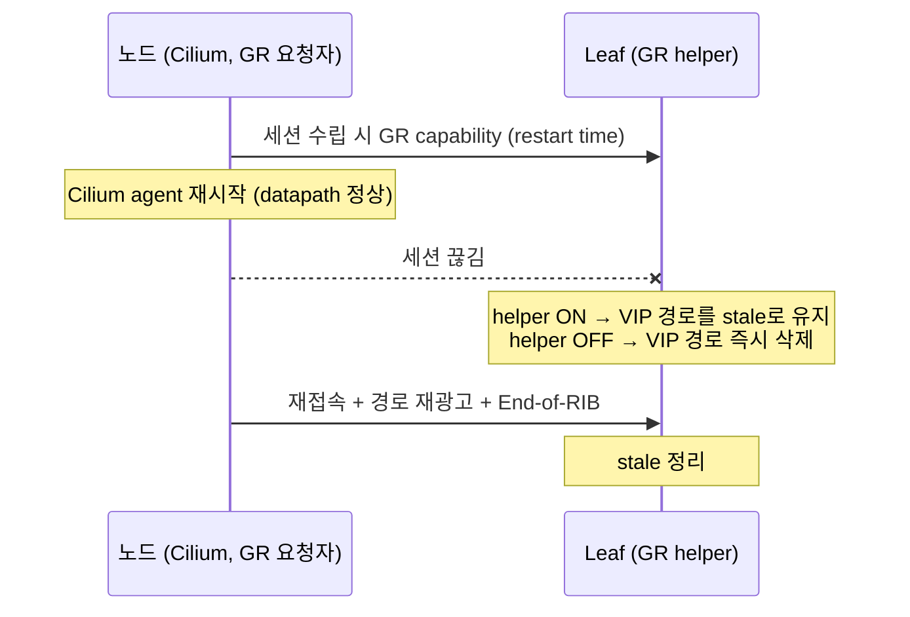

# Y1 NW 1차 검토 학습 노트

> **이 문서의 용도**
> Y지역 N/W 담당자가 보낸 1차 검토 회신(2026-11-23)을 읽고 이해하기 위한 학습 노트입니다.
> 스위치 전문가가 아닌 인프라·DevOps 엔지니어를 기준으로 썼습니다. 각 항목은 **한 줄 요약 → 동작 → Y1에서의 의미 → 확인 명령** 순서입니다.
> Notion에 가져오기(Import → Markdown)하면 제목, 표, 인용 블록, mermaid 그림이 그대로 유지됩니다.

| 표기 | 의미 |
|---|---|
| I지역 / I1 | 현행 Lake (기준 환경). 스위치 OS가 구버전 |
| Y지역 / Y1 | 신규 구축 대상. 스위치 OS가 신규 버전 |
| `ASN-F` | 스위치 fabric ASN (전체 하나) |
| `ASN-K` | K8s 노드(Cilium) ASN |
| `global-svc` | ClusterMesh global service (AIStor S3) |

---

## 0. 전체 그림



- **실선 (외부 적재):** VIP를 향합니다. 스위치가 두 번 ECMP로 나눕니다. 1차는 Spine에서 Leaf별로, 2차는 Leaf에서 노드별로 나눕니다.
- **점선 (ClusterMesh 적재):** `global-svc`를 향합니다. client 노드의 Cilium이 AIStor pod 하나를 직접 고르고 bond1로 보냅니다.
- **control plane:** 노드는 `ASN-K`로 Leaf와 eBGP를 맺습니다. 스위치끼리는 `ASN-F` 하나로 iBGP EVPN을 씁니다.

---

## 1. iBGP vs eBGP — 왜 iBGP가 "설정이 편하다"고 하나

> **한 줄 요약:** fabric 전체가 ASN 하나를 쓰면 모든 스위치 설정이 거의 같아지고 자동값(RD/RT)이 그대로 맞물립니다. eBGP-only는 스위치마다 ASN과 링크를 하나씩 따로 정해야 합니다.

| 비교 | iBGP fabric (현행) | eBGP-only |
|---|---|---|
| ASN | 전체 `ASN-F` 하나 | Spine 하나 + Leaf(쌍)마다 하나씩 할당하고 관리 |
| underlay | IGP가 이웃을 자동으로 찾음 (unnumbered도 가능) | 링크마다 P2P IP와 eBGP neighbor를 각각 설정 |
| EVPN 세션 | Leaf → Spine RR 세션 2개 (템플릿 동일) | Spine이 Leaf마다 neighbor 설정 |
| RT auto | `ASN:VNI`로 생성 → 모든 장비에서 같은 값 → 그대로 맞물림 | Leaf마다 ASN이 달라 RT가 달라짐 → `rewrite-evpn-rt-asn` 또는 수동 RT 필요 |
| Spine 추가 설정 | 없음 (RR 기본 동작) | `next-hop unchanged`, `retain route-target all` |
| vPC 쌍 | 특별한 설정 없음 | 같은 ASN 공유 시 `allowas-in`, `disable-peer-as-check` |
| 다중 경로 | `maximum-paths ibgp` | `maximum-paths` + `multipath-relax` |
| 신규 Leaf 추가 | loopback IP만 바꿔 템플릿 복사 | ASN 할당 + Spine 설정 추가 + RT 확인 |

**NW 담당자 회신의 근거가 이 표입니다.** 운영 단순성 측면에서 iBGP가 확실히 유리합니다.

eBGP-only의 장점은 다음과 같습니다(RFC 7938).
- 수천 대 규모에서 IGP의 flooding이 사라집니다.
- 장애 영향 범위를 AS 경계로 나눌 수 있습니다.

Y1 규모에서 불균형 해소를 목표로 할 때는 eBGP-only가 **필수가 아닙니다.**

**확인 명령**
```
show run bgp | include "router bgp|remote-as|maximum-paths"
show bgp l2vpn evpn summary          ! Leaf: Spine RR 세션 2개
```

---

## 2. RD / RT 자동 할당

> **한 줄 요약:** RD는 "같은 경로를 Leaf별로 구분하는 이름표"이고, RT는 "어느 VRF가 이 경로를 가져갈지 정하는 꼬리표"입니다. 둘 다 `auto`이면 신경 쓸 일이 거의 없습니다.

- **RD (Route Distinguisher)**
  - `rd auto`는 `router-id:VRF번호`로 Leaf마다 **자동으로 다르게** 만들어집니다.
  - RD가 고유하면 같은 VIP라도 Leaf-A의 경로와 Leaf-B의 경로가 **다른 경로**로 취급됩니다. 그래서 RR이 이 경로들을 하나로 줄이지 않고 모두 반사합니다.
  - 이것은 iBGP에서도 필요한 조건입니다. 그래서 "eBGP를 안 쓰면 검토 불필요"보다 **"auto라서 이미 충족"**이 정확한 표현입니다.
- **RT (Route Target)**
  - `route-target both auto evpn`은 `ASN:VNI`로 만들어집니다.
  - ASN이 하나(iBGP)이면 모든 장비의 RT가 같아 자동으로 맞습니다.

**확인 명령**
```
show run vrf pub                     ! rd auto, route-target ... auto evpn
show bgp l2vpn evpn <VIP>            ! Spine: RD가 Leaf 수만큼 서로 다르게 보이면 정상
```

---

## 3. maximum-paths 64

> **한 줄 요약:** 같은 목적지로 가는 경로를 최대 몇 개까지 ECMP로 쓸지 정하는 값입니다.

| 위치 | 의미 | Y1 조건 |
|---|---|---|
| Leaf VRF pub `maximum-paths 64` (eBGP) | 자기 랙 노드들이 광고한 VIP 경로 | 랙당 AIStor 노드 수 ≤ 64 → 충족 |
| Leaf/Spine VRF pub `maximum-paths ibgp 64` | 다른 Leaf에서 온 VIP 경로 | VIP를 가진 Leaf 수 ≤ 64 → 충족 |
| underlay(default VRF) | Spine 방향 링크 ECMP | Spine 수 이상 |

**확인 명령**
```
show run bgp | include maximum-paths
show ip route <VIP>/32 vrf pub       ! next-hop 수
```

---

## 4. ECMP 대역폭 — 노드당 100G, Uplink 400G

> **한 줄 요약:** 노드 NIC가 아니라 **랙 uplink(400G)가 먼저 병목**이 될 수 있습니다. 적재 트래픽에 EC(erasure coding) shard 트래픽까지 랙 밖으로 나가기 때문입니다.

**랙 하나의 uplink 부하 (쓰기 기준 예시)**
- 가정
  - 랙 R개, 랙당 노드 M대, 노드당 적재량 I
  - EC 12+4 (shard 16개 중 15개가 다른 노드로)
  - erasure set이 여러 랙에 고르게 걸쳐 있음
- 들어오는 적재: `M × I`
- 랙 밖에서 들어오는 shard: 약 `1.25 × M × I × (R−1)/R`
- 합계(uplink rx): R=10이면 약 **`2.1 × M × I`**

| 랙당 노드 M | 노드 NIC 합 | uplink 400G 기준 노드당 최대 적재 I | oversubscription (NIC 합 / uplink) |
|---|---|---|---|
| 8 | 800G | 약 24G | 2 : 1 |
| 10 | 1,000G | 약 19G | 2.5 : 1 |
| 12 | 1,200G | 약 16G | 3 : 1 |

- 노드 NIC 100G에 한참 못 미치는 적재량에서 uplink가 먼저 포화됩니다.
- 따라서 **Y1 처리량 목표는 "랙 수 × 400G ÷ 약 2.1"**로 계산해야 합니다. 예: 10랙이면 약 1.9Tbps.
- 수치는 EC 설정, set 구성, 읽기/쓰기 비율에 따라 달라집니다. 실제 값으로 다시 계산해야 합니다.

---

## 5. multipath-relax

> **한 줄 요약:** AS_PATH가 서로 다른 eBGP 경로를 ECMP로 묶게 하는 옵션입니다. iBGP fabric에서는 필요 없습니다.

- 노드들은 모두 `ASN-K` 하나를 씁니다. 그래서 Leaf가 받는 VIP 경로의 AS_PATH가 전부 같습니다.
- 스위치끼리는 iBGP라 AS_PATH가 바뀌지 않습니다.
- → **현행 구조에서는 불필요합니다.** eBGP-only로 가면 Leaf마다 ASN이 달라 필수가 됩니다.

---

## 6. Spine EVPN 중계 (RR)

> **한 줄 요약:** iBGP에서 Spine은 Route Reflector(RR)입니다. Leaf에게 받은 EVPN 경로를 next-hop을 바꾸지 않은 채 다른 Leaf에 그대로 반사합니다.

- eBGP-only에서 필요한 `next-hop unchanged`, `retain route-target all`은 iBGP RR에서는 **기본 동작이라 별도 설정이 필요 없습니다.**
- Y지역 Spine은 외부 진입을 겸하므로(Border 역할) VRF pub를 가지고 1차 ECMP도 수행합니다.

---

## 7. Resilient hashing

> **한 줄 요약:** ECMP 경로 하나가 빠질 때 **그 경로의 흐름만** 다른 경로로 옮기고, 나머지 흐름은 그대로 두는 해시 방식입니다.

**일반 ECMP (hash mod N)**
- 경로가 10개에서 9개로 줄면 대부분의 흐름이 다른 노드로 옮겨집니다.
- 옮겨진 노드에는 그 TCP 상태가 없어 RST가 나고, S3 업로드가 실패합니다.

**Resilient**
- 버킷을 고정해 두고, 빠진 노드의 버킷만 재배정합니다.
- 영향이 해당 노드 몫(1/N)으로 한정됩니다.

| 연결 1,000개, 노드 10대 중 1대 drain | 일반 ECMP | Resilient |
|---|---|---|
| 다른 노드로 옮겨지는 연결 | 약 900 | 약 100 (빠진 노드 것) |
| 멀쩡한 노드에 있던 연결의 RST | 약 800 | 0 |

- eTP=Local은 노드 drain이나 pod 재시작 때마다 VIP 광고가 빠집니다. 그래서 Y1에서는 **필수**입니다.
- 회신 내용: Y지역은 신규 OS라 지원하고, **I지역은 현 OS에서 미지원**입니다.

---

## 8. 계층별 해시 seed (polarization)

> **한 줄 요약:** Spine과 Leaf가 같은 해시 함수와 같은 seed를 쓰면, Spine이 Leaf-A로 보낸 흐름들이 Leaf-A 안에서 일부 노드에 몰릴 수 있습니다.

- 원리:
  1. Spine에서 Leaf-A로 가기로 결정된 흐름들은 해시값의 특정 비트 패턴을 공유합니다.
  2. Leaf-A가 같은 해시로 다시 나누면 그 패턴 때문에 일부 버킷에만 몰립니다.
- 대응: 장비 계층마다 seed(`ip load-sharing ... universal-id` 등)를 다르게 둡니다.
- 회신은 "미적용(협의 완료)"입니다. → **부하 시험에서 노드별 수신량 편차로 실제 편중 여부를 확인**하는 조건으로 수용합니다.

---

## 9. BFD

> **한 줄 요약:** 장애를 밀리초~수 초 안에 감지하는 별도 프로토콜입니다. 대신 일시적인 패킷 손실이나 CPU 부하를 장애로 **잘못 판단**할 수 있습니다.

- 회신 내용: 경험상 오탐으로 인한 장애가 더 많아 미적용입니다.
- 미적용 시 감지 방식:
  - 스위치 간 물리 장애: 인터페이스 down으로 빠르게 감지
  - 노드 세션: BGP hold timer(12초)로 감지
- RFC 7938도 BFD가 단순성 요구와 충돌할 수 있다고 언급합니다. → 합리적인 결정입니다.

---

## 10. LACP fast와 서버 본딩 방식

> **한 줄 요약:** LACP는 링크 두 개를 하나로 묶어 **둘 다 쓰는** 방식입니다. active-backup(HA)은 **하나만 쓰고 하나는 대기**하는 방식입니다.

| 항목 | 802.3ad (LACP) — I지역 현행 | active-backup (HA) |
|---|---|---|
| 사용 대역 | 링크 2개 모두 (예: 2×50G = 100G) | **링크 1개** (절반) |
| 스위치 요구 | Leaf 쌍이 vPC(또는 ESI 멀티호밍) | 일반 access 포트 |
| 송신 분산 | `xmit_hash_policy=layer3+4` (5-tuple) | 없음 |
| 장애 전환 | LACP fast = 1초 주기 LACPDU, 약 3초 감지 | miimon 기준 (보통 100ms) |
| 스위치 쪽 수신 | 양쪽 Leaf에서 바로 수신 | standby 쪽 Leaf로 온 트래픽은 **peer-link나 fabric을 돌아** active Leaf로 감 |

- **LACP rate fast:** LACPDU를 30초가 아니라 1초마다 보냅니다. 링크 이상을 약 3초 안에 감지합니다.
- **layer3+4:** 서버가 송신할 때 5-tuple로 두 링크에 나눕니다.
- **HA로 바꿀 때의 영향**
  - 노드 대역이 절반이 됩니다.
  - Spine이 standby 쪽 Leaf로 보낸 트래픽이 우회합니다.
  - bond1(EC 내부 통신)과 적재 처리량 모두에 직접 영향이 있습니다(→ 검토 결과 문서).

**확인 명령 (노드)**
```bash
cat /proc/net/bonding/bond0 | egrep "Mode|Hash|LACP rate|Slave Interface|MII Status"
```

---

## 11. MTU

> **한 줄 요약:** 패킷 하나의 최대 크기입니다. VXLAN은 헤더 약 50바이트를 덧붙이므로 fabric MTU를 서버보다 크게 둡니다.

- 일반 구성: fabric 9216, 서버 9000 이하
- 회신은 "모두 9217"입니다. NX-OS 인터페이스 MTU 상한은 보통 9216이므로 **값을 다시 확인**합니다.
- 서버(bond, Cilium MTU)는 fabric MTU에서 VXLAN 오버헤드를 뺀 값 이하여야 합니다.

```bash
ping -M do -s 8972 <다른 랙 노드 IP>     # 9000 MTU 경로 확인 (8972 + 28 = 9000)
```

---

## 12. VRF 수신 필터 vs supernet null0

> **한 줄 요약:** 두 설정은 목적이 다릅니다.
> - **null0:** "모르는 주소는 버려라"
> - **수신 필터:** "노드가 광고한 경로 중 허용된 것만 받아라"

| 구분 | supernet null0 (Super Spine) | 수신 필터 (Leaf, 노드 세션 in) |
|---|---|---|
| 막는 것 | 할당되지 않은 주소로 가는 트래픽 (블랙홀 처리, 루프 방지) | 노드가 **잘못 광고한 경로**가 fabric에 퍼지는 것 |
| 예시 | supernet 안의 미사용 IP로 가는 패킷을 버림 | 노드가 실수로 default route나 다른 팀 대역을 광고 → 차단 |
| 대체 가능? | 서로 대체 불가 | |

- I지역 Leaf에는 노드 세션에 `route-map K8S_IN in`이 이미 있습니다.
- 회신의 "VRF 수신 Filter 미적용"이 이 K8S_IN을 말하는 것인지, 다른 필터를 말하는 것인지 확인이 필요합니다.

---

## 13. uRPF

> **한 줄 요약:** 패킷의 출발지 IP가 "그 인터페이스로 돌아갈 수 있는 주소인지" 검사해 위조 패킷을 버리는 기능입니다.

- ECMP나 비대칭 경로가 있는 DC fabric에서 strict 모드를 쓰면 정상 패킷도 버릴 수 있습니다.
- 그래서 보통 fabric 내부에는 적용하지 않습니다. → **미적용이 일반적입니다.**

---

## 14. GR과 GR helper

> **한 줄 요약:**
> - **GR(재시작하는 쪽):** "나 재시작해도 내 경로 지우지 마"라고 요청합니다.
> - **GR helper(상대 쪽):** 그 요청을 받아들여 경로를 잠시 유지해 줍니다.
>
> **helper가 없으면 GR은 효과가 없습니다.**



| Leaf helper | Cilium agent 재시작 (노드 정상) | 노드 자체 다운 |
|---|---|---|
| **ON** | VIP 유지 → **무중단** | hold 12초 + restart time 동안 stale 경로로 블랙홀 |
| **OFF** | VIP가 철회되었다 다시 광고됨 → 해당 노드의 기존 연결이 다른 노드로 옮겨져 **RST** | hold 12초 후 즉시 정리 |

- 노드 ↔ Leaf 구간에서 **재시작하는 쪽은 노드(Cilium)**이고 helper는 **Leaf**입니다.
- Leaf의 helper를 끄면 Cilium의 GR 설정은 의미가 없어집니다.
- 스위치끼리의 GR(NX-OS 자체 재시작)과는 별개입니다.

**확인 명령 (Leaf)**
```
show bgp vrf pub ipv4 unicast neighbors <노드IP> | include -i graceful
```

---

## 15. RTT 측정

> **한 줄 요약:** 왕복 지연 시간입니다. 구축 후에 경로별 기준값을 측정해 두면 이후 이상 여부를 판단하는 근거가 됩니다.

측정 대상:
- 같은 랙 노드 간
- 다른 랙 노드 간 (bond1)
- 외부 client → VIP (bond0)
- ClusterMesh client → AIStor pod

---

## 16. export-gateway-ip

> **한 줄 요약:** VIP 경로의 **next-hop을 Leaf(VTEP)가 아니라 노드 단위로 광고**하게 해서, Spine이 랙별 노드 수에 비례해 분산하도록 만드는 기능입니다. 랙 간 노드 수가 다를 때 쓰는 보정 수단입니다.

| | 적용 전 | 적용 후 |
|---|---|---|
| Spine의 VIP 경로 | Leaf 수만큼 (예: 3) | 노드 수만큼 (예: 10) |
| 랙 A 6대 / B 3대 / C 1대 | 노드당 5.6% ~ 33% | 모두 10% |

- **함께 필요한 것:**
  - `maximum-paths mixed`
  - Spine과 Leaf의 `additional-paths`
  - gateway IP(노드 IP)의 경로 해석(/32 또는 Type-2)
- **제약:**
  - VIP당 노드 수가 ECMP 상한(64)을 넘으면 안 됩니다.
  - maintenance mode isolation을 쓸 수 없습니다.
  - mixed 모드는 eBGP와 iBGP 경로를 함께 ECMP로 묶으므로 **루프 검토를 다시 해야 합니다.**
- **랙별 노드 수가 같으면 효과가 없습니다.** 적용 전 상태로도 이미 균등합니다.

---

## 용어 한눈에 보기

| 용어 | 한 줄 |
|---|---|
| VTEP | VXLAN을 감싸고 푸는 출입구 (Leaf 또는 Border Spine) |
| EVPN Type-5 | VRF의 IP prefix 경로 (VIP /32 등) |
| RR | iBGP 경로를 반사하는 Spine |
| RD / RT | 경로 이름표 / VRF 꼬리표 |
| ECMP | 같은 비용의 여러 경로로 흐름 단위 분산 (5-tuple 해시) |
| eTP=Local | 받은 노드의 pod로만 전달. pod가 없는 노드는 광고 철회 |
| socket-LB | connect() 시점에 서비스 주소를 pod IP로 바꾸는 Cilium 기능 |
| GR / helper | 재시작 시 경로 유지 요청 / 그 요청을 수락하는 쪽 |
| LACP fast | 1초 주기 LACPDU |
| oversubscription | 다운링크 합 / 업링크 합 |
