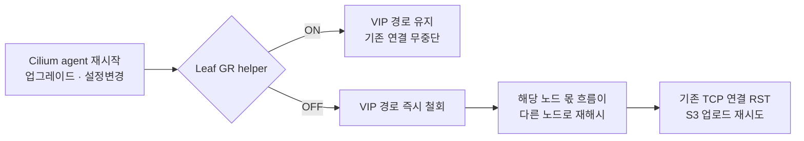

# Y1 NW 1차 검토 회신 — 검토 결과

| 항목 | 내용 |
|---|---|
| 대상 | Y지역 N/W 담당자 1차 검토 회신 (2026-11-23) |
| 목적 | 회신 내용이 Y1 목표(외부·ClusterMesh 적재 LB 불균형 해소, 장애 시 영향 최소화)에 맞는지 판정 |
| 관련 문서 | [01-study-nw-review-concepts.md](./01-study-nw-review-concepts.md) (개념) · [03-final-design-report.md](./03-final-design-report.md) (최종 설계) |

판정 기준:
- **동의:** 회신 그대로 수용
- **조건부 동의:** 수용하되 검증 조건이나 보완이 필요
- **재확인:** 값이나 범위가 불분명해 사실 확인이 필요
- **재검토 요청:** Y1 목표와 충돌할 수 있어 협의가 필요

---

## 1. 요약

| 판정 | 건수 | 항목 |
|---|---|---|
| 동의 | 9 | eBGP-only 미적용, RD, max-paths, multipath-relax, RT, Spine 중계, BFD, LACP fast, uRPF |
| 조건부 동의 | 5 | 랙 구분, resilient hashing(I지역 미지원), 해시 seed 미적용, RTT, export-gateway-ip |
| 재확인 | 3 | ECMP 대역폭(uplink 용량), MTU 9217, VRF 수신 필터 |
| **재검토 요청** | **2** | **GR helper 불필요 판단**, **서버 LACP → HA 변경** |

> **결론**
> - 스위치 쪽 회신은 대부분 타당합니다. iBGP fabric 유지 결정도 Y1 목표에 지장이 없습니다.
> - 다만 **GR helper**와 **서버 본딩 방식** 두 가지는 Y1의 적재 안정성과 처리량에 직접 영향을 줍니다. 구축 전에 확정해야 합니다.
> - 추가로 **랙 uplink(400G)가 실제 처리량 상한**이 될 수 있어, 용량 목표를 다시 계산해야 합니다.

---

## 2. 항목별 판정

| # | 항목 | NW 회신 | 판정 | 근거 / 보완 |
|---|---|---|---|---|
| 1 | 물리 서버/스토리지 랙 구분 | 진행 예정 | 조건부 동의 | 구분에 더해 **랙마다 AIStor 노드 수를 같게** 두고 자투리 랙을 만들지 않아야 함. 2단계 ECMP 불균형의 근본 해결책 |
| 2 | eBGP-only | 미적용 (iBGP가 설정 편리, 운영 불편, 루프 검토 완료) | 동의 | 단일 ASN 덕분에 RD/RT auto 정합, 템플릿 동일, Spine 추가 설정 불필요. 불균형 해소에 eBGP-only는 필수가 아님. **단, export-gateway-ip + `maximum-paths mixed` 적용 시 eBGP/iBGP 혼합 ECMP가 되므로 루프 검토를 다시 해야 함** |
| 3 | RD | 검토 불필요 (자동) | 동의 (근거 보완) | 고유 RD는 iBGP RR 환경에서도 필요한 조건(Leaf별 경로 보존). `rd auto`로 이미 충족됨 |
| 4 | max paths | 64 적용 중 | 동의 | eBGP(노드 → Leaf)와 iBGP(Leaf 간) **양쪽 모두 64**인지 한 번 더 확인 |
| 5 | ECMP H/W 대역폭 | 노드당 100G, uplink 400G | 재확인 | §3.1 참고. EC shard 트래픽까지 포함하면 **uplink가 노드 NIC보다 먼저 포화**됨. "노드당 100G"가 2×50G(LACP)인지 단일 100G인지 확인 필요 |
| 6 | multipath-relax | eBGP 미적용 시 불필요 | 동의 | 노드가 모두 같은 ASN이고 fabric이 iBGP라 AS_PATH가 같음 |
| 7 | RT | 미사용 시 불필요 (자동) | 동의 | `ASN:VNI` 자동값이 모든 장비에서 같음 |
| 8 | Spine EVPN 중계 | 미적용 시 불필요 | 동의 | iBGP RR은 next-hop 유지와 전체 경로 반사가 기본 동작 |
| 9 | resilient hashing | 적용 예정 (I지역 OS 미지원, Y지역 신규 OS 지원) | 조건부 동의 | Y1은 지원 → **필수 적용**. I지역은 미지원 리스크가 남으므로 운영 절차로 보완(§3.4) |
| 10 | 계층별 해시 seed | 미적용 (협의 완료) | 조건부 동의 | polarization 가능성은 이론적으로 있음. **부하 시험 합격 기준**(노드별 수신량 max/min ≤ 1.2)을 넘으면 재협의 |
| 11 | BFD | 미적용 (오탐 장애 경험) | 동의 | 물리 장애는 인터페이스 down으로 감지, 노드 세션은 hold 12초. RFC 7938도 BFD의 복잡도 증가를 언급 |
| 12 | Port-Channel LACP | fast 적용 예정 | 동의 | **#19 서버 HA 변경과 충돌함.** 서버가 active-backup이면 스위치 LACP 설정은 의미가 없음 |
| 13 | MTU | 모두 9217 | 재확인 | NX-OS 인터페이스 MTU 상한은 보통 9216. 오기인지 확인. 서버 MTU(9000 이하)와 VXLAN 오버헤드 정합 확인 |
| 14 | VRF 수신 Filter | 미적용 (Super Spine supernet null0) | 재확인 | null0는 **미할당 주소 블랙홀 처리**이고, 수신 필터는 **노드의 잘못된 광고 차단**이라 서로 대체할 수 없음. I지역 Leaf의 `K8S_IN`을 Y1에서도 유지하는지 확인 |
| 15 | uRPF | 미적용 | 동의 | ECMP fabric에서 strict 모드는 정상 패킷을 버릴 위험이 있음 |
| 16 | **GR helper** | **GR 적용, helper 불필요** | **재검토 요청** | §3.2 참고. 노드(Cilium) ↔ Leaf 구간에서 **helper가 없으면 Cilium GR이 동작하지 않음** |
| 17 | RTT | 구성 후 측정 | 조건부 동의 | 측정 경로와 기준값 정의 필요 (최종 설계 §6) |
| 18 | export-gateway-ip | 적용 예정 | 조건부 동의 | §3.3 참고. 랙 균등 배치가 되면 효과가 없음. 적용한다면 mixed, add-path, gateway 해석, ECMP ≤ 64, 루프 재검토가 전제 |
| 19 | **서버 LACP → HA** | **서버 담당자가 HA로 변경 예정이라 함 (기존 OS는 LACP layer3+4)** | **재검토 요청** | §3.5 참고. 대역 절반, Leaf 간 우회 트래픽 발생. 변경 이유 확인 필요 |

---

## 3. 상세 검토

### 3.1 ECMP 대역폭 — uplink가 실제 상한 (#5)

**가정**
- 랙 R = 10, 랙당 노드 M = 10
- EC 12+4, erasure set이 여러 랙에 걸쳐 있음
- 쓰기 위주 적재

| 흐름 | 랙 uplink 수신량 |
|---|---|
| 외부 / ClusterMesh 적재 | `M × I` |
| 다른 랙에서 오는 EC shard | 약 `1.25 × M × I × 0.9` |
| **합계** | **약 `2.1 × M × I`** |

**계산 결과**
- uplink 400G 기준 노드당 적재 상한은 `I ≈ 400 ÷ (2.1 × 10) ≈ 19G`입니다. 노드 NIC 100G의 약 1/5입니다.
- Y1 전체 적재 상한은 `랙 수 × 400G ÷ 2.1`이고, 10랙 기준 약 **1.9Tbps**입니다.

**요청**
- "노드당 100G"의 구성(2×50G LACP인지 단일 100G인지)을 확인해 주십시오.
- 랙당 노드 수와 erasure set 배치(랙 경계)를 확정한 뒤 uplink를 증설할지 판단해야 합니다.

### 3.2 GR helper (#16) — 재검토 요청

- 노드 ↔ Leaf 세션에서 GR을 **요청하는 쪽은 노드(Cilium)**이고, **받아 주는 쪽(helper)은 Leaf**입니다.
- helper를 끄면 Cilium agent를 재시작할 때마다 그 노드의 VIP가 빠졌다 다시 들어옵니다.
  - resilient hashing이 있어도 **그 노드로 가던 기존 연결은 다른 노드로 옮겨져 끊깁니다.**
  - pod는 정상인데도 연결이 끊기는 셈입니다.
- 반대로 helper를 켜면 **노드가 실제로 죽었을 때** 문제가 생깁니다. Leaf가 restart time 동안 stale 경로를 유지해 블랙홀 시간이 늘어납니다.

**선택지**
| 방안 | 내용 | 조건 |
|---|---|---|
| A (권장) | Leaf helper ON + Cilium `restartTimeSeconds`를 **agent 재시작 실측값보다 약간 크게** (예: 실측 20초면 30초) | 노드 다운 시 블랙홀 최대 hold 12초 + 30초 |
| B | helper OFF 유지 + Cilium agent 재시작은 **항상 drain 절차로만** 수행 (BGP 라벨 off → 철회 확인 → 재시작) | 계획되지 않은 agent 재시작(크래시)은 연결 끊김을 감수 |

**확인 요청**
- NX-OS에서 helper가 실제로 꺼져 있는지 확인해 주십시오(`show bgp vrf pub ipv4 unicast neighbors <노드IP> | include -i graceful`). 기본값은 켜져 있는 경우가 많습니다.
- A와 B 중 어느 운영 방식을 쓸지 정해 주십시오.

### 3.3 export-gateway-ip (#18)

| 조건 | 확인 내용 |
|---|---|
| 효과 범위 | 랙 간 노드 수가 다를 때만 효과가 있음. **#1 랙 균등 배치가 되면 불필요** |
| 동반 설정 | Leaf/Spine의 `maximum-paths mixed`, `additional-paths send/receive` + `set path-selection all advertise` |
| gateway 해석 | 노드 IP(/32 또는 Type-2)를 Spine이 해석해야 함. 노드 대역 `/23 redistribute direct`와 **해석 루프** 위험 검토 |
| ECMP 상한 | Spine의 VIP당 경로 = 전체 AIStor 노드 수. **64를 넘으면 초과분은 분산에서 빠짐** |
| 운영 | maintenance mode isolation을 쓸 수 없음 → 점검 절차 변경 |
| 루프 | mixed는 eBGP/iBGP 경로를 함께 ECMP로 묶음 → #2의 "루프 검토 완료"를 이 구성 기준으로 다시 확인 |

**제안:** 랙 균등 배치를 먼저 하고, 부하 시험에서 랙 간 편차가 기준을 넘을 때만 적용합니다.

### 3.4 Resilient hashing — I지역 미지원 리스크 (#9)

- I지역에서는 노드 drain이나 pod 재시작 때 **다른 노드의 연결까지 끊길 수 있습니다.** 노드 수가 많을수록 영향이 커집니다.
- **I지역 운영 보완**
  - 노드 작업은 적재 비수기에 합니다.
  - 작업은 BGP 라벨 off → 철회 확인 → 작업 순서로 진행합니다. 다만 철회 순간의 재해시는 피할 수 없습니다.
  - client의 S3 재시도 설정을 확인합니다.
- **근본 해결:** I지역 스위치 OS 업그레이드 계획에 반영합니다.

### 3.5 서버 본딩 LACP → HA(active-backup) 변경 (#19) — 재검토 요청

| 영향 | LACP (현행 layer3+4) | active-backup |
|---|---|---|
| 노드 가용 대역 | 링크 2개 합 | **링크 1개 (절반)** |
| bond1 EC 내부 통신 | 링크 2개로 분산 | 링크 1개에 집중 → ClusterMesh ETL과 경합이 더 심해짐 |
| 스위치 수신 경로 | 양쪽 Leaf에서 바로 전달 | standby 쪽 Leaf로 온 트래픽은 **peer-link나 fabric 우회** → peer-link 병목 가능 |
| #12 LACP fast | 의미 있음 | 의미 없음 |

**변경 이유로 추정되는 것**
- Y1 Leaf 쌍이 **vPC를 쓰지 않는** 설계일 수 있습니다. 이 경우 두 스위치에 걸친 LACP를 구성할 수 없습니다.
- 스위치 점검 시 LACP 재협상 문제를 겪은 경험이 있을 수 있습니다.
- 서버마다 port-channel을 설정해야 하는 운영 부담 때문일 수 있습니다.

**요청**
1. 서버 담당자에게 HA로 바꾸는 이유와 정확한 모드(active-backup인지 다른 모드인지)를 확인해 주십시오.
2. NW 담당자에게 Y1 Leaf 쌍이 vPC 또는 ESI 멀티호밍을 지원하는지 확인해 주십시오. ESI 멀티호밍이면 vPC 없이도 LACP를 쓸 수 있습니다.
3. 대역 절반을 감수한다면 §3.1 용량 계산을 그 기준으로 다시 해야 합니다.

**권장:** 802.3ad LACP, `xmit_hash_policy=layer3+4`, `lacp_rate=fast`를 유지합니다. 스위치 쪽은 vPC 또는 ESI 멀티호밍으로 구성합니다.

---

## 4. 후속 질문 목록

**N/W 담당자**
1. GR helper가 실제로 꺼져 있나요? 운영 방식 A와 B 중 무엇으로 할까요? (§3.2)
2. MTU 9217이 맞나요, 9216의 오기인가요?
3. "VRF 수신 Filter 미적용"이 노드 세션 `K8S_IN`을 말하는 건가요? Y1에서도 VIP pool /32 허용 + maximum-prefix를 유지하나요?
4. export-gateway-ip를 적용한다면 mixed, add-path, gateway 해석, ECMP 64 초과, maintenance mode 대응은 어떻게 하나요? 루프 재검토도 하나요? (§3.3)
5. Y1 Leaf 쌍이 vPC 또는 ESI 멀티호밍을 지원하나요? (§3.5)
6. uplink 400G는 Leaf 한 대 기준인가요, Leaf 쌍 기준인가요?
7. `maximum-paths ibgp`도 64인가요?

**서버 담당자**
1. LACP에서 HA로 바꾸는 이유와 모드는 무엇인가요?
2. "노드당 100G"는 NIC 구성상 어떤 것인가요? (2×50G인지 2×100G인지 등)
3. 랙당 AIStor 노드 수 M과 랙 수 R을 확정했나요? 자투리 랙은 없나요?
