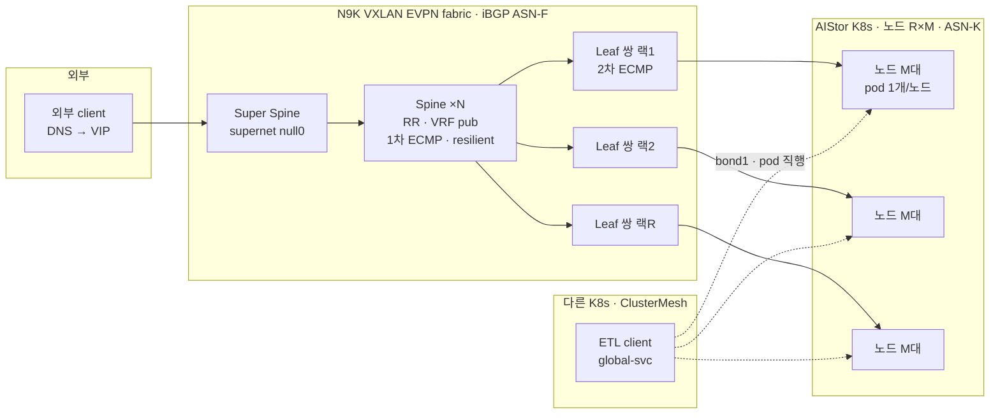

# Y1 AI DATAPLATFORM — K8s·Switch 네트워크 최종 설계 보고서 (1차 검토 반영)

| 항목 | 내용 |
|---|---|
| 버전 | v1.0 (Y지역 N/W 1차 검토 회신 반영, 2026-11-23) |
| 범위 | AIStor(Storage) K8s 적재 경로: 외부 client → VIP, ClusterMesh client → `global-svc` |
| 기준 환경 | I지역(I1) 현행 설정 |
| 관련 문서 | [01 학습 노트](./01-study-nw-review-concepts.md) · [02 검토 결과](./02-review-result.md) |

> 이 문서는 이전 Y1 제안서(`../y1-ai-dataplatform-proposal-*.md`)의 네트워크 부분을 **대체**합니다. 주요 변경점은 다음과 같습니다.
> - **LB 방식:** 이전에는 Maglev/DSR/eTP=Cluster였으나, 이 문서에서는 eTP=Local과 스위치 ECMP를 씁니다.
> - **fabric BGP:** 이전 제안은 eBGP-only였으나, 이 문서에서는 iBGP fabric을 유지합니다.

---

## 1. 요약

**목표**
- 외부와 ClusterMesh 양쪽 적재 경로에서 **AIStor 노드 간 부하를 균등하게** 만듭니다.
- 노드 장애나 작업이 생겨도 **영향을 그 노드 몫으로 한정**합니다.

**핵심 결정**
| # | 결정 | 상태 |
|---|---|---|
| D1 | **랙(Leaf 쌍)마다 AIStor 노드 수를 같게(M대)** 두고, 증설은 랙 단위로, 자투리 랙 없음 | 확정 (서버, NW 진행 예정) |
| D2 | fabric은 **iBGP + EVPN 유지** (단일 `ASN-F`, Spine RR, RD/RT auto) | 확정 |
| D3 | AIStor VIP는 **eTP=Local + 스위치 ECMP**로 처리. eTP=Cluster, DSR, Maglev는 쓰지 않음 | 확정 |
| D4 | `maximum-paths 64` (eBGP / iBGP), 5-tuple 해시 | 확정 |
| D5 | **resilient hashing** 적용 (Y지역 신규 OS) | 확정 |
| D6 | ClusterMesh 적재는 `global-svc`(socket-LB, bond1). Ingress는 쓰지 않음 | 확정 |
| D7 | BFD, uRPF, 계층별 해시 seed는 쓰지 않음 (seed는 부하 시험 결과에 따라 재협의) | 확정 (조건부) |
| D8 | export-gateway-ip는 **랙 균등이 어려울 때만** 쓰는 보완책 | 조건부 |
| D9 | GR helper 운영 방식 | **미결** (§4.7) |
| D10 | 서버 본딩 방식 (LACP 또는 HA) | **미결** (§4.9) |

---

## 2. 목표 구조



**경로별 분산 주체**
| 경로 | 분산 주체 | 분산 단위 | 균등 조건 |
|---|---|---|---|
| A. 외부 → VIP (bond0) | Spine ECMP → Leaf ECMP | Leaf별 → 노드별 | **랙별 노드 수 동일 (D1)** + 충분한 동시 연결 |
| B. ClusterMesh → `global-svc` (bond1) | client 노드 Cilium socket-LB | pod별 (연결마다) | backend 수 = pod 수 + 충분한 동시 연결 |

랙별 노드 수가 같으면, 경로 A에서 노드 하나가 받는 몫은 `1/R × 1/M = 1/전체 노드 수`로 균등해집니다.

---

## 3. I지역 현행 대비 Y1 변경

| 항목 | I지역 현행 | Y1 | 비고 |
|---|---|---|---|
| 랙 배치 | 불균등 (추정) | **랙당 M대 동일** | 경로 A 불균형 해소 |
| fabric BGP | iBGP EVPN | 동일 | |
| 노드 세션 | 동적 peer /23, lo5, multihop 3, timers 4/12 | 동일 + **노드는 Leaf 쌍 두 대 모두와 peer** | lo5가 Leaf마다 고유한지 확인 |
| `bestpath igp-metric ignore` | 적용 | 유지 | DC 구간 거리 차이로 Leaf가 빠지는 것 방지 |
| `local-as` (fabric ASN과 같은 값) | 있음 (효과 없음) | 제거 | |
| 노드 세션 수신 필터 | `K8S_IN` | 유지: VIP pool /32 + maximum-prefix | 검토 결과 #14 확인 |
| resilient hashing | 미지원 (OS) | **적용** | |
| ECMP 해시 | 5-tuple | 동일 | |
| LACP | 서버 layer3+4 | 서버 LACP fast + layer3+4 권장 | 서버 HA 변경 협의 (§4.9) |
| MTU | — | fabric 9216(확인), 서버 ≤ 9000 | 검토 결과 #13 |

---

## 4. 상세 설계

### 4.1 물리 배치 (D1)
- **DC 구간 분리:** 역할별로 Compute, GPU, Storage 구간을 나눕니다.
- **Storage 랙:** 랙 R개 × 랙당 AIStor 노드 M대로 둡니다. 전체 노드 수는 R × M으로 나누어떨어져야 합니다.
- **증설:** 랙 단위(M대)로만 합니다. 부분 증설은 하지 않습니다.
- **라벨:** 노드에 `rack=<id>` 라벨을 붙입니다. 이후 Cilium BGP 설정과 erasure set 배치에서 사용합니다.
- **자투리 랙이 불가피할 때:** 그 랙의 노드는 VIP 광고에서 빼고(BGP 라벨 off) ClusterMesh 전용으로 씁니다.

### 4.2 Fabric (D2)
- 전체가 `ASN-F` 하나를 쓰고, Spine이 RR입니다. Leaf는 Spine RR과 EVPN 세션을 맺습니다.
- VRF는 `pub`(bond0 / VIP)과 `private`(bond1 / PodCIDR)로 나눕니다.
- RD/RT는 `rd auto`와 `route-target both auto evpn`을 씁니다.
- Super Spine에 supernet null0를 둡니다. 미할당 주소는 블랙홀로 처리합니다.
- 외부 진입은 Spine(Border 역할)입니다. Spine에 VRF pub와 VTEP이 있는지 확인합니다.

### 4.3 노드 BGP (Cilium ↔ Leaf)
| 항목 | Leaf | Cilium | 값 |
|---|---|---|---|
| ASN | `remote-as ASN-K` | `localASN` | `ASN-K` |
| 상대 ASN | `router bgp ASN-F` | `peerASN` | `ASN-F` |
| 상대 주소 | `neighbor <node-pub-subnet>/23` (동적) | `peerAddress` = Leaf lo5 (Leaf 쌍 **2개 모두**) | |
| 출발지 | `update-source loopback5` | 출발지 = bond0 IP (lo5까지 경로는 bond0로) | |
| multihop | `ebgp-multihop 3` | `ebgpMultihop: 3` | |
| timers | `timers 4 12` | `keepAliveTimeSeconds: 4`, `holdTimeSeconds: 12` | |
| GR | helper (§4.7) | `gracefulRestart.restartTimeSeconds` | 실측값보다 약간 크게 |
| 광고 | `K8S_IN` (VIP pool /32 허용) | `CiliumBGPAdvertisement` Service LoadBalancerIP | eTP=Local 서비스만 |
| 수신 | `K8S_OUT` (deny 또는 default) | — | Cilium은 받은 경로를 노드 커널에 넣지 않음 |

### 4.4 서비스 LB (D3, D6)
**AIStor S3 API**
- Service는 `type=LoadBalancer`, `externalTrafficPolicy=Local`입니다.
- VIP는 CiliumLoadBalancerIPPool에서 할당받습니다.
- DNS는 `s3.<domain>`을 VIP로 직접 가리킵니다. virtual-host 방식을 쓰면 `*.s3.<domain>`도 VIP로 등록합니다.

**쓰지 않는 것과 그 이유**
| 기능 | 이유 |
|---|---|
| eTP=Cluster | 노드 간 추가 hop과 SNAT가 생깁니다. 스위치 ECMP가 이미 노드 단위로 나눕니다 |
| DSR | 중계 노드가 없어 응답 경로 문제가 없습니다 |
| Maglev | 노드가 backend를 고를 일이 없습니다. 같은 역할을 스위치 resilient hashing이 합니다 |
| Ingress (S3 경로) | L7 hop이 추가되고 controller pod가 새로운 병목이 됩니다 |

**내부 client와 ClusterMesh client**
- 접속 대상은 `global-svc` / ClusterIP입니다. VIP를 쓰지 않습니다.
- socket-LB(KPR)가 켜져 있어야 합니다.
- `ipv4NativeRoutingCIDR`가 AIStor 클러스터의 PodCIDR을 포함해야 합니다.

### 4.5 ECMP와 해시 (D4, D5, D7, D8)
| 항목 | 값 |
|---|---|
| `maximum-paths` | eBGP 64 / iBGP 64 |
| `bestpath igp-metric ignore` | 적용 |
| 해시 | 5-tuple (src/dst IP, src/dst port, proto) |
| resilient hashing | Spine과 Leaf **모두** 적용 |
| 계층별 seed | 미적용. 부하 시험 T3에서 편중이 기준을 넘으면 재협의 |
| export-gateway-ip | 기본은 미적용. T3에서 **랙 간** 편차가 기준을 넘을 때만 적용 (mixed, add-path, gateway 해석, ECMP ≤ 64, 루프 재검토가 전제) |

### 4.6 장애 감지와 장애 창 최소화
| 장애 유형 | 감지 | 목표 장애 창 | 설계 |
|---|---|---|---|
| pod 프로세스 종료 | kubelet | 수 초 | 기본 동작 |
| pod hang | readinessProbe | **약 4초** | `periodSeconds: 2`, `failureThreshold: 2` |
| 계획 작업 (drain, upgrade) | 사전 철회 | **0** | BGP 라벨 off → 경로 철회 확인 → 작업. pod는 `preStop`으로 대기 |
| 노드 다운 | hold 12초 (+ GR stale) | 12초 + α | BFD 미적용(D7). helper 방식에 따라 α가 정해짐 (§4.7) |
| 스위치 링크 장애 | 인터페이스 down | 1초 미만 | LACP fast, ECMP 재계산 |

모든 경우에 resilient hashing으로 **다른 노드의 연결은 유지**됩니다.

### 4.7 GR helper (D9 — 미결)
| 방안 | 내용 | Cilium agent 재시작 | 노드 다운 |
|---|---|---|---|
| **A (권장)** | Leaf helper ON, Cilium `restartTimeSeconds` = 실측값 + 여유 | 무중단 | 블랙홀 최대 12초 + restart time |
| B | helper OFF, agent 재시작은 drain 절차로만 | 계획 작업은 무중단, 크래시 시 해당 노드 연결 끊김 | 12초 |

**결정에 필요한 입력**
- Cilium agent 재시작부터 BGP Established까지의 실측 시간
- NW 쪽 helper의 현재 상태

### 4.8 ClusterMesh ETL 경로와 bond1 부하
- ETL이 `global-svc`를 쓰면 **적재 트래픽이 bond1로 들어와 EC 내부 통신과 같은 링크를 씁니다.**
- 예시(EC 12+4)로 보면 bond1 rx가 약 1.25 I에서 2.25 I로 늘어납니다.

| 단계 | 조치 |
|---|---|
| 1 | I지역 ETL 시간대에 노드별 bond1 rx/tx 사용률과 drop을 실측합니다 (70% 이상 지속 시 조치) |
| 2 | 여유가 부족하면 대량 ETL은 **PUBLIC VIP(bond0) 경로로 전환**하는 것을 검토합니다. 랙 균등 배치(D1) 덕분에 이 경로도 균등합니다. VRF 간 경로 설계가 필요합니다 |
| 3 | 보조 수단으로 ETL pod의 egress 대역폭을 제한합니다 (Cilium Bandwidth Manager) |
| 4 | Y1 하드웨어에 내부 통신 대역 확보를 반영합니다. 예: bond1 증속, 또는 AIStor 노드 간 통신 분리 지원 여부 확인 |

### 4.9 서버 NIC 본딩 (D10 — 미결)
- **권장:** 802.3ad LACP, `xmit_hash_policy=layer3+4`, `lacp_rate=fast`
  - 스위치 쪽은 vPC 또는 EVPN ESI 멀티호밍으로 구성합니다.
- **active-backup(HA)으로 바꿀 경우의 영향**
  - 노드 대역이 절반이 됩니다.
  - standby 쪽 Leaf로 들어온 트래픽이 우회해서 peer-link나 fabric 부하가 생깁니다.
  - bond1의 EC 트래픽 여유가 줄어듭니다.
  - 그래서 §4.10 용량 계산을 다시 해야 합니다.
- **결정에 필요한 입력**
  - 서버 측에서 HA로 바꾸려는 이유
  - Y1 Leaf 쌍의 vPC / ESI 지원 여부

### 4.10 용량 (uplink 기준)
**계산식 (쓰기, EC 12+4, erasure set이 여러 랙에 걸친 경우)**
- 랙 uplink 수신량 ≈ `M × I × (1 + 1.25 × (R−1)/R)` ≈ **2.1 × M × I** (R = 10일 때)

| 구성 (uplink 400G) | 노드당 적재 상한 I | 전체 적재 상한 (R = 10) |
|---|---|---|
| M = 8 | 약 24G | 약 1.9Tbps |
| M = 10 | 약 19G | 약 1.9Tbps |
| M = 12 | 약 16G | 약 1.9Tbps |

- 전체 상한은 M과 거의 상관없이 **랙 수 × uplink**로 정해집니다.
- 목표 처리량이 이보다 크면 랙 수를 늘리거나 uplink를 증설해야 합니다.
- 노드 NIC가 100G여도 uplink가 먼저 포화됩니다.
- 이 수치는 EC 설정, set 배치, 읽기/쓰기 비율의 실제 값으로 확정해야 합니다.

---

## 5. 설정 기준값 (요약)

```
! Leaf — VRF pub (I지역 기준, Y1 변경점 표시)
router bgp ASN-F
  vrf pub
    bestpath igp-metric ignore
    log-neighbor-changes
    address-family ipv4 unicast
      advertise l2vpn evpn
      redistribute direct route-map <redist-subnet>
      maximum-paths 64
      maximum-paths ibgp 64                 ! Y1: 값 명시
    neighbor <node-pub-subnet>/23
      remote-as ASN-K
      ! local-as 제거                        ! Y1
      update-source loopback5               ! Y1: Leaf별 고유 IP
      ebgp-multihop 3
      timers 4 12
      address-family ipv4 unicast
        route-map K8S_IN in                 ! VIP pool /32 + maximum-prefix
        route-map K8S_OUT out               ! deny 또는 default
! + resilient hashing (Y지역 OS, Spine·Leaf)  ! Y1
```

```yaml
# Cilium — pub instance (요약)
localASN: ASN-K
peers: [Leaf-A lo5, Leaf-B lo5]   # peerASN: ASN-F
peerConfig:
  ebgpMultihop: 3
  timers: { keepAliveTimeSeconds: 4, holdTimeSeconds: 12 }
  gracefulRestart: { enabled: true, restartTimeSeconds: <실측 + 여유> }
advertisement: Service LoadBalancerIP (eTP=Local, AIStor)
```

---

## 6. 검증 계획과 합격 기준

| ID | 시험 | 방법 | 합격 기준 |
|---|---|---|---|
| T1 | 경로 정합 | Spine: `show ip route <VIP>/32 vrf pub` / Leaf: 같은 명령 | Spine next-hop 수 = Leaf(VTEP) 수, Leaf next-hop 수 = 랙 노드 수 |
| T2 | 노드 세션 | `cilium bgp peers`, Leaf `summary` | 노드당 세션 2개 (Leaf 쌍), Established, 4/12 |
| T3 | **부하 균등** | 외부와 ClusterMesh 각각 병렬 S3 부하 (동시 연결 ≥ 노드 수 × 4) | 노드별 수신량 **max/min ≤ 1.2** |
| T4 | 노드 drain | 부하 중 노드 1대 drain | 다른 노드의 연결 RST 0 (resilient), 적재 실패는 해당 노드 몫 이하 |
| T5 | pod 장애 | 부하 중 pod kill / hang 주입 | 장애 창이 목표 이하 (종료: 수 초, hang: 약 4초) |
| T6 | agent 재시작 | 부하 중 Cilium agent 재시작 | 방안 A: VIP 유지, 연결 무중단 / 방안 B: drain 절차로 무중단 |
| T7 | 노드 다운 | 부하 중 노드 전원 차단 | 경로 정리 12초 + α 이내, 다른 노드 영향 없음 |
| T8 | MTU | `ping -M do -s 8972` (랙 간, VIP 경로) | 단편화 없음 |
| T9 | RTT 기준값 | 같은 랙, 다른 랙, 외부 → VIP, ClusterMesh → pod | 기준값 기록 (이후 이상 감지용) |
| T10 | bond1 여유 | ETL 피크 시 bond1 사용률과 drop | 지속 사용률 < 70%, drop 0 |
| T11 | uplink | T3 중 랙 uplink 사용률 | 목표 처리량에서 < 80% |

---

## 7. 미결 사항과 담당

| ID | 내용 | 담당 | 관련 |
|---|---|---|---|
| O1 | GR helper 운영 방식 (A / B) | NW + DevOps | §4.7 |
| O2 | 서버 본딩 방식 (LACP / HA), Leaf vPC/ESI 지원 여부 | 서버 + NW | §4.9 |
| O3 | 랙 수 R, 랙당 노드 수 M 확정, 자투리 랙 여부 | 서버 | §4.1 |
| O4 | "노드당 100G" NIC 구성, uplink 400G 기준(Leaf / 쌍) | 서버 + NW | §4.10 |
| O5 | MTU 9217 값 확인 | NW | 검토 결과 #13 |
| O6 | 노드 세션 수신 필터(`K8S_IN`) Y1 유지 여부 | NW | 검토 결과 #14 |
| O7 | Leaf lo5 고유 IP 여부, 노드 peer 2개 구성 | NW + DevOps | §4.3 |
| O8 | ETL 경로 (`global-svc` 유지 / VIP 전환) | DevOps + 고객 | §4.8 |
| O9 | export-gateway-ip 적용 여부 (T3 결과 기준) | NW | §4.5 |
| O10 | AIStor EC 설정과 erasure set 랙 배치 | DevOps | §4.10 |

## 8. 리스크

| 리스크 | 영향 | 대응 |
|---|---|---|
| 자투리 랙 발생 | 해당 랙 노드에 몇 배 부하 | VIP 광고 제외 또는 재배치 |
| 서버 HA 전환 | 대역 절반, 우회 트래픽 | O2에서 LACP 유지 협의 |
| GR helper OFF + agent 크래시 | 해당 노드 연결 끊김 | 방안 A, 또는 drain 절차 |
| uplink 포화 | 전체 처리량 상한 | 랙 수 또는 uplink 증설 |
| 해시 polarization | Leaf 안 노드 간 편중 | T3 결과로 seed 재협의 |
| I지역 resilient 미지원 | 작업 시 대량 RST | 비수기 작업, OS 업그레이드 계획 |
