# Y1 AI DATAPLATFORM 인프라 아키텍처 설계 제안서

| 항목 | 내용 |
|---|---|
| 문서 | 상세 제안서 v1.0 |
| 제안 | DevOps 파트 (인프라 · 스위치 설정 최적화) |
| 대상 | Y1 AI DATAPLATFORM : Compute K8s · GPU · Storage(AIStor) K8s |
| 기준 | RHEL 10.x · K8s 1.37 · Cilium 1.20 · Cisco N9K VXLAN EVPN · 100G · bond 802.3ad |
| 함께 보는 문서 | 요약 제안서 |

> 표기 : R = Storage 랙 수, M = Storage 랙당 서버 수, N = Compute 랙당 서버 수, V = Storage VTEP 수 (R × 2)
> 구간 : **DCNY01** = Compute K8s, **DCNY02** = GPU, **DCNY03** = Storage(AIStor) K8s
> 판단 : **개선** = I Lake 대비 변경 제안 / **유지** = I Lake 설계 그대로 / **협의** = 값 확인 · 의사결정 후 확정
> 그림 : 오렌지 = 쏠림 · 위험, 그린 = 개선 · 권장, 머스터드 = 핵심, 먹색 = 장비 · 일반

---

## 1. 제안 개요

> **I Lake 1차 설계의 골격(EVPN 패브릭 · BGP native routing · netkit · ClusterMesh)은 그대로 이어받고, 운영 중 확인된 AIStor 분산 편차를 배치 · 패브릭 · L4 LB · 노드 4개 층에서 해소한다.**

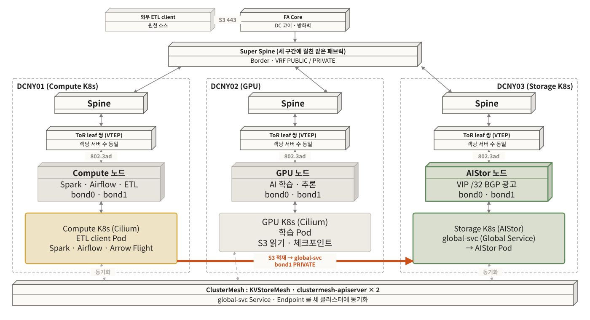

### 1-1. 배경

- I Lake 는 VXLAN EVPN 패브릭 위에 Cilium BGP native routing · netkit · ClusterMesh 를 적용한 1차 설계로 안정 운영 중
- 운영 중 AIStor(S3) 요청이 일부 노드 · Pod 에 몰리는 현상이 관찰됨 (iBGP · eBGP 구간 경로 선택, Service 정책 영향)
- 1차에서 igp-metric ignore 를 적용해 패브릭 단의 일부를 이미 개선
- Y1 은 신규 구축 → 운영 중 변경이 어려운 항목(랙 배치 · MTU · LB 방식)까지 처음부터 반영할 기회

### 1-2. 목표

| 목표 | 지표 | 목표값 |
|---|---|---|
| 균등 분산 | AIStor Pod 별 요청 수 편차 | ±10% 이내 |
| 인입 균등 | 랙 · 노드별 인입 트래픽 편차 | ±10% 이내 |
| 무중단 작업 | 노드 작업 · 경로 변경 시 끊긴 연결 | 0 (계획 작업), ≈ 1/N (장애) |
| 빠른 전환 | bond 멤버 장애 전환 | 3초 이내 |
| 대역 효율 | 인입 노드 응답 부하 | GET 응답이 인입 노드를 거치지 않음 |
| 구간 여유 | DCNY03 구간 간 링크 사용률 | 70% 이하 |

### 1-3. 제안 요약

| 층 | 핵심 제안 | 판단 |
|---|---|---|
| 배치 | 역할별 랙 분리 · 랙당 서버 수 균일 · 랙 단위 증설 | 개선 |
| 패브릭 | 고유 RD · maximum-paths · multipath-relax, export-gateway-ip · resilient hashing | 개선 (igp-metric ignore 유지) |
| L4 LB | AIStor VIP Maglev · eTP Cluster · 소켓 LB · DSR(Geneve) | 개선 |
| 망 분리 | bond0 PUBLIC · bond1 PRIVATE, BGP 광고 분리 | 유지 · 광고 대상 정리 |
| 노드 | LACP fast · MTU 9000 · BBR · 버퍼 · IRQ/NUMA | 개선 (netkit · 802.3ad 유지) |
| 클러스터 | KVStoreMesh · clustermesh-apiserver 이중화 | 개선 (IPAM · ID 체계 유지) |
| 클라이언트 | gRPC(Arrow Flight) 장기 연결 재분산 | 개선 |
| 운영 | 무중단 노드 작업 절차 · 분산 편차 모니터링 | 개선 |

---

## 2. 현행 분석 (I Lake)

> **AIStor 요청은 패브릭 → leaf → 노드 → Pod 세 번 나뉜다. I Lake 는 패브릭 1차 개선이 끝났고, 남은 편차는 주로 Service 정책 · 랙 배치 · LB 방식에서 온다.**

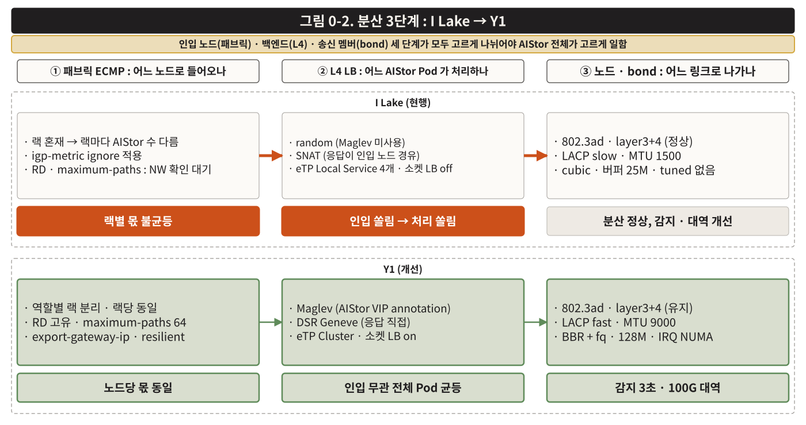

### 2-1. 1차 설계에서 확보된 기반 (유지)

| 영역 | I Lake 설계 | Y1 |
|---|---|---|
| 패브릭 | VXLAN EVPN, igp-metric ignore | 유지 |
| VIP | CiliumLoadBalancerIPPool + BGP 광고 | 유지 |
| 망 분리 | bond0 PUBLIC · bond1 PRIVATE | 유지 |
| 노드 | netkit, bond 802.3ad · layer3+4, ice 100G, XDP best-effort | 유지 |
| BGP 타이머 | hold 12초 · keepalive 4초 · GR 15초 | 유지 |
| 클러스터 | multi-pool IPAM, 클러스터 ID 체계, Hubble | 유지 |
| 데이터 | rack 라벨, 랙 고려 erasure set | 유지 |
| 적재 | Airflow · Spark Job | 유지 |

### 2-2. 분산 편차 요인 (운영 관찰)

| 순위 | 요인 | 영향 | Y1 대응 |
|---|---|---|---|
| 1 | LoadBalancer Service 일부 eTP Local | 인입이 몰린 노드의 Pod 만 처리 | eTP Cluster (4장) |
| 2 | Compute · AIStor 랙 혼재 배치 | 랙마다 AIStor 수가 달라 노드당 몫 차이 | 역할별 랙 분리 (3장) |
| 3 | 백엔드 선택 random | 경로 변경 · 노드 작업 시 연결 재수립 | Maglev (4장) |
| 4 | SNAT 응답 경로 | 응답이 인입 노드를 다시 경유 | DSR Geneve (4장) |
| 5 | 패브릭 multipath 설정 범위 | VIP 경로 일부만 사용 가능성 | RD · maximum-paths 점검 (3장) |
| 6 | 노드 기본값 (MTU 1500 · cubic · 기본 버퍼 · LACP slow) | 100G 활용도 · 장애 전환 시간 | 노드 튜닝 (6장) |

---

## 3. 랙 배치 · 패브릭 경로

> **랙당 서버 수를 같게 하고, VIP 경로가 패브릭 어느 단계에서도 줄지 않게 한다.**

### 3-1. 역할별 랙 분리 · DC 구간

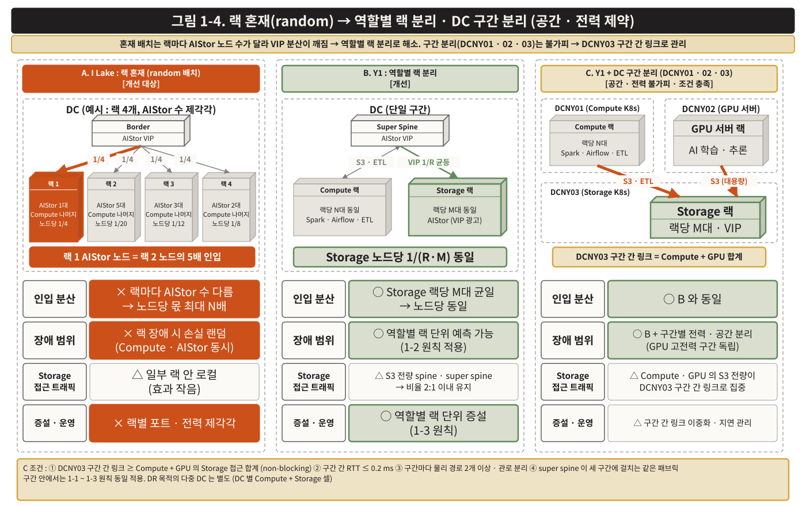

- I Lake : 랙마다 Compute · AIStor 혼재 → VIP 는 랙 단위로 똑같이 나뉘지만 랙 안 AIStor 수가 달라 노드당 몫이 최대 수 배 차이
- Y1 : 역할별 랙 분리 (Storage 랙 M대 · Compute 랙 N대 균일) → Storage 노드당 몫 동일
- DC 구간 분리는 공간 · 전력 제약에 따른 구성이며, 랙 원칙은 구간마다 동일 적용

| 구간 조건 | 기준 |
|---|---|
| DCNY03 구간 간 링크 대역 | Compute + GPU 의 Storage 접근 합계 이상 |
| 지연 | RTT 0.2 ms 이하 |
| 경로 | 구간마다 물리 경로 2개 이상 · 관로 분리 |
| 모니터링 | DCNY01 → 03, DCNY02 → 03 각각 |

### 3-2. 랙당 서버 수와 인입 분산

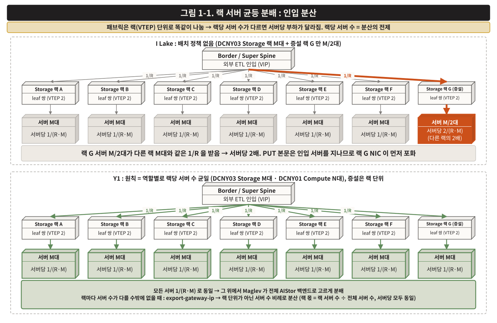

- 패브릭은 랙(VTEP) 단위로 같은 몫 → 랙 안 서버 수가 적으면 서버당 부하 증가
- ETL 적재(PUT)는 인입 서버를 지나므로 랙 배치가 직접 영향
- 랙마다 서버 수가 다를 수밖에 없을 때 : **export-gateway-ip** 로 서버 수 비례 분산 (네트워크 파트 적용 예정)

| 예 (랙 A M대 · 랙 G M/2대) | 랙 몫 | 서버당 몫 |
|---|---|---|
| 기본 (랙 단위) | A 1/2 · G 1/2 | G 서버가 A 의 2배 |
| export-gateway-ip | A 2/3 · G 1/3 | 모두 동일 |

### 3-3. 장애 범위 · 증설

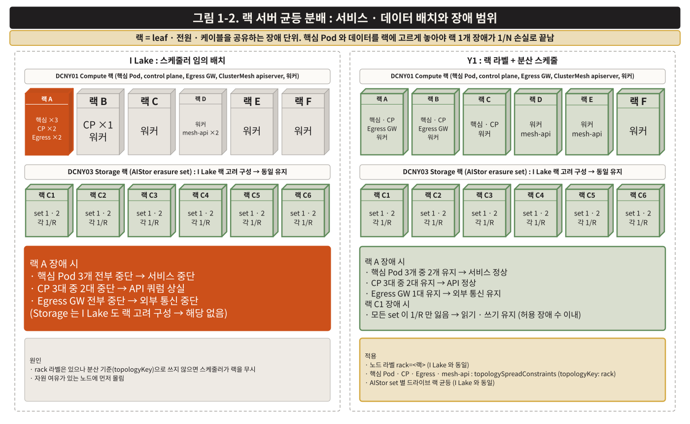

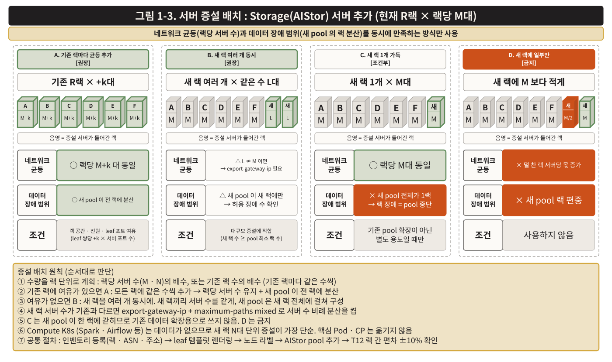

| 대상 | Y1 배치 | 랙 1개 장애 시 |
|---|---|---|
| 핵심 Pod · control plane | 3랙 분산 (rack 라벨 기준) | 서비스 · 쿼럼 유지 |
| Egress GW · clustermesh-apiserver | 2랙 이상 | 외부 통신 · 원격 동기화 유지 |
| AIStor erasure set | 랙 균등 (I Lake 유지) | 읽기 · 쓰기 유지 |

| 증설 방식 | 판단 |
|---|---|
| 기존 랙마다 같은 수 추가 | 권장 |
| 새 랙 여러 개 동시 (같은 수) | 권장 (수 다르면 export-gateway-ip) |
| 새 랙 1개 가득 | 별도 용도에 한정 |
| 새 랙에 일부만 | 지양 |

### 3-4. VIP 경로 다중화

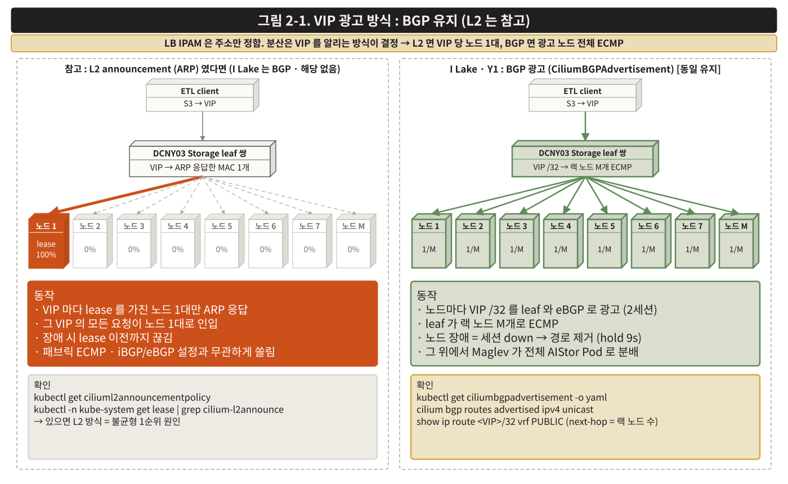

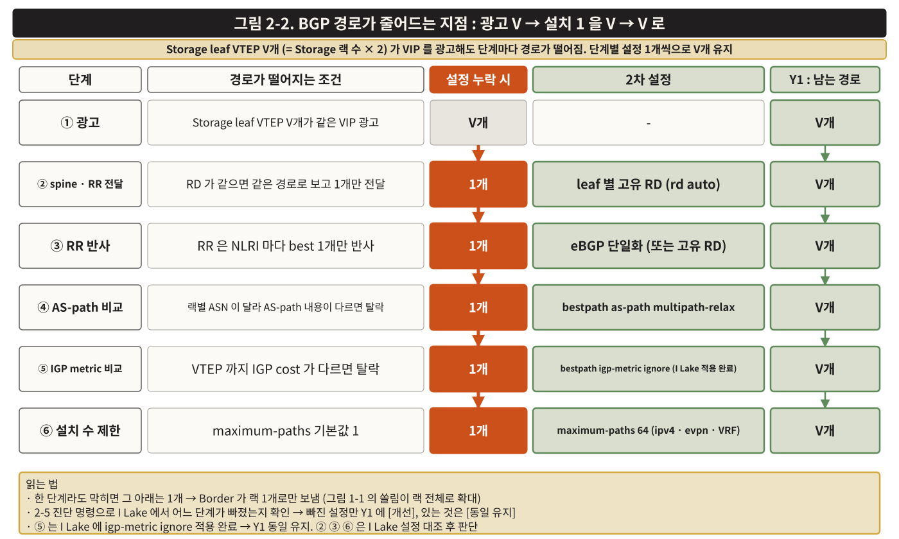

| 단계 | 경로가 줄어드는 조건 | 제안 | 판단 |
|---|---|---|---|
| spine · RR 전달 | leaf 간 RD 공통 | leaf 별 고유 RD | 협의 (현행 확인) |
| AS-path 비교 | 랙별 ASN 차이 | multipath-relax | 협의 (현행 확인) |
| IGP metric 비교 | VTEP 거리 차이 | igp-metric ignore | 유지 (적용 완료) |
| 설치 수 | maximum-paths 부족 | maximum-paths ≥ V (ibgp 포함) | 협의 (현행 확인) |

### 3-5. BGP 구조

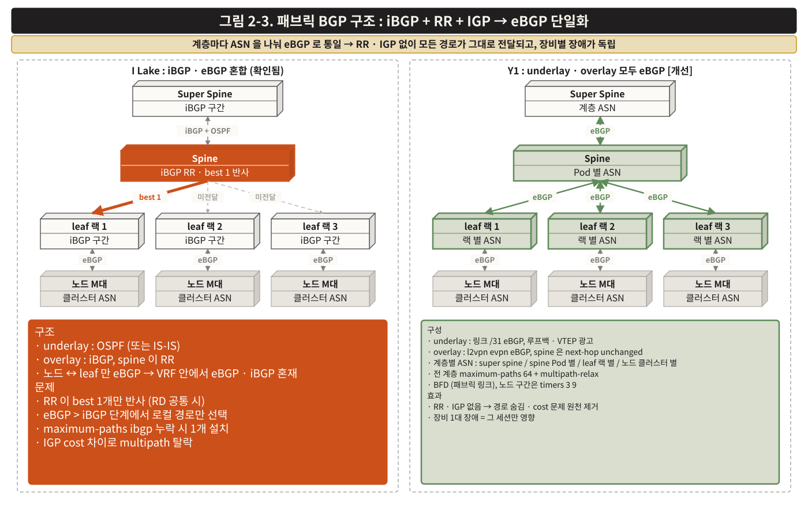

| 안 | 내용 | 장점 | 고려 |
|---|---|---|---|
| A. 혼합 유지 + 보강 | I Lake 구조에 RD · maximum-paths · relax 보강 | I Lake 와 같은 운영 표준 | RR · IGP 요인 관리 필요 |
| B. eBGP 단일화 | 계층별 ASN, underlay · overlay eBGP | 경로 선택 단순 · 장비별 장애 독립 | I Lake 와 표준 상이 |

- 제안 : 두 안 모두 분산 목표 달성 가능. **운영 표준 일관성을 우선하면 A, 장기 단순화를 우선하면 B** → 의사결정 요청

### 3-6. ECMP 해시 · 장애 감지

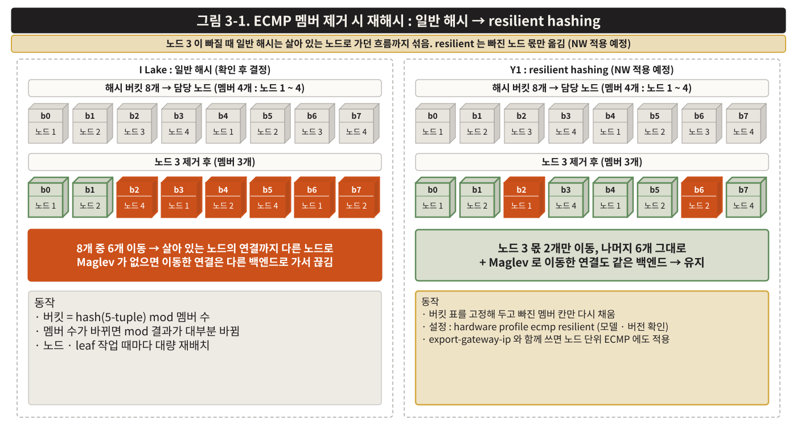

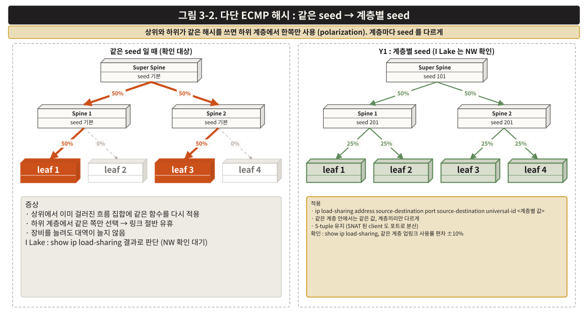

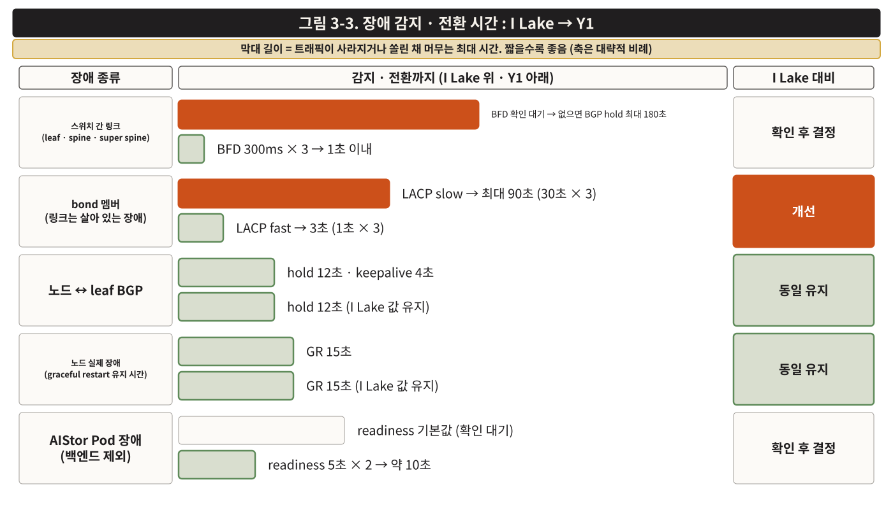

| 항목 | 효과 | 판단 |
|---|---|---|
| resilient hashing | 경로 하나가 빠져도 나머지 흐름 유지 | 개선 (네트워크 파트 적용 예정) |
| 계층별 해시 seed | 상 · 하위 계층 해시 쏠림 방지 | 협의 |
| BFD (스위치 간) | 링크 장애 1초 내 감지 | 협의 |
| LACP fast | bond 멤버 장애 90초 → 3초 | 개선 |
| 노드 BGP 타이머 · GR | 12/4초 · 15초 | 유지 |

### 3-7. 기대 효과

| 변경 | 기대 · 개선 효과 | 확인 지표 |
|---|---|---|
| 역할별 랙 분리 · 랙당 서버 수 균일 | Storage 노드당 인입 몫 동일 (혼재 시 최대 수 배 차이 → 1배) | 랙 · 노드별 인입 편차 ±10% |
| 랙 단위 증설 표준 | 증설 후에도 균등 유지, 재배치 · 재설계 불필요 | 증설 후 편차 재측정 |
| 핵심 Pod · 데이터 랙 분산 | 랙 1개 장애 시 서비스 유지, 손실 1/R 로 한정 | 랙 차단 시험 (T14) |
| 고유 RD · maximum-paths · relax | VIP 경로 전부 사용 (일부 랙 집중 해소) | Border VIP next-hop 수 = V |
| export-gateway-ip | 랙마다 서버 수가 달라도 서버 수 비례 분산 | 노드별 인입 편차 |
| resilient hashing | 경로 1개 이탈 시 이동 흐름 대부분 → 약 1/n 로 축소 | 장애 시 끊긴 연결 수 |
| 계층별 해시 seed | 상 · 하위 계층 쏠림 방지, 업링크 고른 사용 | 업링크 사용률 편차 ±10% |
| BFD · LACP fast | 링크 장애 감지 수십 초 ~ 90초 → 1 ~ 3초 | 장애 시험 전환 시간 (T9 · T11) |

---

## 4. L4 로드밸런싱 (AIStor VIP)

> **어느 노드로 들어와도 같은 백엔드를 고르고(Maglev), 전체 Pod 가 처리하며(eTP Cluster), 응답은 직접 보낸다(DSR).**

### 4-1. VIP 처리 경로

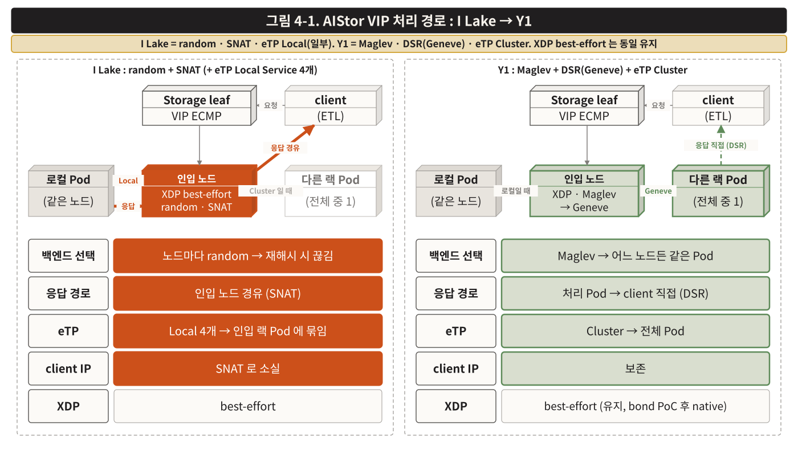

| 항목 | I Lake | Y1 제안 | 효과 |
|---|---|---|---|
| 백엔드 선택 | random | AIStor VIP 에 Maglev | 노드 변경 시에도 같은 백엔드 |
| 응답 경로 | SNAT | DSR (Geneve) | 인입 노드 응답 부하 제거, client IP 보존 |
| 외부 정책 | Local · Cluster 혼용 | AIStor VIP Cluster | 처리 균등 |
| 내부 경로 | 소켓 LB off | on | 패킷 단위 NAT 제거 |
| 가속 | XDP best-effort | 유지 | - |
| LB 맵 | 기본 크기 | 상향 | 대규모 연결 여유 |

### 4-2. Maglev

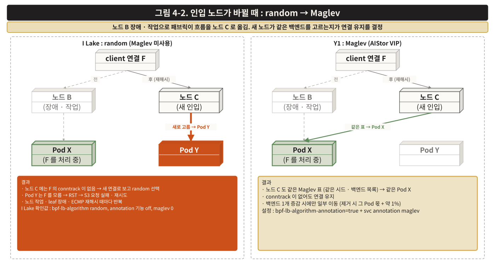

- 모든 노드가 같은 표로 백엔드 선택 → ECMP 재해시 · 노드 작업으로 인입 노드가 바뀌어도 연결 유지
- 백엔드 증감 시 약 1/N 연결만 이동
- AIStor VIP 에만 annotation 으로 적용 → 다른 Service 영향 없음

### 4-3. externalTrafficPolicy

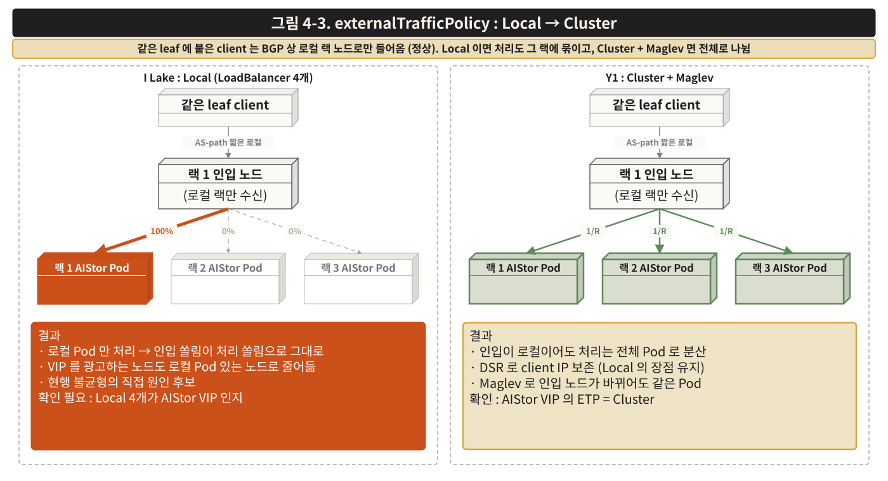

- 같은 leaf 의 client 는 BGP 특성상 로컬 랙 노드로 인입 (정상 동작)
- Local : 그 노드의 Pod 만 처리 → 인입 쏠림이 그대로 처리 쏠림
- Cluster + DSR : 처리는 전체 Pod, client IP 도 보존 → Local 의 장점 유지

### 4-4. 내부 경로 : 소켓 LB · Global Service

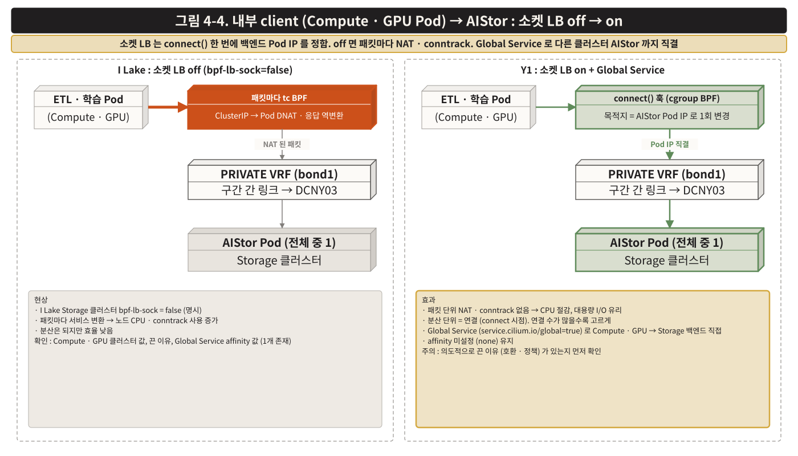

- Compute · GPU Pod 는 Service(ClusterIP · Global) 로 AIStor 접근
- 소켓 LB : 연결 시점에 백엔드로 1회 연결 → NAT · conntrack 부담 제거
- I Lake 에서 off 로 둔 배경 확인 후 Y1 에 적용 (협의)

### 4-5. 적용 조건

| 항목 | 조건 |
|---|---|
| DSR | 노드 MTU 9000 · 패브릭 9216, leaf uRPF loose, UDP 6081 허용 → **PoC 후 적용** |
| eTP 전환 | Local 로 운영 중인 Service 의 client IP 의존 여부 확인 |
| 소켓 LB | 1차에서 off 로 둔 사유 확인 |
| 대안 | DSR PoC 미통과 시 SNAT + Maglev + eTP Cluster 로도 처리 균등 · 연결 유지 달성 |

### 4-6. 기대 효과

| 변경 | 기대 · 개선 효과 | 확인 지표 |
|---|---|---|
| eTP Local → Cluster | 인입이 한 랙에 몰려도 처리는 전체 AIStor Pod 로 분산 | Pod 별 요청 수 편차 ±10% |
| random → Maglev | 노드 작업 · 장애 · 재해시 때 기존 연결 유지, 백엔드 증감 시 약 1/N 만 이동 | 노드 작업 중 오류 0 (T13) |
| SNAT → DSR | GET 응답이 인입 노드를 거치지 않음 → 인입 노드 송신 부하 제거, client IP 보존 (감사 · 접근 제어) | 인입 노드 송신량 · 응답 경로 |
| 소켓 LB on | 내부 접근 시 패킷마다 하던 NAT · 연결 추적 제거 → CPU · 지연 감소 | 노드 CPU · 지연 기준선 대비 |
| LB 맵 상향 | 대량 연결 시 맵 포화 · drop 예방 | 맵 사용률 · drop 카운터 |

---

## 5. 망 분리 · 서비스 진입

> **bond0 = PUBLIC, bond1 = PRIVATE 설계를 유지하고, 광고 · 응답 · 이름 해석을 같은 쪽으로 맞춘다.**

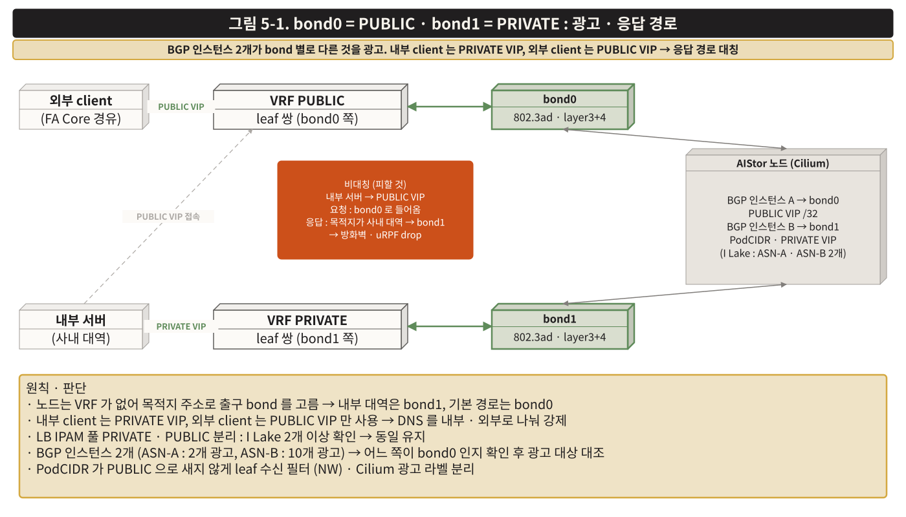

| 항목 | Y1 제안 | 판단 |
|---|---|---|
| bond · VRF | bond0 PUBLIC · bond1 PRIVATE | 유지 |
| LB IP 풀 | PRIVATE · PUBLIC 분리 | 유지 |
| BGP 광고 | PUBLIC VIP → bond0 세션, PodCIDR · PRIVATE VIP → bond1 세션 | 협의 (현행 인스턴스 매핑 확인) |
| 내부 client | PRIVATE VIP · 내부 DNS 만 사용 | 협의 |
| leaf 수신 필터 | VRF 별 prefix-list | 협의 (네트워크 파트) |
| TLS · 접근 제어 | SAN 정리 · 접근 대역 제한 · AIStor 네임스페이스 기본 차단 | 협의 |

- 내부 서버가 PUBLIC VIP 로 접속하면 요청 · 응답 bond 가 달라져 방화벽 · uRPF 에서 차단될 수 있음 → 이름 해석 단계에서 분리

### 5-1. 기대 효과

| 변경 | 기대 · 개선 효과 | 확인 지표 |
|---|---|---|
| 광고 대상 bond 별 정리 | 요청 · 응답 경로 일치 → 비대칭 차단 · 간헐 실패 예방 | 응답 출구 bond 점검 |
| 내부 · 외부 VIP · DNS 분리 | 내부 트래픽이 PUBLIC 망을 쓰지 않음 → 보안 경계 명확 · PUBLIC 대역 여유 | 망별 트래픽 비율 |
| leaf 수신 필터 · 접근 제한 | 내부 대역의 외부 노출 방지 | 광고 · 수신 prefix 점검 |

---

## 6. 노드 OS · 네트워크

> **netkit · 802.3ad 기반은 유지하고, 100G 에 맞게 MTU · TCP · CPU · NIC 를 맞춘다.**

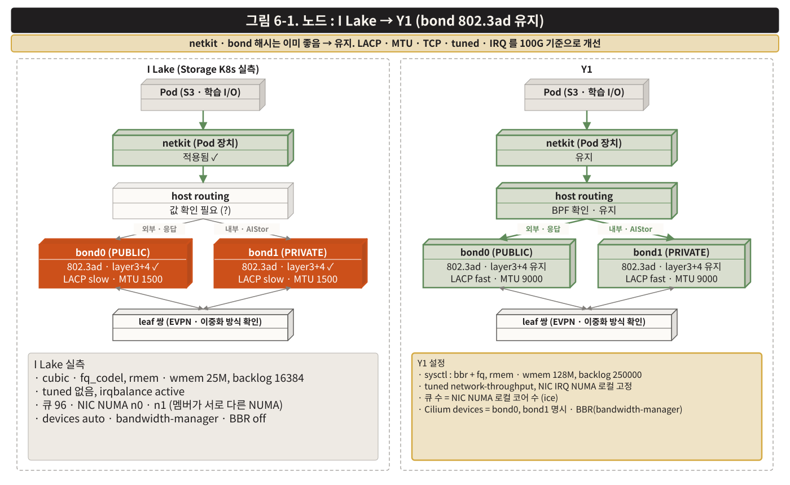

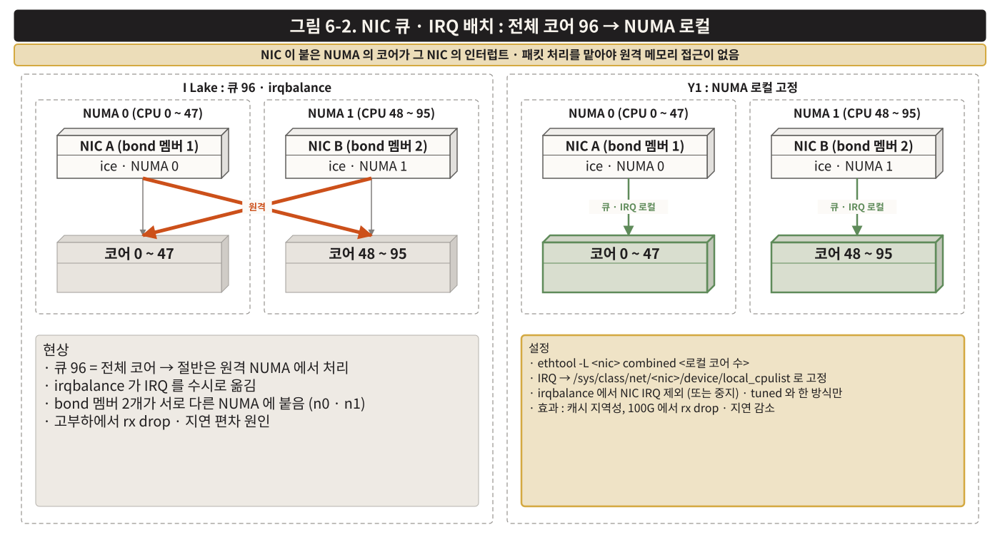

| 항목 | I Lake | Y1 제안 | 효과 |
|---|---|---|---|
| Pod 장치 · bond | netkit · 802.3ad layer3+4 | 유지 | - |
| LACP | slow | fast | 장애 전환 3초 |
| MTU | 1500 | 9000 (패브릭 9216) | 패킷 수 감소, DSR 전제 |
| TCP 혼잡 제어 | cubic · fq_codel | bbr · fq | 100G · 짧은 RTT 처리량 · 재전송 개선 |
| 소켓 버퍼 · backlog | 25M · 16384 | 128M · 250000 | 버스트 drop 감소 |
| CPU 프로파일 | 미적용 | tuned network-throughput | 지연 편차 감소 |
| IRQ · 큐 | 전체 코어 · 자동 이동 | NIC 로컬 NUMA 고정 | 원격 메모리 접근 제거 |
| Cilium 노드 설정 | devices · MTU 자동 | bond0 · bond1 · 9000 명시, bandwidth manager · BBR | 설정 일관성 · Pod pacing |
| BIG TCP | 미사용 | PoC 후 결정 | - |

### 6-1. 기대 효과

| 변경 | 기대 · 개선 효과 | 확인 지표 |
|---|---|---|
| LACP fast | 링크는 살아 있고 상대만 멈춘 장애 감지 최대 90초 → 3초 | 멤버 장애 전환 시간 (T11) |
| MTU 9000 | 대용량 전송 패킷 수 약 1/6 → CPU · 인터럽트 감소, DSR 전제 충족 | 노드 CPU · 처리량 |
| bbr + fq | 100G · 짧은 지연 구간에서 대역 활용 · 재전송 개선, 큐 적체 감소 | 처리량 · 재전송 수 기준선 대비 |
| 버퍼 · backlog 확대 | 버스트 시 수신 drop 감소 | softnet drop · 재전송 |
| tuned · IRQ/NUMA 고정 | 원격 메모리 접근 제거, 지연 편차 감소 | 지연 p99 · CPU 분포 |
| Cilium devices · MTU 명시, bandwidth manager | 노드 간 설정 일관성, Pod 송신 pacing | 설정 drift 없음 |

---

## 7. 클러스터 연동 (ClusterMesh)

> **Compute · GPU · Storage 3개 클러스터 연동을 캐시 구조와 이중화로 안정화한다.**

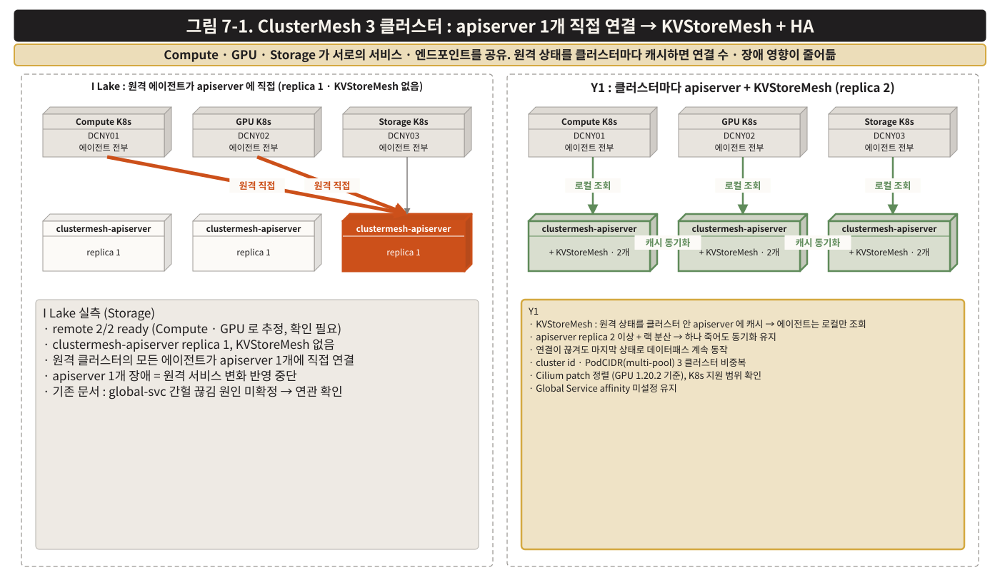

| 항목 | I Lake | Y1 제안 | 판단 |
|---|---|---|---|
| IPAM · 클러스터 ID | multi-pool · 고유 ID | 3개 클러스터 풀 비중복 | 유지 |
| 연동 방식 | 노드가 원격 직접 연결 | KVStoreMesh (클러스터 내 캐시) | 개선 |
| clustermesh-apiserver | 1개 | 2개 이상 · 랙 분산 | 개선 |
| 버전 | 클러스터별 상이 | Cilium patch 버전 정렬 | 협의 |
| Hubble · 암호화 | Hubble on · WireGuard off | 유지 | 유지 |
| K8s API VIP · Egress 고정 IP | - | 요구사항 확인 후 | 협의 |

- 원격 클러스터 장애 · 지연이 각 노드로 전파되지 않고, 연결 수가 크게 줄어듦

### 7-1. 기대 효과

| 변경 | 기대 · 개선 효과 | 확인 지표 |
|---|---|---|
| KVStoreMesh | 원격 연결 수 (노드 수 × 원격 수) → 클러스터당 원격 수, 원격 장애가 노드로 전파되지 않음 | 원격 연결 수 · agent 오류 |
| clustermesh-apiserver 2개 이상 | 1개 장애에도 원격 서비스 변화 반영 지속 | apiserver 1개 중지 시험 |
| 버전 정렬 | 클러스터 간 기능 · 동작 차이 제거 | 버전 일치 |

---

## 8. ETL · 데이터 클라이언트

> **L4 LB 는 연결 단위로 나눈다. 클라이언트가 충분한 연결을 쓰고 오래된 연결을 주기적으로 다시 맺도록 한다.**

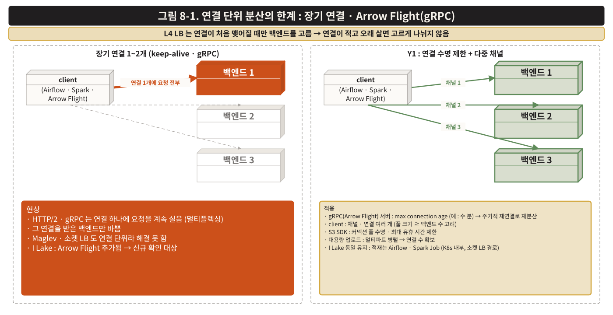

| 대상 | Y1 제안 | 판단 |
|---|---|---|
| Airflow · Spark Job | 현행 적재 경로 | 유지 |
| Arrow Flight (gRPC) | 서버 최대 연결 수명 설정 · client 다중 채널 | 개선 |
| S3 SDK | 커넥션 풀 수명 · 유휴 제한 | 협의 |
| 대용량 업로드 | 멀티파트 병렬 | 협의 |
| GPU 학습 I/O | 대용량 읽기 · 체크포인트 기준 연결 수 · 동시성 | 개선 |

### 8-1. 기대 효과

| 변경 | 기대 · 개선 효과 | 확인 지표 |
|---|---|---|
| Arrow Flight 연결 수명 · 다중 채널 | 장기 연결 1개가 백엔드 1개에 묶이는 현상 해소 | 백엔드별 요청 편차 ±20% (T16) |
| S3 커넥션 풀 · 멀티파트 | 대용량 적재가 여러 연결 · 백엔드로 나뉨 → 적재 시간 단축 | 적재 처리량 |
| GPU I/O 동시성 | 학습 데이터 읽기 · 체크포인트 버스트 시 특정 Pod 집중 방지 | 학습 I/O 처리량 · 지연 |

---

## 9. 운영

> **계획 작업은 광고를 먼저 거둬 무중단으로, 분산 편차는 상시 지표로 관리한다.**

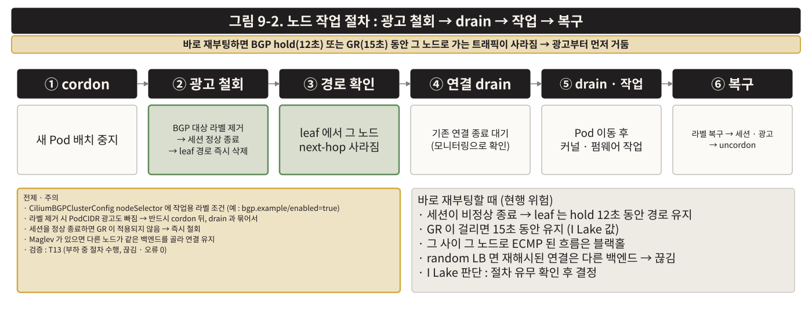

| 항목 | Y1 제안 |
|---|---|
| 노드 작업 | cordon → BGP 광고 철회 → drain → 작업 → 광고 복구 |
| 분산 모니터링 | 스위치 포트 · 노드 · AIStor Pod 별 편차 ±10% 알람 |
| 구간 간 링크 | DCNY01 → 03, DCNY02 → 03 사용률 · RTT 별도 관리 |
| 설정 관리 | 인벤토리 기반 설정 생성 · 변경 이력 · drift 점검 |

### 9-1. 기대 효과

| 변경 | 기대 · 개선 효과 | 확인 지표 |
|---|---|---|
| 광고 철회 후 작업 | 노드 작업 · 패치 시 서비스 끊김 0 | 작업 중 오류 0 (T13) |
| 분산 편차 모니터링 | 쏠림 조기 감지 · 원인 구간 즉시 식별 | 알람 · 대시보드 |
| 구간 간 링크 관리 | DCNY03 병목 사전 대응 | 사용률 70% 이하 |
| 설정 표준화 · drift 점검 | 수작업 오류 감소, 증설 시 동일 품질 | drift 0 |

---

## 10. 기대 효과 종합

> **처리는 고르게, 작업 · 장애에는 끊김 없이, 100G 는 끝까지 쓴다.**

| 관점 | I Lake | Y1 변경 후 | 근거 변경 |
|---|---|---|---|
| 처리 균등 | 인입 몰린 노드 · 랙의 Pod 만 처리 | 전체 AIStor Pod 처리, 편차 ±10% 목표 | eTP Cluster · Maglev · 역할별 랙 |
| 인입 균등 | 랙마다 노드당 몫 차이 | 노드당 몫 동일 | 랙 균일 · RD · maximum-paths · export-gateway-ip |
| 연결 유지 | 경로 · 노드 변경 시 연결 재수립 | 계획 작업 끊김 0, 장애 시 약 1/N | Maglev · resilient · 광고 철회 절차 |
| 장애 전환 | bond 멤버 최대 90초 | 3초 (스위치 간 BFD 적용 시 1초 내) | LACP fast · BFD |
| 인입 노드 부하 | 요청 + 응답 모두 경유 | 요청만 경유 | DSR |
| 노드 효율 | 기본 MTU · TCP · IRQ | 패킷 수 감소 · 재전송 · 지연 편차 감소 | MTU 9000 · bbr · NUMA |
| 클러스터 연동 | apiserver 1개 · 직접 연결 | 이중화 · 캐시 | KVStoreMesh |
| 운영 | 쏠림 사후 확인 | 상시 편차 지표 · 표준 작업 절차 | 모니터링 · 설정 표준화 |

- 처리량 · 지연 개선 폭은 환경에 따라 달라 **PoC · 검증 시험(부록 A)에서 기준선 대비로 측정**해 보고

---

## 11. 적용 계획

> **확인 → 노드 → L4 LB → DSR → 패브릭 순으로, 단계마다 검증 기준을 통과한 뒤 다음으로 넘어간다.**

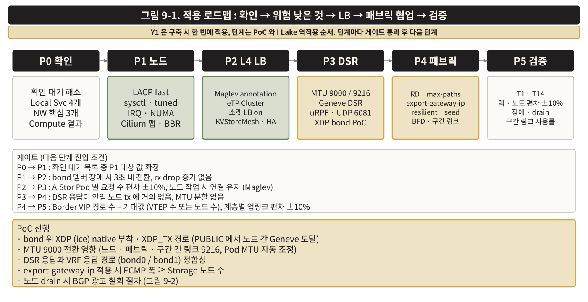

| 단계 | 내용 | 통과 기준 | 서비스 영향 |
|---|---|---|---|
| P0 확인 | 현행 값 확인 · 의사결정 (12장) | 설계 값 확정 | 없음 |
| P1 노드 | LACP · sysctl · tuned · IRQ · LB 맵 · BBR | 멤버 장애 3초 내 전환 · drop 증가 없음 | 노드별 롤링 |
| P2 L4 LB | Maglev · eTP Cluster · 소켓 LB · KVStoreMesh · 이중화 | Pod 편차 ±10% · 작업 시 연결 유지 | agent 롤링 재시작 |
| P3 DSR | MTU 9000/9216 · Geneve DSR · XDP (PoC 선행) | 응답이 인입 노드 미경유 · 패킷 분할 없음 | PoC 후 롤링 |
| P4 패브릭 | RD · maximum-paths · export-gateway-ip · resilient · seed · BFD | VIP 경로 수 = 기대값 · 업링크 편차 ±10% | Pod 단위 순차 · 롤백 지점 확보 |
| P5 검증 | 통합 시험 (부록 A) | 전 항목 통과 | 없음 |

- Y1 은 신규 구축이므로 P1 ~ P4 를 구축 단계에 반영하고, 서비스 오픈 전 P5 완료를 권장
- 일정은 구축 일정 · PoC 환경 확보 시점에 맞춰 협의

---

## 12. 리스크 · 협조 요청

### 12-1. 리스크와 대응

| 리스크 | 영향 | 대응 |
|---|---|---|
| DSR 경로 (MTU · uRPF · 방화벽) | 일부 응답 차단 | PoC 선행, 미통과 시 SNAT + Maglev 유지 |
| eTP 전환 | client IP 의존 서비스 영향 | 대상 Service 사전 확인, DSR 로 IP 보존 |
| 패브릭 설정 변경 | 경로 일시 변동 | 순차 적용 · checkpoint 롤백 |
| export-gateway-ip ECMP 폭 | 폭 초과 시 일부 노드 미사용 | 장비 ECMP 폭 ≥ Storage 노드 수 확인 |
| 구간 간 링크 | DCNY03 병목 · 단절 | 대역 · 경로 2개 이상 · 상시 모니터링 |
| 버전 차이 | 기능 동작 차이 | Cilium patch 정렬 |

### 12-2. 의사결정 요청

| 항목 | 선택지 | 제안 |
|---|---|---|
| BGP 구조 | A. 혼합 유지 + 보강 / B. eBGP 단일화 | 운영 표준 일관성 우선 시 A |
| DSR 도입 | PoC 후 적용 / SNAT 유지 | PoC 후 적용 |
| 증설 원칙 | 랙 단위 증설 표준화 | 채택 |

### 12-3. 협조 요청

| 대상 | 요청 |
|---|---|
| 네트워크 파트 | maximum-paths · RD · Border VIP 경로 수 현행 공유, resilient · export-gateway-ip · BFD · seed · MTU 9216 · uRPF loose 적용 범위 |
| 인프라 | 구간 간 링크 대역 · RTT · 경로 수, 랙 단위 증설 가능 여부 (공간 · 전력 · leaf 포트) |
| AIStor | readiness 기준 · pool 확장 시 재배치 방식 |
| 서비스 담당 | eTP Local 로 운영 중인 Service 의 사용 목적, Egress 고정 IP · K8s API VIP 요구 |

---

## 부록 A. 검증 시험

| 시험 | 조건 | 기준 |
|---|---|---|
| T1 ~ T4 | 외부 · 같은 Pod · 같은 leaf · Compute Pod 에서 GET | AIStor Pod 편차 ±10% |
| T5 | 외부 · 내부 PUT (ETL 모사) | Pod 편차 ±10%, 인입 NIC 편차 2배 이내 |
| T6 | 4개 위치 동시 GET · PUT | 랙 간 편차 ±10% |
| T7 | 부하 중 AIStor 노드 1대 종료 | 끊긴 연결 ≈ 1/N |
| T8 | 분석 쿼리 · 학습 I/O | 기준선 대비 처리량 · 지연 |
| T9 | 부하 중 leaf 1대 차단 | 영향 12초 이내 |
| T10 | 부하 중 인입 노드 종료 | 15초 이내, 연결 유지 |
| T11 | bond 멤버 1개 장애 | 3초 내 전환 |
| T12 | 랙별 인입 | 편차 ±10% |
| T13 | 부하 중 노드 작업 절차 | 오류 0 |
| T14 | 부하 중 랙 1개 차단 | 핵심 서비스 · AIStor 유지 |
| T15 | DCNY01 · 02 동시 부하 | DCNY03 링크 70% 이하 · RTT 0.2 ms 이하 |
| T16 | Arrow Flight 장기 연결 | 백엔드 편차 ±20% |

## 부록 B. 그림 목록

| 그림 | 내용 | 그림 | 내용 |
|---|---|---|---|
| 0-1 | 전체 구조 | 3-3 | 장애 감지 시간 |
| 0-2 | 분산 3단계 | 4-1 | VIP 처리 경로 |
| 1-1 | 랙당 서버 수 · 인입 | 4-2 | Maglev |
| 1-2 | 장애 범위 | 4-3 | eTP Local vs Cluster |
| 1-3 | 증설 배치 | 4-4 | 소켓 LB |
| 1-4 | 역할별 랙 · DC 구간 | 5-1 | VRF · bond |
| 2-1 | VIP 광고 | 6-1 | 노드 데이터패스 |
| 2-2 | 경로 탈락 지점 | 6-2 | NUMA · IRQ |
| 2-3 | BGP 구조 | 7-1 | ClusterMesh |
| 3-1 | resilient hashing | 8-1 | 연결 단위 분산 |
| 3-2 | 해시 seed | 9-1 · 9-2 | 로드맵 · 노드 작업 |

