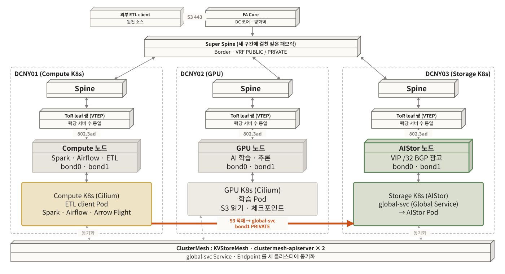
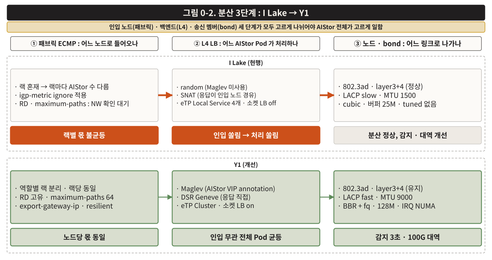
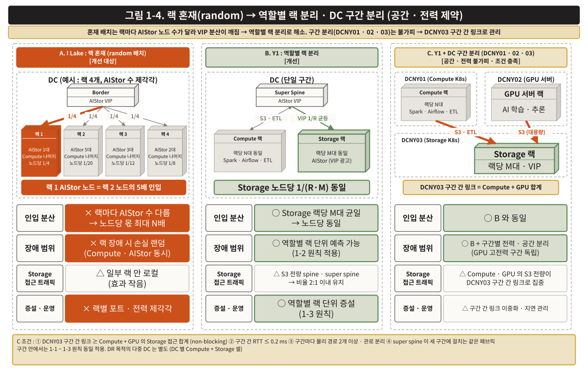
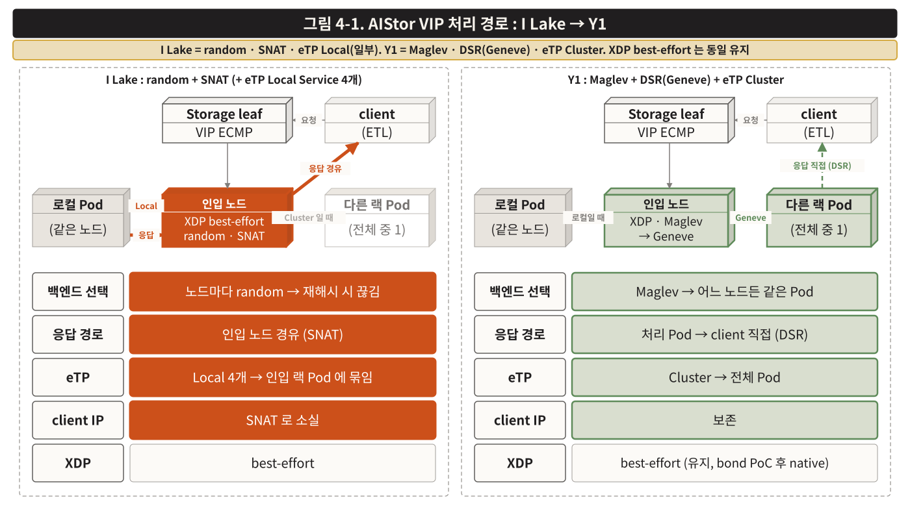
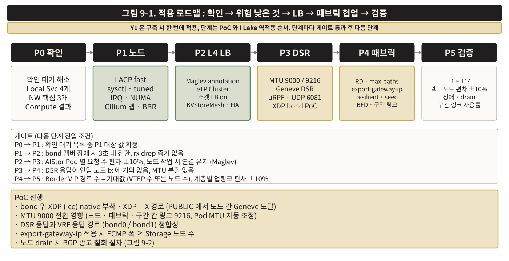

# Y1 AI DATAPLATFORM 인프라 아키텍처 설계 제안 — 요약

| 항목 | 내용 |
|---|---|
| 제안 | DevOps 파트 (인프라 · 스위치 설정 최적화) |
| 대상 | Y1 AI DATAPLATFORM : Compute K8s (DCNY01) · GPU (DCNY02) · Storage(AIStor) K8s (DCNY03) |
| 관련 문서 | 상세 제안서 |

---

## 1. 한 장 요약

> **I Lake 1차 설계의 골격은 그대로 잇고, 운영 중 확인된 AIStor 분산 편차를 4개 층에서 해소해 Y1 을 처음부터 균등 · 무중단 구조로 구축한다.**

| 목표 | 목표값 |
|---|---|
| AIStor Pod 별 요청 편차 | ±10% 이내 |
| 노드 작업 · 경로 변경 시 끊긴 연결 | 0 (계획 작업) |
| bond 멤버 장애 전환 | 3초 이내 |
| GET 응답 경로 | 인입 노드 미경유 |
| DCNY03 구간 간 링크 사용률 | 70% 이하 |

## 2. 현행 관찰 : 분산 편차는 어디서 오나

| 요인 | 현행 | Y1 |
|---|---|---|
| Service 정책 | 일부 eTP Local → 인입 쏠림이 처리 쏠림으로 | eTP Cluster |
| 랙 배치 | Compute · AIStor 혼재 → 노드당 몫 차이 | 역할별 랙 분리 · 균일 |
| 백엔드 선택 | random → 경로 변경 시 연결 재수립 | Maglev |
| 응답 경로 | SNAT → 인입 노드 재경유 | DSR (PoC 후) |
| 패브릭 | igp-metric ignore 적용 완료, 나머지 multipath 범위 확인 필요 | 고유 RD · maximum-paths · export-gateway-ip · resilient |

## 3. 핵심 제안 5가지

| # | 제안 | 기대 효과 |
|---|---|---|
| 1 | **역할별 랙 분리 · 랙 단위 증설** | Storage 노드당 인입 동일, 증설 후에도 균등 유지 |
| 2 | **AIStor VIP : Maglev + eTP Cluster** | 어느 노드로 들어와도 전체 Pod 가 처리, 작업 · 장애 시 연결 유지 |
| 3 | **DSR (Geneve)** | 응답이 인입 노드를 거치지 않음, client IP 보존 |
| 4 | **패브릭 multipath 보강 · resilient hashing** | VIP 경로 전부 사용, 경로 변화 시 무관한 흐름 유지 |
| 5 | **노드 100G 튜닝 · KVStoreMesh** | 장애 전환 3초, 처리량 · 재전송 개선, 클러스터 연동 안정 |

## 4. 변경 시 기대 · 개선 효과

| 관점 | I Lake | Y1 변경 후 | 확인 지표 |
|---|---|---|---|
| 처리 균등 | 인입 몰린 노드 · 랙의 Pod 만 처리 | 전체 AIStor Pod 처리 | Pod 별 요청 편차 ±10% |
| 인입 균등 | 랙마다 노드당 몫 차이 (최대 수 배) | 노드당 몫 동일 | 랙 · 노드 인입 편차 ±10% |
| 연결 유지 | 경로 · 노드 변경 시 연결 재수립 | 계획 작업 끊김 0, 장애 시 약 1/N | 작업 · 장애 시험 오류 수 |
| 장애 전환 | bond 멤버 최대 90초 | 3초 (BFD 적용 구간 1초 내) | 전환 시간 |
| 인입 노드 부하 | 요청 + 응답 경유 | 요청만 경유, client IP 보존 | 인입 노드 송신량 |
| 노드 효율 | 기본 MTU · TCP · IRQ | 패킷 수 약 1/6 (대용량), 재전송 · 지연 편차 감소 | 처리량 · 재전송 · p99 지연 |
| 클러스터 연동 | apiserver 1개 · 노드별 직접 연결 | 이중화 · 클러스터 내 캐시 | 원격 연결 수 · 장애 시험 |
| 운영 | 쏠림 사후 확인 | 편차 상시 지표 · 표준 작업 절차 | 알람 · drift 0 |

- 처리량 · 지연 개선 폭은 PoC · 검증 시험에서 기준선 대비로 측정해 보고

## 5. 그대로 이어받는 1차 설계

| 영역 | 유지 항목 |
|---|---|
| 패브릭 · VIP | VXLAN EVPN, igp-metric ignore, LB IP 풀 + BGP 광고 |
| 망 분리 | bond0 PUBLIC · bond1 PRIVATE |
| 노드 | netkit, bond 802.3ad, ice 100G, XDP best-effort, BGP 타이머 12/4 · GR 15 |
| 클러스터 · 데이터 | multi-pool IPAM, 클러스터 ID 체계, rack 라벨, 랙 고려 erasure set |
| 적재 | Airflow · Spark Job |

## 6. 적용 계획

| 단계 | 내용 | 통과 기준 |
|---|---|---|
| P0 | 현행 값 확인 · 의사결정 | 설계 값 확정 |
| P1 | 노드 튜닝 | 3초 내 전환 |
| P2 | Maglev · eTP Cluster · 소켓 LB · KVStoreMesh | Pod 편차 ±10% |
| P3 | MTU · DSR (PoC 선행) | 응답 직접 전달 |
| P4 | 패브릭 보강 | VIP 경로 수 = 기대값 |
| P5 | 통합 검증 16개 시험 | 전 항목 통과 |

- 신규 구축 단계에 P1 ~ P4 반영, 서비스 오픈 전 P5 완료 권장

## 7. 리스크 · 요청 사항

| 리스크 | 대응 |
|---|---|
| DSR 경로 (MTU · uRPF) | PoC 선행, 미통과 시 SNAT + Maglev 로도 균등 달성 |
| eTP 전환 영향 | 대상 Service 사전 확인 |
| 패브릭 변경 | 순차 적용 · 롤백 지점 |
| DCNY03 구간 링크 | 대역 · 이중 경로 · 상시 모니터링 |

| 의사결정 | 제안 |
|---|---|
| BGP 구조 (혼합 유지 + 보강 / eBGP 단일화) | 운영 표준 일관성 우선 시 혼합 유지 + 보강 |
| DSR 도입 | PoC 후 적용 |
| 랙 단위 증설 표준 | 채택 |

| 협조 요청 | 내용 |
|---|---|
| 네트워크 파트 | 패브릭 multipath 현행 값, resilient · export-gateway-ip · BFD · MTU 9216 적용 범위 |
| 인프라 | 구간 간 링크 대역 · RTT · 경로, 랙 단위 증설 여건 |
| 서비스 · AIStor | eTP Local Service 사용 목적, readiness · pool 확장 방식 |

