# Y1 개선 기술 학습 문서

> 목적 : 보고서의 각 개선이 **왜** 효과가 있는지 원리 단위로 이해. 고객 보고용 아님.
> 기준값은 I Lake Storage K8s 실측 (ilake-node-check.sh). 근거 표의 "N번" = 체크리스트 항목 번호.
> 각 장 끝에 **근거** (실측 · 원리 · 문서) 와 **검증 명령** (줄마다 설명 · 기대 결과). `!` 줄은 N9K (NW), `#` 줄은 노드.
> 문서명은 Cilium 1.20 · NX-OS 해당 버전 기준으로 대조. 명령 출력 형식은 버전에 따라 다를 수 있음.

목차

1. 큰 그림 : 요청 하나가 Pod 에 닿기까지
2. 패브릭 : VXLAN EVPN 기본 용어
3. BGP 경로 선택과 multipath
4. export-gateway-ip 와 랙 균등
5. ECMP 해시 : resilient · polarization
6. bond · LACP
7. Cilium L4 LB : 소켓 LB · eTP · Maglev · DSR · XDP
8. VRF · bond 비대칭
9. 노드 데이터패스 : netkit · host routing · TCP · NUMA
10. ClusterMesh · KVStoreMesh
11. 연결 단위 LB 와 gRPC / Arrow Flight
12. 장애 감지 시간 계산
13. 실습 · 확인 명령
14. Q&A

---

## 1. 큰 그림

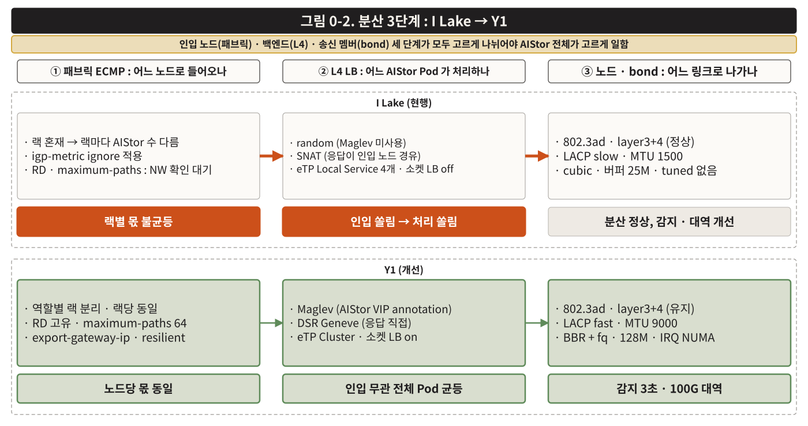

외부 client 의 S3 요청 하나는 3번 갈림길을 지난다.

| 단계 | 누가 나누나 | 단위 | 실패하면 |
|---|---|---|---|
| ① 패브릭 | spine · leaf ECMP | 흐름(5-tuple) → leaf(VTEP) | 일부 랙만 받음 |
| ② leaf → 노드 | leaf 의 BGP multipath | 흐름 → 노드 | 랙 안 일부 노드만 받음 |
| ③ 노드 → Pod | Cilium LB | 연결 → AIStor Pod | 받은 노드의 Pod 만 일함 (eTP Local) |

- 세 단계가 **모두** 고르게 나눠야 최종 균등. 어느 하나라도 좁으면 그 뒤는 소용없음
- ③ 에서 eTP Cluster + Maglev 면 ①② 의 치우침을 상당 부분 흡수 → Y1 이 L4 LB 를 핵심으로 보는 이유

### 1-1. client IP 기준 패킷 흐름

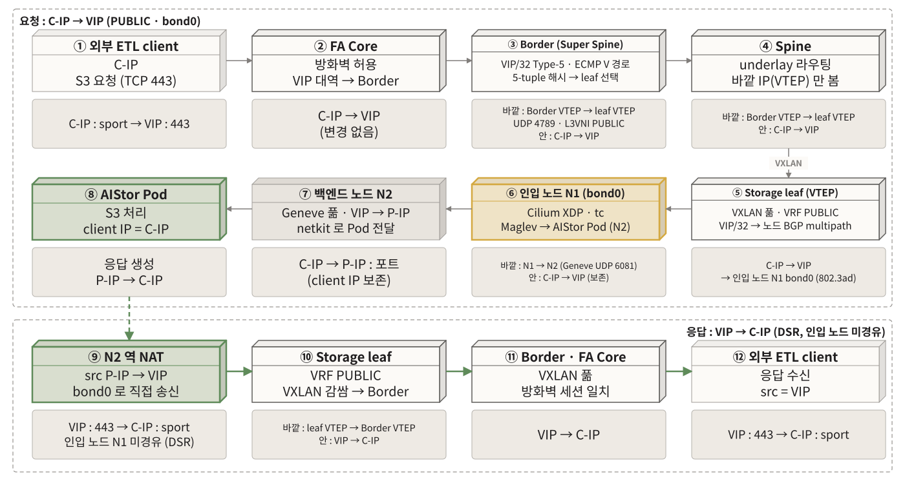

| 단계 | 지점 | 결정 · 처리 | 패킷 (바깥 / 안) |
|---|---|---|---|
| ① | 외부 client | S3 요청 | C-IP:sport → VIP:443 |
| ② | FA Core | 방화벽 허용, VIP 대역 → Border | 변경 없음 |
| ③ | Border | VIP/32 Type-5 경로 V 개 중 5-tuple 해시로 leaf 선택 | 바깥 Border VTEP → leaf VTEP (UDP 4789, L3VNI PUBLIC) |
| ④ | Spine | 바깥 IP(VTEP) 로만 라우팅 | 동일 |
| ⑤ | Storage leaf | VXLAN 해제, VRF PUBLIC 에서 VIP/32 → 노드 BGP multipath | C-IP → VIP → 인입 노드 N1 bond0 |
| ⑥ | 인입 노드 N1 | XDP · tc 에서 Maglev 로 백엔드 선택. 다른 노드면 Geneve 로 전달 (같은 노드면 바로 DNAT) | 바깥 N1 → N2 (UDP 6081) / 안 C-IP → VIP |
| ⑦ | 백엔드 노드 N2 | Geneve 해제, VIP → P-IP DNAT, netkit 로 Pod 전달 | C-IP → P-IP |
| ⑧ | AIStor Pod | S3 처리, client IP = C-IP | - |
| ⑨ ~ ⑫ | N2 → client | 역 NAT (src P-IP → VIP), bond0 로 직접 송신 → leaf → Border → FA Core | VIP:443 → C-IP:sport |

- I Lake (SNAT) 와 차이 : ⑥ 에서 src 를 N1 주소로 바꿔 보내므로 Pod 는 client IP 를 모르고, 응답이 N1 을 거쳐 돌아감
- FA Core 방화벽은 요청 · 응답이 모두 Border 를 지나므로 세션이 맞음. leaf 는 응답 src(VIP) 가 들어온 경로와 달라 **uRPF loose** 필요

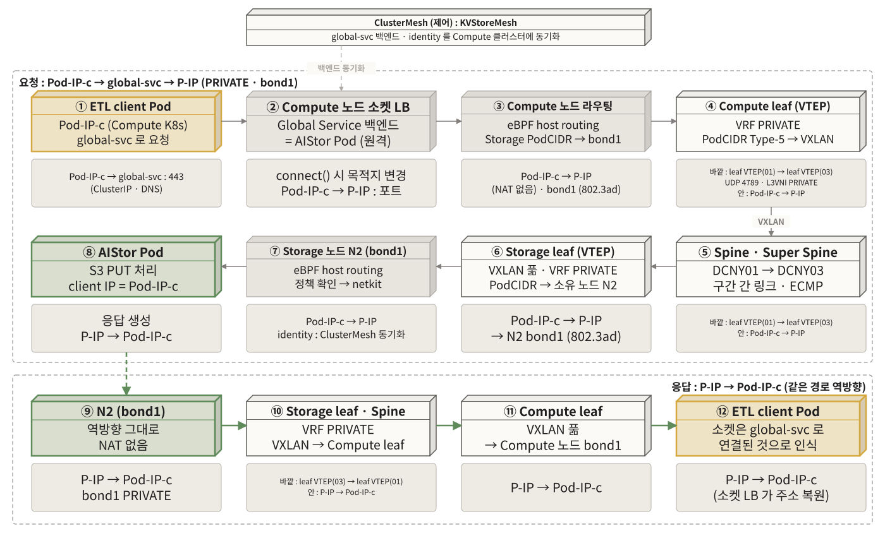

| 단계 | 지점 | 결정 · 처리 | 패킷 (바깥 / 안) |
|---|---|---|---|
| ① | ETL client Pod | global-svc DNS → ClusterIP | Pod-IP-c → ClusterIP:443 |
| ② | Compute 노드 소켓 LB | connect() 시 Global Service 백엔드(원격 AIStor Pod) 중 선택, 목적지를 P-IP 로 변경 | Pod-IP-c → P-IP |
| ③ | Compute 노드 | eBPF host routing, Storage PodCIDR 경로(BGP 학습) → bond1 | NAT 없음 |
| ④ | Compute leaf | VRF PRIVATE, PodCIDR Type-5 → VXLAN | 바깥 leaf VTEP(01) → leaf VTEP(03) (L3VNI PRIVATE) |
| ⑤ | Spine · Super Spine | 구간 간 링크 ECMP | 동일 |
| ⑥ | Storage leaf | VXLAN 해제, PodCIDR → 소유 노드 N2 | Pod-IP-c → P-IP |
| ⑦ | Storage 노드 N2 | host routing, NetworkPolicy (identity 는 ClusterMesh 로 동기화) → netkit | 동일 |
| ⑧ | AIStor Pod | S3 PUT 처리, client IP = Pod-IP-c | - |
| ⑨ ~ ⑫ | 역방향 | 같은 경로, NAT 없음. 소켓 LB 가 응답 주소를 global-svc 로 보이게 복원 | P-IP → Pod-IP-c |

- 외부 VIP 를 쓰지 않으므로 Maglev · DSR 과 무관, 분산은 ② 소켓 LB 가 연결 단위로 결정
- ClusterMesh 는 제어(백엔드 목록 · identity) 만 동기화, 데이터는 패브릭으로 직접
- 경로 확인 : `hubble observe --from-pod <ns>/<client> --to-ip <P-IP>`, `cilium-dbg bpf lb list | grep <global-svc ClusterIP>`

### 1-근거

| 구분 | 근거 |
|---|---|
| I Lake 실측 | eTP Cluster 4 · Local 4 (29번), lb-algorithm random · maglev 0 (6 · 32번), lb-mode snat (9번) → 3단계 중 ③ 이 좁음 |
| 원리 | ECMP 는 흐름 단위, L4 LB 는 연결 단위 분산. 앞 단계 치우침은 뒤 단계가 전체 백엔드를 후보로 둘 때만 흡수됨 |
| 문서 | Cilium Docs : Kubernetes Without kube-proxy (externalTrafficPolicy · Maglev · DSR 절) |

### 1-검증 명령

```bash
# ① 패브릭 : VIP 로 가는 경로 수 (N9K, NW)
show ip route <VIP> vrf <PUBLIC VRF>                       # next-hop 수 = Storage VTEP 수 V 이면 정상
# ② leaf → 노드 : leaf 가 받은 노드 경로 수 (N9K, NW)
show bgp ipv4 unicast <VIP>/32 vrf <PUBLIC VRF>            # 랙 안 Storage 노드 수만큼 multipath 표시
# ③ 노드 → Pod : 백엔드 후보 수 (Storage 노드)
cilium-dbg service list | grep -A20 <VIP>                  # 백엔드 = 전체 AIStor Pod 수 (Local 이면 로컬 Pod 만)
kubectl get svc -A -o custom-columns=NS:.metadata.namespace,N:.metadata.name,ETP:.spec.externalTrafficPolicy | grep Local
                                                          # Local 로 남은 Service 목록 (Y1 AIStor VIP 는 없어야 함)
```


---

## 2. VXLAN EVPN 기본 용어

| 용어 | 뜻 | 이 구조에서 |
|---|---|---|
| VXLAN | L2/L3 패킷을 UDP 4789 로 감싸 IP 망 위로 전달 | **스위치 간** 오버레이. Cilium 은 native routing 이라 VXLAN 안 씀 |
| VTEP | VXLAN 을 감싸고 푸는 지점 (Tunnel End Point) | leaf 스위치 (보통 leaf 쌍이 anycast VTEP 하나 공유 → 랙당 VTEP 수는 설계에 따라 1 또는 2) |
| VNI | VXLAN 의 네트워크 번호 | L3VNI = VRF 단위 (PUBLIC · PRIVATE) |
| EVPN | BGP 로 "어느 VTEP 뒤에 무엇이 있다" 를 알리는 제어부 | Type-5 = IP prefix 경로 (VIP · PodCIDR) |
| RD | 경로를 서로 다르게 보이게 하는 구분자 | **leaf 마다 고유** 해야 같은 VIP 의 여러 경로가 살아남음 |
| RT | 어느 VRF 로 가져갈지 표시하는 태그 | VRF 별 import/export |
| RR | Route Reflector, iBGP 에서 경로를 대신 전달 | 기본적으로 **최선 1개만** 전달 → 경로 숨김의 원인 |

**RD 와 RR 의 관계 (자주 헷갈림)**

- RR 은 같은 prefix(RD + IP) 에 대해 best 1개만 반사
- leaf A · B 가 같은 RD 로 VIP 를 내면 → 같은 prefix → RR 이 1개만 넘김 → 원격은 경로 1개
- RD 가 다르면 → 다른 prefix 2개 → 둘 다 반사 → 원격에서 둘 다 import → multipath 가능
- 즉 "RR 이라서 경로가 줄어든다" 의 해법은 **고유 RD** (add-path 없이도)

### 2-근거

| 구분 | 근거 |
|---|---|
| I Lake 확인 | iBGP · eBGP 혼합, igp-metric ignore 적용 (NW 담당 전언), leaf 이중화 (구성도) |
| 원리 | RFC 7432 (EVPN) · RFC 9136 (EVPN IP Prefix, Type-5) : 경로 식별 = RD + prefix. RFC 4456 (Route Reflection) : RR 은 prefix 당 best 1개만 반사 |
| 문서 | Cisco Nexus 9000 VXLAN BGP EVPN Configuration Guide (RD auto · route-target 절) |

### 2-검증 명령

```
show bgp l2vpn evpn <VIP>                    ! Route Distinguisher 줄이 leaf 수만큼 따로 보여야 함 (같은 RD 하나면 RD 중복)
show bgp l2vpn evpn summary                  ! RR 피어 상태 · 받은 prefix 수
show run bgp | include rd|route-target       ! leaf 별 RD 가 auto 또는 고유값인지
show nve peers                               ! VTEP 목록 = 기대 leaf 수
show nve vni                                 ! L3VNI (PUBLIC · PRIVATE) Up
```


---

## 3. BGP 경로 선택과 multipath

BGP 는 같은 목적지 경로가 여러 개면 순서대로 비교해서 하나를 고른다 (주요 단계만).

| 순서 | 비교 | 분산에 미치는 영향 |
|---|---|---|
| 1 | weight · local-pref | 보통 동일 |
| 2 | AS-path 길이 | 짧은 쪽만 → **로컬 랙 우선**의 원인 (정상) |
| 3 | origin · MED | 보통 동일 |
| 4 | eBGP > iBGP | 혼합 구조에서 eBGP 경로만 남음 |
| 5 | IGP metric (next-hop 까지 거리) | 가까운 VTEP 만 → **igp-metric ignore** 로 제거 (I Lake 적용 완료) |
| 6 | router-id 등 tie-break | 최종 1개 |

**multipath 가 성립하려면**

- `maximum-paths N` (eBGP) + `maximum-paths ibgp N` (iBGP) → N 개까지 같은 값이면 함께 설치
- 2단계 AS-path 가 길이는 같고 내용이 다르면 기본적으로 multipath 불가 → `bestpath as-path multipath-relax`
- 5단계에서 갈리면 불가 → `bestpath igp-metric ignore`
- N 은 **기대 경로 수 이상**. Storage VTEP V개 전부 받으려면 N ≥ V

**확인 포인트**

```
show bgp l2vpn evpn <VIP>          ! 받은 경로 수 (RD 별로 따로 보여야 정상)
show ip route <VIP> vrf <VRF>      ! 실제 설치된 next-hop 수 = 기대값?
```

- 받은 경로 수 < 기대 → RD 중복 또는 RR
- 받은 경로 수 = 기대인데 설치 수 < 기대 → maximum-paths · relax · igp-metric

### 3-근거

| 구분 | 근거 |
|---|---|
| I Lake 확인 | igp-metric ignore 적용 완료. maximum-paths · multipath-relax 값은 NW 체크리스트 W1 대기 |
| 원리 | BGP best path 순서 (Cisco BGP Best Path Selection Algorithm) : AS-path 길이 → origin → MED → eBGP>iBGP → IGP metric → tie-break. multipath 는 tie-break 직전까지 같아야 성립 |
| 문서 | Cisco NX-OS Unicast Routing Configuration Guide (BGP : maximum-paths · bestpath as-path multipath-relax · igp-metric ignore) |

### 3-검증 명령

```
show run bgp | include maximum-paths         ! maximum-paths N · maximum-paths ibgp N, N ≥ V
show run bgp | include bestpath              ! as-path multipath-relax · igp-metric ignore 둘 다
show bgp ipv4 unicast <VIP>/32 vrf <VRF>     ! "multipath" 표시된 경로 수 = 받은 경로 수
show ip route <VIP> vrf <VRF>                ! 설치된 next-hop 수 (받은 수 > 설치 수 → 위 두 설정 문제)
show bgp ipv4 unicast <VIP>/32 vrf <VRF> bestpath-reason   ! 탈락 경로의 탈락 사유 (지원 버전)
```


---

## 4. export-gateway-ip 와 랙 균등

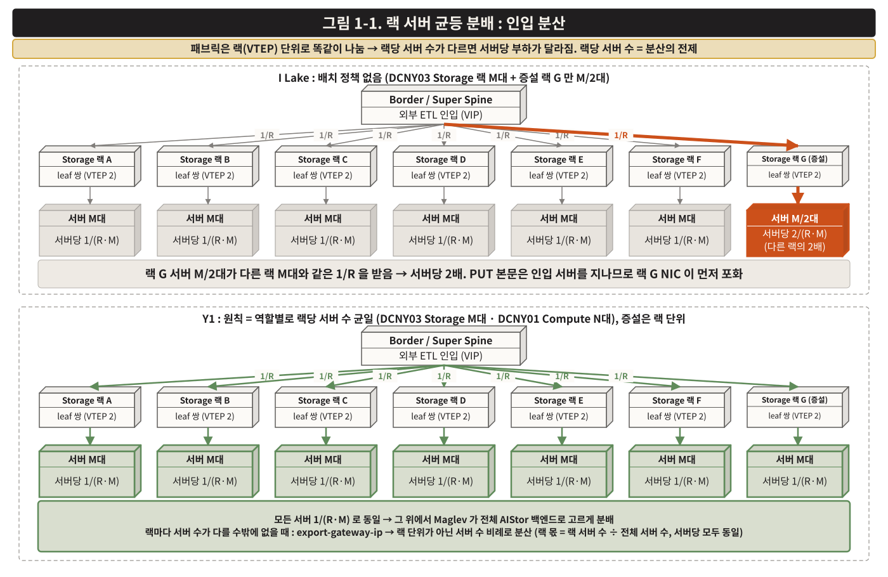

- 기본 EVPN Type-5 next-hop = **leaf(VTEP)** → 원격은 VTEP 단위로 균등 분배
- 랙 A 에 서버 4대, 랙 B 에 2대여도 VTEP 은 1:1 → 서버 1대당 부하는 B 가 2배
- 그래서 **랙당 Storage 서버 수 M 을 같게** (1장) 하면 VTEP 균등 = 서버 균등

**export-gateway-ip** (NW 계획)

- Type-5 에 gateway IP = **노드 IP** 를 실어 보냄 → 원격이 노드 단위로 ECMP
- 서버 수가 랙마다 달라도 서버 수 비례 분산
- 조건 : 원격 장비 ECMP 폭 ≥ Storage 노드 수, maximum-paths 동일, 장비 · 버전 지원
- 즉 "랙 균등 배치" 는 기본, "export-gateway-ip" 는 증설 시 불균등을 흡수하는 보조

### 4-근거

| 구분 | 근거 |
|---|---|
| I Lake 실측 | 랙 별 역할 혼재 (random 배치), rack 라벨 `rack=<랙>` 존재 |
| 원리 | Type-5 next-hop = VTEP → 원격 ECMP 는 VTEP 단위 균등. gateway IP (RFC 9136 GW IP 필드) 를 쓰면 노드 단위 ECMP |
| 문서 | Cisco N9K VXLAN EVPN Guide : export-gateway-ip (모델 · 버전별 지원 확인 필요) |
| 계산 | 서버 1대당 부하 ∝ 1 / (그 랙의 Storage 서버 수) → 랙당 M 이 같아야 서버 균등 |

### 4-검증 명령

```bash
kubectl get nodes -L rack -l <storage 역할 라벨>       # 랙별 Storage 노드 수 = 모두 M 인지
kubectl get nodes -L rack -l <storage 역할 라벨> --no-headers | awk '{print $NF}' | sort | uniq -c
                                                      # 랙별 대수 집계 (편차 0 이 목표)
```
```
show bgp l2vpn evpn <VIP> | include Gateway  ! export-gateway-ip 적용 시 GW IP = 노드 IP 표시
show ip route <VIP> vrf <VRF>                ! 적용 시 next-hop 수 = Storage 노드 수 (ECMP 폭 이내)
show hardware capacity | include ECMP        ! 장비 ECMP 최대 폭 ≥ Storage 노드 수 (모델별 명령 상이)
```


---

## 5. ECMP 해시 : resilient · polarization

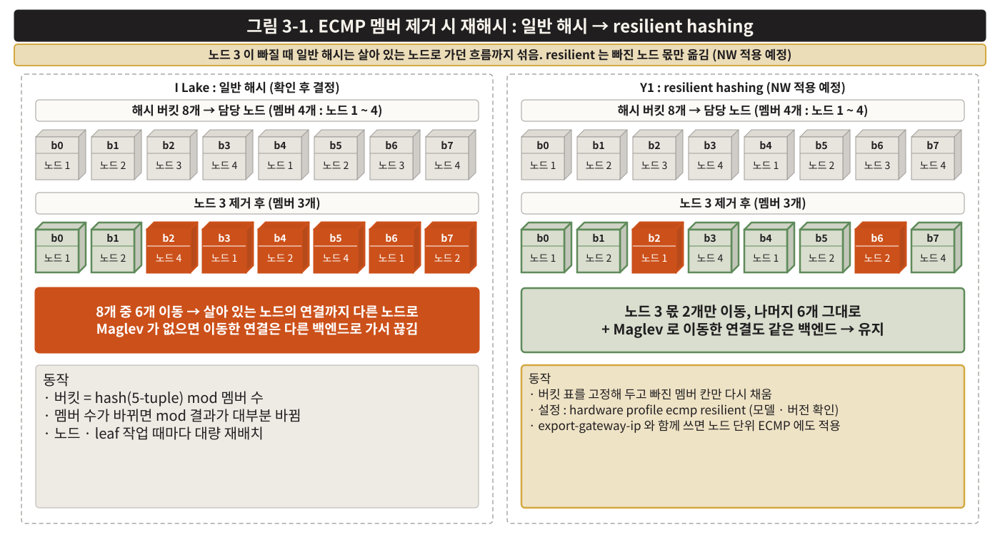

**일반 해시**

- 버킷 = hash(5-tuple) mod 멤버 수
- 멤버 8 → 7 이 되면 mod 값이 거의 다 바뀜 → 기존 흐름 대부분이 다른 경로로
- 경로가 바뀌면 다른 인입 노드 → conntrack 없음 → (Maglev 없으면) 다른 백엔드 → RST

**resilient hashing**

- 버킷 표를 고정 크기로 두고 빠진 멤버의 칸만 남은 멤버로 재배정
- 영향받는 흐름 ≈ 1/멤버 수

**polarization**

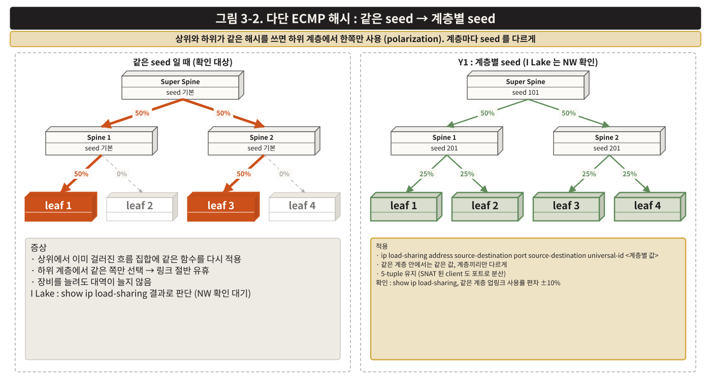

- spine 이 hash 로 링크 A 를 고른 흐름들은 hash 값이 특정 범위에 몰려 있음
- 다음 계층이 **같은 함수 · 같은 seed** 면 그 흐름들이 또 같은 링크로 → 한쪽 링크만 사용
- 계층별 다른 seed (`universal-id`) → 독립 분산

### 5-근거

| 구분 | 근거 |
|---|---|
| I Lake 확인 | resilient · seed 설정 미확인 (NW 체크리스트 대기), NW 가 Y1 에 resilient 적용 예정 |
| 원리 | 일반 해시 mod n : 멤버 n → n-1 시 약 (n-1)/n 흐름 이동. resilient : 약 1/n 만 이동. polarization : 계층간 동일 해시 함수 · seed |
| 문서 | Cisco NX-OS : `hardware profile ecmp resilient`, `ip load-sharing ... universal-id` (모델 · 버전별 지원) |

### 5-검증 명령

```
show ip load-sharing                         ! 해시 필드 (src/dst IP · port) · universal-id(seed) 값, 계층별로 달라야 함
show run | include ecmp resilient            ! resilient 적용 여부
show routing hash <src IP> <dst IP> ip-proto 6 <sport> <dport> vrf <VRF>
                                             ! 특정 흐름이 고르는 next-hop (계층별로 비교해 polarization 확인)
show interface <uplink> | include rate       ! 업링크별 사용률 편차 ±10% 이내
```


---

## 6. bond · LACP

| 설정 | I Lake | Y1 | 의미 |
|---|---|---|---|
| mode | 802.3ad | 동일 | 스위치와 LACP 협상, 두 링크 동시 사용 |
| xmit_hash_policy | layer3+4 | 동일 | 송신 링크를 5-tuple 로 선택 → 흐름별 분산 |
| lacp_rate | slow | **fast** | LACPDU 30초 → 1초 주기, 타임아웃 90초 → 3초 |
| miimon | 100 | 동일 | 링크 down(물리) 100ms 감지 |

- miimon 은 **링크가 내려간** 장애만 봄
- 링크는 up 인데 상대 스위치가 멈추거나 포트가 막힌 장애 → LACPDU 가 안 와야 감지 → rate 가 감지 시간
- 수신 쪽 분산은 스위치 port-channel 해시가 결정 (노드 설정과 별개)
- per-port L3 (bond 없이 포트마다 BGP) 대안이면 `fib_multipath_hash_policy` 가 의미 있음. bond 구조에선 해당 낮음

### 6-근거

| 구분 | 근거 |
|---|---|
| I Lake 실측 | 802.3ad · layer3+4 (37번), lacp slow/slow · miimon 100 (39번), fib_multipath_hash_policy 0 (41번) |
| 원리 | IEEE 802.1AX : LACPDU slow 30초 · fast 1초, timeout = 3 × 주기. miimon 은 carrier(링크) 상태만 확인 |
| 문서 | Linux kernel Documentation : networking/bonding (lacp_rate · miimon · xmit_hash_policy) |

### 6-검증 명령

```bash
grep -E "Bonding Mode|Hash Policy|LACP rate|MII Polling" /proc/net/bonding/bond0
                                             # 802.3ad · layer3+4 · fast · 100 (bond1 도 동일)
grep -E "Aggregator ID|Partner Mac" /proc/net/bonding/bond0
                                             # 멤버 2개 Aggregator ID 같고 Partner Mac 이 leaf 쌍(vPC) 값
cat /sys/class/net/bond0/statistics/tx_bytes; cat /sys/class/net/<멤버>/statistics/tx_bytes
                                             # 부하 중 멤버별 tx 비율 (흐름 다수면 거의 반반)
journalctl -k | grep -i bond                 # 멤버 장애 시 전환 시각 (fast 면 장애 후 3초 내)
```
```
show port-channel summary                    ! 멤버 (P) 상태 (NW)
show lacp interface <멤버> | include rate    ! 스위치 쪽 fast 여부 (NW)
```


---

## 7. Cilium L4 LB

### 7-1. 처리 위치

| 경로 | 처리 지점 | 설정 |
|---|---|---|
| Pod → ClusterIP / Global Service | connect() 시점 소켓 훅 | `bpf-lb-sock` (I Lake false) |
| 외부 → LoadBalancer VIP | 노드 NIC 입구 (XDP 또는 tc) | KPR, `bpf-lb-acceleration` |

**소켓 LB**

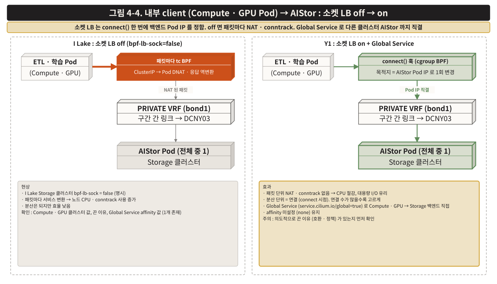

- connect() 할 때 목적지를 Service IP → 백엔드 Pod IP 로 바꿈 (1회)
- 이후 패킷은 처음부터 Pod IP → NAT · conntrack 없음, 패킷 단위 비용 0
- off 면 패킷마다 tc 단계에서 DNAT + conntrack

### 7-2. externalTrafficPolicy

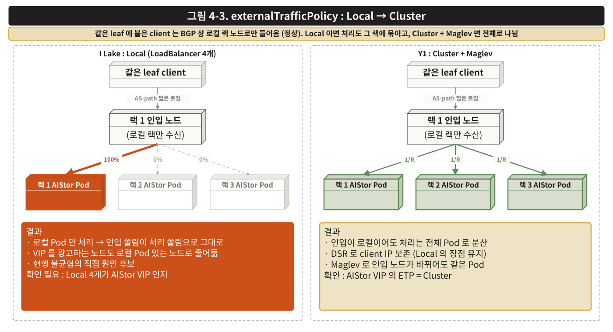

| | Local | Cluster |
|---|---|---|
| 백엔드 후보 | 인입 노드의 Pod 만 | 전체 Pod |
| client IP | 보존 | SNAT 이면 노드 IP, **DSR 이면 보존** |
| 인입 쏠림 시 | 처리도 쏠림 | 처리는 균등 |
| BGP 광고 | Pod 있는 노드만 | 전 노드 (설정 따라) |

- 같은 leaf 의 client 는 AS-path 가 짧은 로컬 랙 노드로만 들어옴 → Local 이면 그 랙 Pod 만 일함
- I Lake LoadBalancer 4개가 Local → 원인 후보 1순위

### 7-3. Maglev

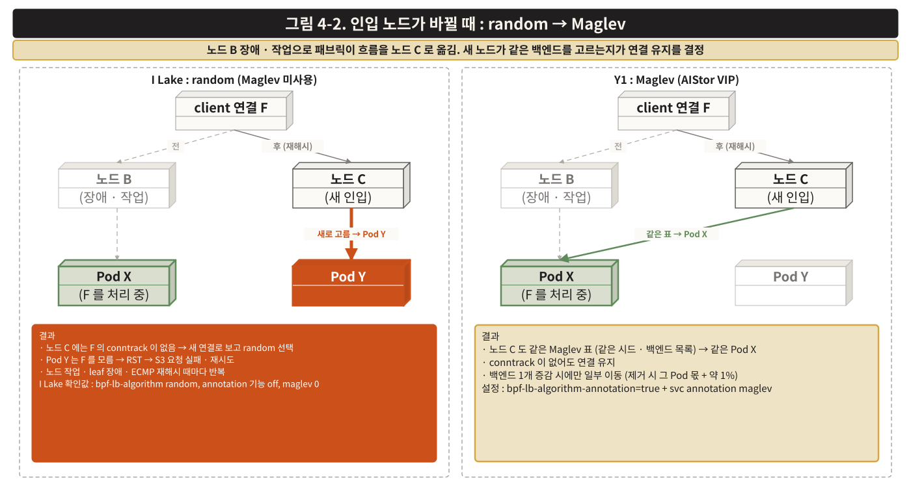

- 각 백엔드가 (offset, skip) 으로 표 크기 M(소수, 16381) 칸에 자기 선호 순서를 만들고, 돌아가며 빈 칸을 채움 → 결과 표 = 칸마다 백엔드
- 흐름 → hash(5-tuple) mod M → 칸 → 백엔드
- 특징
  - **모든 노드가 같은 입력(백엔드 목록 · 시드) → 같은 표** → 어느 노드로 들어와도 같은 백엔드 → conntrack 없어도 연결 유지
  - 백엔드 1개 증감 시 표의 약 1/N 칸만 변경
  - 백엔드별 칸 수 거의 동일 → 균등
- random 은 노드마다 독립적으로 고르고 conntrack 에 기억 → 경로가 바뀌면 새 노드는 모름
- 적용 : `bpf-lb-algorithm-annotation=true` + Service 에 `service.cilium.io/lb-algorithm: maglev` → AIStor VIP 만 Maglev, 나머지 random (메모리 · 갱신 비용 국한)

### 7-4. DSR (Geneve)

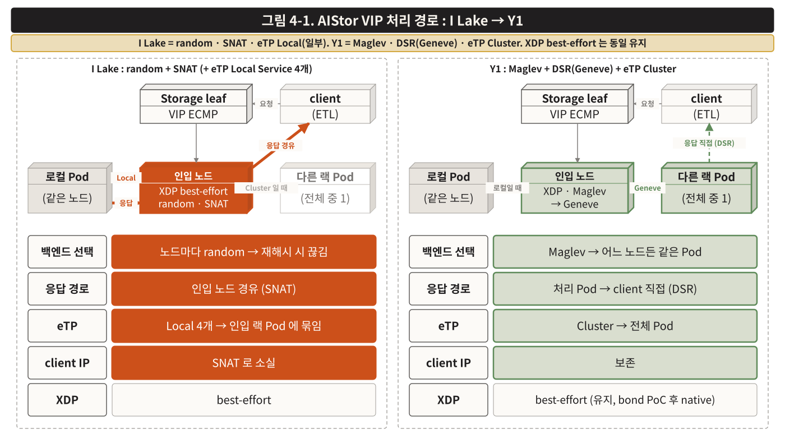

| | SNAT | DSR |
|---|---|---|
| 인입 → 백엔드 노드 | src 를 인입 노드 IP 로 바꿈 | 원 패킷을 Geneve 로 감싸 전달 (VIP · client IP 정보 포함) |
| 응답 | 백엔드 → 인입 노드 → client | 백엔드 → **client 직접** (src = VIP) |
| client IP | 백엔드가 모름 | 보존 |
| 인입 노드 부하 | 요청 + 응답 | 요청만 |

- Geneve 헤더만큼 패킷 커짐 → MTU 9000 (노드) / 9216 (패브릭) 전제
- 응답 src = VIP 인데 그 노드 bond 에서 나감 → leaf uRPF strict 면 drop → **uRPF loose**
- `tunnel-protocol: geneve` 는 DSR 전달용. `routing-mode: native` 는 그대로
- dispatch `opt` (IP 옵션 방식) 은 중간 장비가 옵션 패킷을 느리게/버리는 경우가 있어 Geneve 권장

### 7-5. XDP

- NIC 드라이버 단계(skb 생성 전)에서 LB 처리 → CPU 비용 최소
- `best-effort` : 드라이버가 지원하면 native XDP, 아니면 tc 로 대체 (I Lake 와 동일)
- bond 위 XDP 는 커널 · 드라이버 조합 의존 → PoC
- XDP 에서 다른 노드로 넘길 때 `XDP_TX` = **받은 장치로 다시 내보냄** → PUBLIC(bond0) 로 받은 요청은 bond0 로 Geneve 전달 → 노드 간 PUBLIC 경로가 열려 있어야 함

### 7-근거

| 구분 | 근거 |
|---|---|
| I Lake 실측 | bpf-lb-sock false (8번), lb-algorithm-annotation false · maglev 0 (6 · 32번), lb-mode snat · dispatch opt* · tunnel vxlan (9 · 10번), acceleration best-effort (11번), 맵 65536 · 0.0025 (12번), eTP Cluster 4 · Local 4 (29번) |
| 원리 | Maglev (Google, NSDI 2016 "Maglev: A Fast and Reliable Software Network Load Balancer") : 소수 크기 표 · 백엔드 변화 시 최소 이동 · 노드간 동일 결과 |
| 문서 | Cilium Docs : Kubernetes Without kube-proxy (Socket LoadBalancer Bypass · Maglev Consistent Hashing · DSR with Geneve · LoadBalancer & NodePort XDP Acceleration) |
| 커널 | XDP_TX = 수신 장치로 재송신 (kernel Documentation : bpf/XDP) |

### 7-검증 명령

```bash
cilium-dbg config -a | grep -Ei "bpf-lb-(sock|mode|algorithm|dsr|acceleration|map-max)|tunnel-protocol"
                                             # 설정값 한 번에 (Y1 기대 : sock true · dsr · geneve · annotation true)
cilium-dbg status --verbose | grep -iE "Socket LB|XDP Acceleration|Session Affinity|Backend Selection|Mode"
                                             # 실제 동작 값 (설정과 다르면 기능 미지원 · 폴백)
kubectl get svc <AIStor VIP svc> -n <ns> -o jsonpath='{.metadata.annotations}'
                                             # service.cilium.io/lb-algorithm: maglev 확인
cilium-dbg bpf lb maglev list | grep -A2 <VIP> | md5sum
                                             # 두 노드에서 실행, 해시값 같으면 Maglev 표 동일
cilium-dbg bpf ct list global | grep <VIP> | wc -l
                                             # 소켓 LB on 이면 내부 경로 CT 항목 거의 없음
tcpdump -ni bond0 udp port 6081 -c 20        # DSR : 인입 노드 → 백엔드 노드 Geneve 패킷 보임
tcpdump -ni bond0 src host <VIP> -c 20       # DSR : 백엔드 노드에서 src=VIP 응답이 직접 나감
ip -d link show bond0 | grep -i xdp          # XDP native 부착 여부 (없으면 tc 폴백)
```


---

## 8. VRF · bond 비대칭

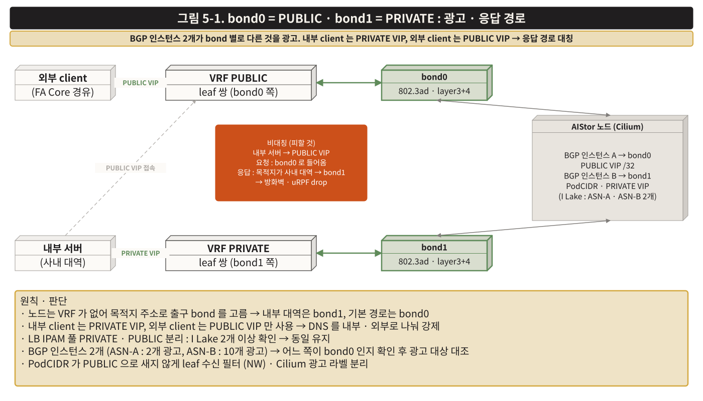

- 스위치 : PUBLIC · PRIVATE VRF 분리
- 노드 : VRF 없음. 라우팅 테이블이 목적지로 출구 결정 (사내 → bond1, 기본 경로 → bond0)
- 내부 서버가 **PUBLIC VIP** 로 접속 → 요청은 bond0 로 들어오고 응답은 목적지(사내) 따라 bond1 로 나감 → 비대칭
  - 상태 기반 방화벽 : SYN 을 못 본 쪽이 SYN-ACK 를 drop
  - uRPF strict : 들어온 VRF 와 소스 경로 불일치로 drop
- 원칙 : 내부 client 는 PRIVATE VIP · 내부 DNS 만. 외부는 PUBLIC VIP

### 8-근거

| 구분 | 근거 |
|---|---|
| I Lake 확인 | bond0 = PUBLIC · bond1 = PRIVATE, BGP 인스턴스 2개 ASN-A (2 prefix) · ASN-B (10 prefix) (27번), L2 announcement 정책 없음 |
| 원리 | 노드는 VRF 없이 목적지 기반 라우팅 → 요청 · 응답 출구가 다를 수 있음. 상태 기반 방화벽은 한 방향만 보면 세션 불성립. RFC 3704 : uRPF strict 는 소스 경로 불일치 drop |
| 문서 | Cilium Docs : BGP Control Plane (CiliumBGPClusterConfig · CiliumBGPAdvertisement), LB IPAM |

### 8-검증 명령

```bash
cilium-dbg bgp peers                         # 인스턴스(ASN) 별 peer 주소 → bond0 · bond1 대역으로 구분
cilium-dbg bgp routes advertised ipv4 unicast
                                             # 인스턴스별 광고 prefix : PUBLIC VIP 는 bond0 쪽만, PodCIDR 은 bond1 쪽만
ip route get <사내 client IP> from <PRIVATE VIP>   # dev bond1 이어야 정상
ip route get <외부 client IP> from <PUBLIC VIP>    # dev bond0 이어야 정상
ip route get <사내 client IP> from <PUBLIC VIP>    # dev bond1 이면 비대칭 위험 (내부는 PRIVATE VIP 사용)
kubectl get ciliumloadbalancerippool -o wide # 풀이 PRIVATE · PUBLIC 로 분리
```


---

## 9. 노드 데이터패스

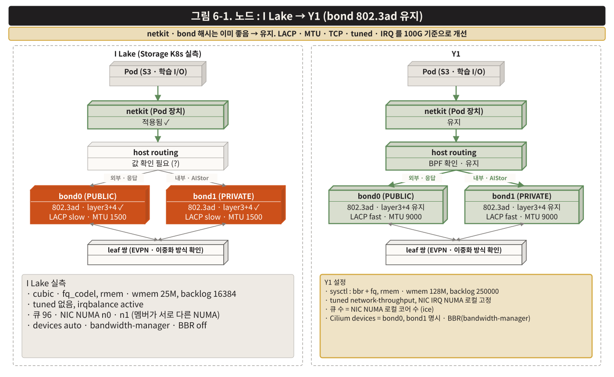

| 요소 | 내용 |
|---|---|
| netkit | veth 대체. Pod 쪽 장치에 BPF 를 직접 붙여 호스트 스택 진입 없이 전달 → 지연 · CPU 감소 (I Lake 사용) |
| BPF host routing | 패킷을 iptables · 호스트 라우팅 대신 BPF 가 바로 다음 장치로 (`bpf_redirect_neigh`) |
| BBR + fq | 손실이 아닌 대역 · RTT 추정으로 속도 조절. fq 가 pacing → 100G · 짧은 RTT 에서 큐 적체 · 재전송 감소 |
| 버퍼 128M | BDP = 100Gbps × RTT. 구간 간 0.2ms 면 2.5MB, 다중 흐름 · 지연 증가 여유로 상한을 크게 |
| backlog 250000 | NAPI 가 CPU 큐로 넘길 때 대기열. 100G 버스트 시 16384 는 drop |
| bandwidth-manager | Cilium 이 EDT 로 Pod egress pacing + BBR 를 Pod 에 적용 |
| BIG TCP | GSO/GRO 크기 64K → 수백 K, 패킷 수 감소. ice 지원 → PoC |

**NUMA · IRQ**

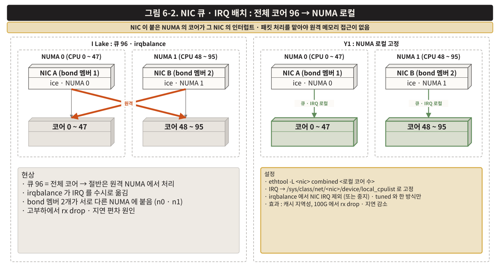

- NIC 은 PCIe 로 특정 소켓(NUMA)에 붙음. 그 NIC 의 IRQ · softirq 를 다른 소켓 코어가 처리하면 메모리 접근이 소켓 간 링크를 넘음
- I Lake : 큐 96 = 전체 코어 → 절반은 원격 처리, irqbalance 가 계속 이동
- Y1 : 큐 = 로컬 코어 수, IRQ 고정, irqbalance 에서 NIC 제외, tuned network-throughput (C-state · governor)

### 9-근거

| 구분 | 근거 |
|---|---|
| I Lake 실측 | netkit (13번), MTU 1500 · 1500 (40번), cubic · fq_codel (43번), 25M · 25M · 16384 (44번), tuned none · irqbalance active (49번), ice (45번), 큐 96@NUMA0 · 96@NUMA1 (47번), bwm · bbr false (18번), devices · mtu auto (15번) |
| 원리 | BDP = 대역 × RTT (100Gbps × 0.2ms = 2.5MB). BBR (Cardwell et al., ACM Queue 2016) 은 pacing 필요 → fq. NUMA 원격 접근은 소켓간 링크 경유 |
| 문서 | Cilium Docs : netkit · eBPF Host Routing · Bandwidth Manager · BIG TCP (Tuning Guide). RHEL Network Performance Tuning · tuned profiles. Intel ice 드라이버 README |

### 9-검증 명령

```bash
cilium-dbg status --verbose | grep -iE "host routing|device mode|bandwidth|bbr|big tcp"
                                             # Host Routing: BPF, Device Mode: netkit, BandwidthManager: EDT with BPF [BBR]
ip -d link show | grep -c netkit             # Pod 장치가 netkit (0 이면 veth)
ip link show bond0 | grep -o "mtu [0-9]*"    # 9000 (멤버 · bond1 도)
ping -M do -s 8972 <다른 노드 bond1 IP> -c 3 # 9000 MTU 경로 확인 (실패 시 패브릭 9216 미적용 구간)
sysctl net.ipv4.tcp_congestion_control net.core.default_qdisc   # bbr · fq
sysctl net.core.rmem_max net.core.wmem_max net.core.netdev_max_backlog   # 134217728 · 134217728 · 250000
tc qdisc show dev bond0                      # fq (또는 mq + fq)
tuned-adm active                             # network-throughput
cat /sys/class/net/<nic>/device/numa_node    # NIC 별 NUMA 번호
ethtool -l <nic> | grep -A4 Current          # combined = 로컬 NUMA 코어 수
grep <nic> /proc/interrupts | head           # IRQ 가 로컬 코어에만 증가하는지
cat /proc/net/softnet_stat | awk '{print $2}'   # 2번째 칸 (drop) 이 부하 중 증가하지 않아야 함
nstat -az TcpRetransSegs                     # 부하 전후 재전송 증가량 비교
```


---

## 10. ClusterMesh · KVStoreMesh

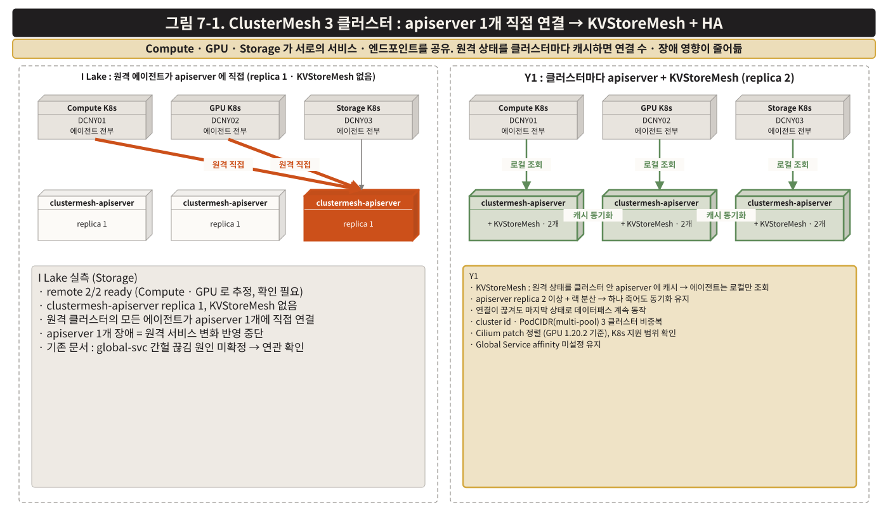

- ClusterMesh : 클러스터마다 clustermesh-apiserver(etcd) 가 자기 Service · 엔드포인트 · identity 를 공개
- 기본 : 각 노드 agent 가 **원격 클러스터 apiserver 에 직접** 연결 → 노드 수 × 원격 수 만큼 연결
- KVStoreMesh : 클러스터 안 apiserver 가 원격 정보를 받아 로컬 etcd 에 캐시 → agent 는 로컬만 봄
  - 원격 장애 · 지연이 agent 로 전파되지 않음, 연결 수 급감
- apiserver replica 1 이면 그것이 멈출 때 원격 변화 반영 중단 → 2 이상 · 랙 분산
- 조건 : cluster-name · id 고유, PodCIDR 비중복, 노드 간 라우팅 가능 (native)
- Global Service : 같은 이름 · 네임스페이스 Service 에 `service.cilium.io/global: "true"` → 원격 백엔드까지 후보. `affinity: local` 이면 로컬 우선

### 10-근거

| 구분 | 근거 |
|---|---|
| I Lake 실측 | multi-pool (16번), cluster cluster-name · id 2 (17번), 원격 2/2 ready · apiserver replica 1 · KVStoreMesh 없음 (23번), global Service 1 · affinity 1 (33번) |
| 원리 | KVStoreMesh 없이는 연결 수 = 노드 수 × 원격 클러스터 수. 캐시 후 = 클러스터당 원격 수 |
| 문서 | Cilium Docs : Cluster Mesh (Setting up Cluster Mesh · KVStoreMesh · Global Services / Service Affinity) |

### 10-검증 명령

```bash
cilium clustermesh status --context <ctx>    # 원격 클러스터 이름 · ready 수 · KVStoreMesh 사용 여부
kubectl -n kube-system get deploy clustermesh-apiserver -o jsonpath='{.spec.replicas}'   # 2 이상
kubectl -n kube-system get pod -l k8s-app=clustermesh-apiserver -o wide   # 서로 다른 노드 · 랙
cilium-dbg status | grep -i clustermesh      # agent 가 본 원격 상태 (KVStoreMesh 면 로컬 apiserver 경유)
cilium-dbg service list | grep <global svc IP>   # 백엔드에 원격 클러스터 Pod IP 포함
kubectl get svc -A -o jsonpath='{range .items[*]}{.metadata.namespace}/{.metadata.name} {.metadata.annotations.service\.cilium\.io/affinity}{"\n"}{end}' | awk 'NF>1'
                                             # affinity 지정 Service 와 값
```


---

## 11. 연결 단위 LB 와 gRPC / Arrow Flight

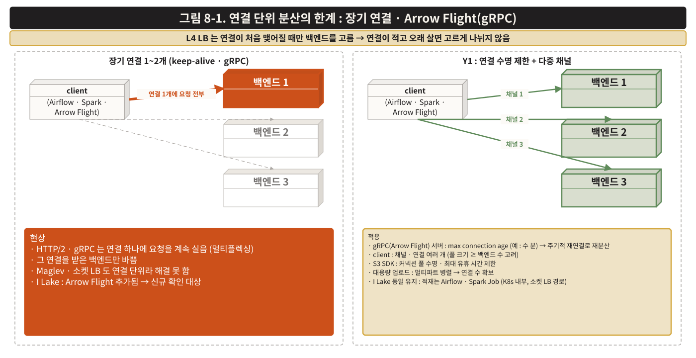

- L4 LB 는 **연결이 생길 때 한 번** 백엔드를 정함
- HTTP/1.1 S3 SDK : 풀에 연결 여러 개 → 어느 정도 분산
- HTTP/2 · gRPC (Arrow Flight) : 연결 하나에 스트림 다수 → 그 연결의 백엔드만 바쁨, 수 시간 유지
- 대책
  - 서버 `max_connection_age` (예 : 수 분) → 주기적 재연결로 재분산
  - client 채널 여러 개 (풀) 또는 client-side LB (DNS 다중 · xDS)
  - S3 SDK 커넥션 수명 · 유휴 제한, 대용량은 멀티파트 병렬 → 여러 연결로 쪼개짐

### 11-근거

| 구분 | 근거 |
|---|---|
| I Lake 확인 | 적재 = Airflow · Spark Job, Arrow Flight (gRPC) 신규 추가 |
| 원리 | L4 LB 는 연결 생성 시 1회 결정. HTTP/2 는 연결 하나에 다중 스트림 (RFC 9113) → 연결 수 = 분산 상한 |
| 문서 | gRPC Docs : Keepalive · Connection Management (MAX_CONNECTION_AGE), gRPC Load Balancing 블로그. Apache Arrow Flight 문서. AWS SDK S3 multipart · 커넥션 풀 설정 |

### 11-검증 명령

```bash
ss -tnp state established dst <VIP> | wc -l  # client 노드에서 VIP 로 열린 연결 수 (적으면 분산 한계)
ss -tno state established dst <VIP> | grep -o "timer:[^ ]*" | head   # 연결 수명 관찰
cilium-dbg bpf ct list global | grep <Flight 포트> | awk '{print $NF}' | sort | uniq -c
                                             # 백엔드별 연결 수 (편차 확인, 소켓 LB 면 client 노드 기준)
hubble observe --to-port <Flight 포트> --last 200 -o compact | awk '{print $4}' | sort | uniq -c
                                             # 백엔드 Pod 별 흐름 수
```


---

## 12. 장애 감지 시간 계산

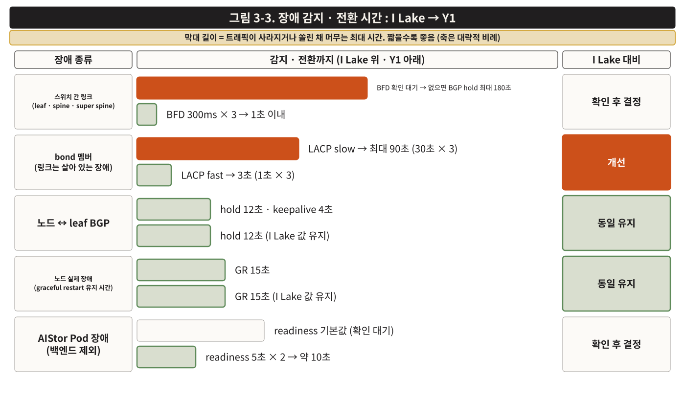

| 메커니즘 | 공식 | I Lake | Y1 |
|---|---|---|---|
| BFD | interval × multiplier | 확인 대기 | 300ms × 3 = 0.9초 |
| BGP hold | hold time | 노드 12초 | 동일 |
| BGP GR | 재시작 대기 | 15초 | 동일 |
| LACP | 3 × 주기 | slow 90초 | fast 3초 |
| miimon | 주기 | 0.1초 | 동일 |

- GR 은 "제어부만 재시작, 데이터부는 살아 있음" 을 전제로 경로를 유지 → 노드가 **진짜 죽으면** GR 동안 블랙홀 → 15초로 짧게 (I Lake 값)
- 계획 작업은 9-2 절차로 광고를 먼저 철회 → 감지 시간과 무관하게 무손실

### 12-근거

| 구분 | 근거 |
|---|---|
| I Lake 실측 | BGP timers 12/4 · GR 15 (25번), LACP slow (39번) |
| 원리 | RFC 5880 (BFD) : 감지 = interval × multiplier. RFC 4271 : hold timer 만료 시 세션 down. RFC 4724 (GR) : restart time 동안 경로 유지 |
| 문서 | Cilium Docs : BGP Control Plane (holdTimeSeconds · keepAliveTimeSeconds · gracefulRestart). Cisco NX-OS BFD Configuration |

### 12-검증 명령

```bash
cilium-dbg bgp peers                         # Hold Time · Keepalive · Uptime (12 · 4)
kubectl get ciliumbgppeerconfig -o yaml | grep -iE "holdTime|keepAlive|restartTime"   # 12 · 4 · 15
date +%T.%N; ip link set <멤버> down         # (PoC 노드에서만) 시각 기록 후 장애 유발
```
```
show bfd neighbors                           ! BFD 세션 · interval · multiplier (NW)
show bgp ipv4 unicast neighbors <노드> | include hold|Graceful   ! leaf 쪽 협상 값 (NW)
show logging | include BGP|BFD               ! 장애 시각 대비 감지 시각 (감지 시간 실측)
```


---

## 13. 실습 · 확인 명령

| 목적 | 명령 |
|---|---|
| Cilium 핵심 설정 | `cilium-dbg config -a \| grep -Ei "lb-|kube-proxy|routing|netkit|bandwidth|bbr"` |
| LB 상태 · host routing | `cilium-dbg status --verbose \| grep -iE "kubeproxy|host routing|xdp|socket"` |
| Service 백엔드 | `cilium-dbg service list` |
| Maglev 표 비교 | 두 노드에서 `cilium-dbg bpf lb maglev list` |
| BGP | `cilium-dbg bgp peers`, `cilium-dbg bgp routes advertised ipv4 unicast` |
| eTP 확인 | `kubectl get svc -A -o custom-columns=NS:.metadata.namespace,N:.metadata.name,T:.spec.type,ETP:.spec.externalTrafficPolicy` |
| bond | `cat /proc/net/bonding/bond0` |
| NIC 큐 · NUMA | `ethtool -l <nic>`, `cat /sys/class/net/<nic>/device/numa_node` |
| 드롭 | `cilium-dbg monitor --type drop`, `hubble observe --verdict DROPPED` |
| 분산 측정 | warp 부하 중 AIStor Pod 별 요청 수 (Prometheus `minio_s3_requests_total`) |
| N9K 경로 | `show bgp l2vpn evpn <VIP>`, `show ip route <VIP> vrf <VRF>`, `show ip load-sharing` |

**실습 시나리오**

1. eTP Local Service 하나를 테스트 네임스페이스에 만들고 같은 leaf client 로 부하 → Pod 편차 관찰 → Cluster 로 바꿔 비교
2. Maglev annotation 전후로 부하 중 노드 하나의 BGP 라벨 제거 → 끊긴 연결 수 비교
3. LACP slow / fast 에서 스위치 포트 shutdown 아닌 LACP 차단 (예 : 상대 포트 err-disable) → 전환 시간 측정

---

## 14. Q&A

**Q. VTEP 은 Cilium VXLAN 과 관계 있나?**
아니다. 여기서 VTEP 은 leaf 스위치의 패브릭 오버레이 지점. Cilium 은 native routing 이라 노드는 VXLAN 을 쓰지 않는다 (DSR Geneve 는 노드 간 LB 전달용 별도).

**Q. igp-metric ignore 를 했는데 왜 아직 불균형?**
그건 BGP 선택 5단계 하나를 푼 것. RD 중복 · maximum-paths 부족 · eTP Local · Maglev 부재 등 다른 단계가 남아 있다.

**Q. eTP Local 이 client IP 때문에 필요했다면?**
DSR 이면 Cluster 에서도 client IP 가 보존된다. DSR 전까지는 해당 Service 만 Local 유지 여부를 판단.

**Q. Maglev 를 전역으로 켜면 안 되나?**
가능하지만 Service 마다 16381 칸 표를 모든 노드가 유지 · 갱신. 연결 유지가 중요한 AIStor VIP 에만 annotation 으로 국한.

**Q. bond 대신 포트별 L3 (BGP 2세션) 가 낫지 않나?**
분산 · 감지 면에서 장점이 있지만 I Lake 표준(802.3ad) 과 다르고 IP · 세션 수가 두 배. 특별한 이득이 확인되지 않아 동일 유지.

**Q. DSR 이 PoC 에서 실패하면?**
SNAT + Maglev + eTP Cluster 만으로도 처리 균등 · 연결 유지는 달성. 인입 노드 응답 부하만 남는다.

**Q. DC 구간이 나뉘어 지연이 늘지 않나?**
구간 간 RTT ≤ 0.2 ms 조건이면 S3 요청 지연 대비 무시 가능. 대신 구간 간 링크 대역이 병목이 되지 않게 Compute + GPU 합 이상 확보.
